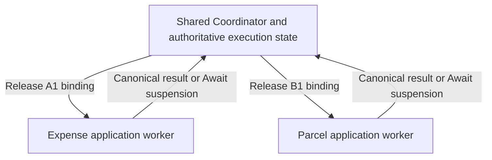

# Runtime Topology Strategy

Choose the deployment topology around ownership, suspension and the work that should stay together.

## Decision model

Choose topology by balancing:

- Change isolation (blast radius)
- Operational footprint (containers/charts)
- Latency budget (network hops vs in-process calls)
- Security boundaries (public ingress and service exposure)
- Team ownership boundaries

## Topology trade-offs

| Topology | Strengths | Risks |
| --- | --- | --- |
| `modular` | Strong isolation, clear ownership, independent scaling | Highest operational overhead |
| `pipeline-runtime` | Good compromise: isolated orchestrator + grouped service runtime | Some coupling inside grouped runtime |
| `monolith` | Lowest deploy complexity and network latency between steps | Largest blast radius and least isolation |

## Orchestrator boundary

Keeping the orchestrator isolated is usually a good default when you want:

- One external ingress point
- Reduced attack surface for internal services/plugins
- Stable migration path from grouped runtime to more modular layouts

The Coordinator and the typed Application Runtime have separate responsibilities.
In serialized coordination mode, the Coordinator retains canonical envelopes and
pinned Contracts without loading application business classes. The typed workers
own those classes and execute their business transitions. Several unrelated
applications can share that Coordinator while preserving separate tenants,
immutable Releases and registered worker bindings.

Application-specific complete hosts remain supported. Sharing a Coordinator is a
packaging and deployment choice over the same execution semantics; runtime mapping
does not provision or select that service. Group work using
[execution-segment guidance](/deploy/runtime-layouts/using-runtime-mapping#group-work-around-deferred-completion),
then choose the external worker and generated adapter boundaries explicitly.
See [registered REST targeting](/deploy/orchestrator-runtime/queue-async#release-aware-rest-targets)
and [AWS Durable deployment](/deploy/orchestrator-runtime/aws-durable).

## Plugin/synthetic placement

Treat plugin side effects as first-class when designing topology. They are easy to forget and can silently add coupling or load to the wrong runtime.

Practical rule:

- If plugins are operationally independent concerns (persistence/cache/observability), keep their placement explicit in runtime mapping.
- In monolith mode, accept that plugins collapse into the same blast radius as core steps.

## Migration architecture

Recommended evolution path:

1. `pipeline-runtime` as default operational baseline.
2. Split hotspots from grouped runtime into dedicated modules/runtimes when needed.
3. Keep runtime mapping and Maven topology synchronized at each step.

This avoids "logical layout only" drift where YAML says one thing but build artifacts enforce another.
