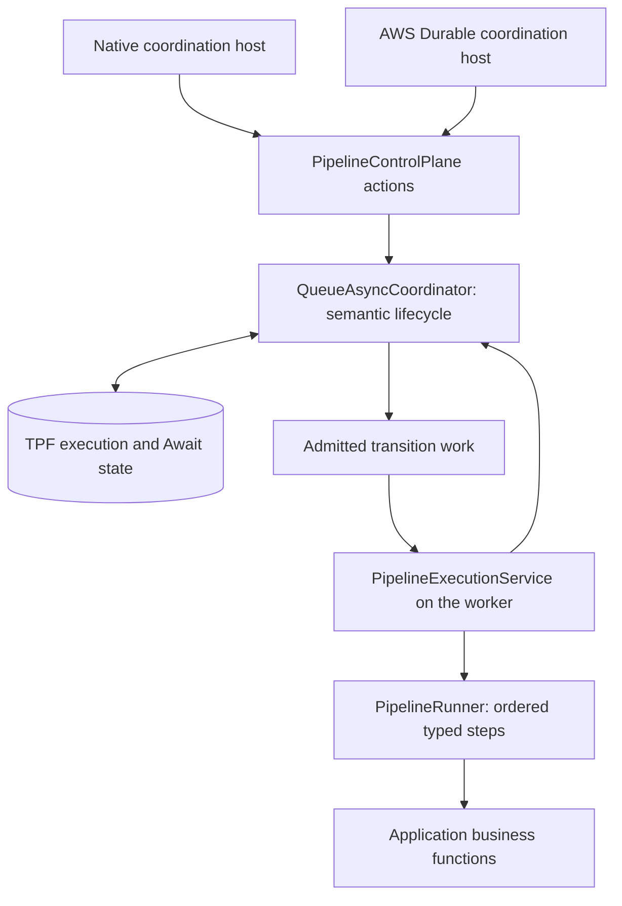
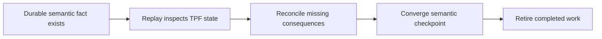

# State Model

TPF uses several state surfaces. They solve different problems and should not be treated as interchangeable storage.

| Surface | Purpose | Use when |
| --- | --- | --- |
| Persistence | Durable business records | APIs, reports, UIs, audit, or queryable outputs need saved domain data |
| Cache | Reusable derived outputs | Expensive deterministic work should be reused during normal execution or replay |
| Materialization | Large payload claim-checks | Payloads are too large or awkward to carry inline through every boundary |
| Execution state | Runtime progress and recovery | `QUEUE_ASYNC` needs leases, retry timing, terminal status, or crash recovery |
| Await units | Durable external waiting | A flow must pause for callbacks, approvals, provider decisions, or long-running jobs |
| Checkpoint handoff | Cross-pipeline admission | One pipeline finishes a stable output and another pipeline owns the next flow |

## From running steps to durable coordination

`PipelineRunner` still runs the ordered, typed steps. In the Quarkus runtime,
`PipelineExecutionService` calls it for ordinary runs and for an admitted transition's
step range. Business functions stay behind that execution path.

`QUEUE_ASYNC` adds responsibility around the runner: accept an execution once, pin its
Release, admit work, record progress, handle Await completion and decide whether to
retry or finish. `QueueAsyncCoordinator` implements that lifecycle behind
`PipelineControlPlane`. The control plane is the bounded action boundary; it is not
another engine that runs the business functions.

A coordination host drives those actions over time. The native host schedules them
in TPF processes. The AWS Durable host uses a Lambda Durable handler for polling,
suspension, wake-up and replay. SQS carries work to workers in either AWS placement.

The arrows show responsibility and work flow; each box need not be a separate
service. A native deployment can host several roles in one process. In the AWS
host, a Durable coordinator invokes an action Lambda, and SQS separates worker
execution from coordination. `COMPUTE` and `FUNCTION` choose worker placement;
they do not change which layer owns execution decisions.

## Two kinds of durable state

Here, *durable* means information survives the process that wrote it. The contents
and authority of that information matter:

| Durable state | What it remembers | What it permits |
| --- | --- | --- |
| TPF semantic state | Execution and Release identity, admitted work, Await completion, progress, effects, retry/DLQ evidence and results | Decide which pipeline consequences are still required |
| AWS Durable history | The coordinator handler's checkpointed operations, waits and callback outcomes | Replay and resume that handler across invocations |
| AWS callback binding state | How a TPF interaction reaches a provider callback, with generation claims and fences | Wake the current provider execution without granting semantic completion authority |

AWS Durable keeps the coordinating code moving across invocations. TPF records
what the pipeline has done and what it may do next. Worker code still runs through
the TPF execution path. A provider callback wakes coordination only after TPF has
admitted the typed completion.

A stored completion alone does not prove that its continuation or parent release
has finished. Retrying an action must reconcile those consequences before retiring
work. AWS replay does not replace that check or make external business effects
exactly-once.

If provider history disappears, TPF state remains the recovery authority. The AWS
host can fence an old generation and start a new provider execution against the
same TPF execution and pinned Release. That is mechanical recovery, not a new
business submission. Complete recovery coverage and deployment support gates are
listed in [AWS Durable Coordination](/deploy/orchestrator-runtime/aws-durable).

## Decision Path

1. Query business data later? Use [Persistence](/architecture/persistence).
2. Want to avoid recomputing a deterministic output? Use [Caching](/architecture/caching/).
3. Carrying large content across boundaries? Use [Field Materialization](/architecture/materialization).
4. Should work survive crashes? Use [Queue-Async Runtime](/deploy/orchestrator-runtime/queue-async).
5. Waiting for external reality? Use [Await Boundaries](/architecture/await-boundaries).
6. Handing off stable ownership to another pipeline? Use [Checkpoint Handoff](/deploy/orchestrator-runtime/checkpoint-handoff).

## Replay Boundary

Replay is easier when each state surface has a single job.

Persistence is the durable business record. Cache is an optimization and replay accelerator. Execution state is runtime bookkeeping. Await state records external waiting and completion snapshots. Checkpoint handoff records a stable boundary between two pipeline owners.

When these responsibilities are mixed in application code, retries and replay become harder to reason about. Keep them explicit.
