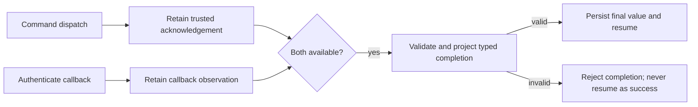

# ADR-0074: Command completion can require the dispatch acknowledgement

## Context

[ADR-0037](./0037-command-deferred-completion-joins-effect-and-callback.md)
intentionally permits a correlated callback to complete a Command whose dispatch
outcome is ambiguous. Its projector receives the canonical request and callback,
not the immediate acknowledgement. That remains useful when the provider accepts
a caller-chosen correlation identity.

Some providers instead assign an identity during dispatch. For example, an Actions
dispatch returns a workflow-run ID. An application may require a later completion
to match that returned ID, not merely a value supplied by the callback. The current
Command decorator discards the acknowledgement, so the existing projector cannot
express that comparison. An application callback table would duplicate native
Await ownership and introduce another recovery path.

## Decision proposed

Add an explicit, typed acknowledgement-aware Command completion projector. It
receives the canonical request, successful dispatch acknowledgement, admitted
callback and framework completion metadata, and produces the final pipeline value.
The compiler validates all four value types against the selected Command and
callback contracts. The ordinary request-aware projector retains ADR-0037 semantics.

Await owns durable acknowledgement retention and any callback observed before that
acknowledgement. These are distinct from the final projected response. Successful
dispatch settlement and callback observation use the existing conditional-write
interaction lifecycle in every supported store; an in-memory-only implementation
does not satisfy this contract.

The acknowledgement-aware path cannot release a continuation until both inputs
exist and projection succeeds. An ambiguous dispatch does not create a trusted
acknowledgement, even if a callback is observed. Recovery must not repeat a
potentially accepted effect merely to obtain its acknowledgement. Deadline,
cancellation, duplicate delivery and concurrent settlement retain native lifecycle
authority. No callback-supplied acknowledgement can replace the recorded one.

Mode, acknowledgement type and projector identity participate in compiled and
release-pinned contracts. Restoring an acknowledgement-aware interaction must not
silently downgrade it to the older request-aware mode. Existing records remain
readable with their original semantics; replay uses the persisted final projection
without reissuing the Command.

Acknowledgements contain only the canonical, safe output declared by the Command.
They must not retain installation tokens, callback signing material, provider SDK
objects or arbitrary HTTP response headers. Provider credentials remain host-owned.

Provider authentication and wire admission remain connector-shell responsibilities.
The imported HTTP connector's callback resource remains specific to its pinned
HTTP contracts. A provider-owned authenticated ingress may invoke native Await
admission; it does not need to become an application-owned callback registry.
Connector callback interactions use `connector-callback` as their boundary
transport identity when authored without an Await transport adapter. This is not
a new `pipeline.transport` mode. Durable lifecycle facts must retain that identity
even while execution is suspended; a fast callback must not be required to avoid
emitting an invalid waiting-state event.

## Consequences and acceptance

- Contracts owns the projector API and portable durable values; compiler owns type
  validation and generated descriptors; runtime owns settlement, projection and
  store implementations. No GitHub-specific type belongs in those owners.
- Acknowledgement is evidence of dispatch, not evidence that external work passed.
- Existing request-aware and internal-service Await behaviour stays unchanged.
- Tests must cover acknowledgement-first and callback-first order, wrong returned
  identity, duplicates, ambiguity, terminal races and durable reconstruction.
- Generated-code tests must reject an incompatible acknowledgement type. Durable
  tests must prove that staged callbacks cannot be mistaken for final output.
- This is a proposed extension, not a claim that current published snapshots support
  it. Product activation remains blocked until implementation and assembled native
  continuation evidence are available.
