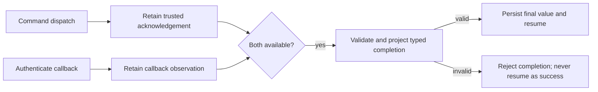

# ADR-0079: Command completion can require the dispatch acknowledgement

## Context

[ADR-0037](./0037-command-deferred-completion-joins-effect-and-callback.md)
intentionally permits a correlated callback to complete a Command whose dispatch
outcome is ambiguous. Its projector receives the canonical request and callback,
not the immediate acknowledgement. That remains useful when the provider accepts
a caller-chosen correlation identity.

Some providers instead assign an identity during dispatch. For example, an Actions
dispatch returns a workflow-run ID. An application may require a later completion
to match that returned ID, not merely a value supplied by the callback. The original
request-aware projector could not express that comparison because it did not receive
the acknowledgement. An application callback table would duplicate native
Await ownership and introduce another recovery path.

## Decision proposed

Add an explicit, typed acknowledgement-aware Command completion projector. It
receives the canonical request, successful dispatch acknowledgement, admitted
callback and framework completion metadata, and produces the final pipeline value.
The compiler validates all four value types against the selected Command and
callback contracts. The ordinary request-aware projector retains ADR-0037 semantics.

Await owns durable acknowledgement retention and any callback observed before that
acknowledgement. These are distinct from the final projected response. Successful
dispatch settlement and callback observation use the existing conditional-write
interaction lifecycle in every supported store; an in-memory-only implementation
does not satisfy this contract.

The acknowledgement-aware path cannot release a continuation until both inputs
exist and projection succeeds. An ambiguous dispatch does not create a trusted
acknowledgement, even if a callback is observed. Recovery must not repeat a
potentially accepted effect merely to obtain its acknowledgement. Deadline,
cancellation, duplicate delivery and concurrent settlement retain native lifecycle
authority. No callback-supplied acknowledgement can replace the recorded one.

Mode, acknowledgement type and projector identity participate in compiled and
release-pinned contracts. Restoring an acknowledgement-aware interaction must not
silently downgrade it to the older request-aware mode. Existing records remain
readable with their original semantics; replay uses the persisted final projection
without reissuing the Command.

Acknowledgements contain only the canonical, safe output declared by the Command.
They must not retain installation tokens, callback signing material, provider SDK
objects or arbitrary HTTP response headers. Provider credentials remain host-owned.

Provider authentication and wire admission remain connector-shell responsibilities.
The imported HTTP connector's callback resource remains specific to its pinned
HTTP contracts. A provider-owned authenticated ingress may invoke native Await
admission; it does not need to become an application-owned callback registry.
Connector callback interactions use `connector-callback` as their boundary
transport identity when authored without an Await transport adapter. This is not
a new `pipeline.transport` mode. Durable lifecycle facts must retain that identity
even while execution is suspended; a fast callback must not be required to avoid
emitting an invalid waiting-state event.

## Consequences and acceptance

- Contracts owns the projector API and portable durable values; compiler owns type
  validation and generated descriptors; runtime owns settlement, projection and
  store implementations. No GitHub-specific type belongs in those owners.
- Acknowledgement is evidence of dispatch, not evidence that external work passed.
- Existing request-aware and internal-service Await behaviour stays unchanged.
- Tests must cover acknowledgement-first and callback-first order, wrong returned
  identity, duplicates, ambiguity, terminal races and durable reconstruction.
- Generated-code tests must reject an incompatible acknowledgement type. Durable
  tests must prove that staged callbacks cannot be mistaken for final output.
- Implementation and published-artifact consumer evidence are available. This ADR
  remains draft pending complete isolated application-JVM restart acceptance;
  publication and fixture success do not establish product activation.

## Evidence checkpoint — 29 October 2026

[Issue #1023](https://github.com/The-Pipeline-Framework/pipelineframework/issues/1023)
coordinates merged contracts #45, compiler #29, runtime #55 and documentation #1024.
The runtime evidence includes 107 focused unit tests and 10 LocalStack Dynamo
integration tests, including typed payload reconstruction and completion admission.

The [product-set-verification stack through #56](https://github.com/MokapotLabs/product-set-verification/pull/56)
merged as `784d0a3a0467116ead35b41509491914e4134572`. Its exact published input set
includes contracts `26.10.1-main.66cf17d85540`, compiler
`26.10.1-main.d972daa918c6` and runtime `26.10.1-main.c83c59656ecd`.
The fresh local reactor passed 121 tests with no failures or skips. Packaged
native-Await pass/fail journeys cover the same source tree. GitHub CI was blocked
by account billing; local evidence was explicitly used for the stack merge.

The initial preflight found process-local fixture authentication and memory-backed
stores. The authorised fixture continuation supplied a stable test-only key,
manual completion delivery, explicit canonical Java bindings and the existing
Dynamo stores on local LocalStack, with a persistent native file release registry.
No framework artifacts were modified.

The [bounded process-restart evidence](../evolve/acknowledgement-await-restart-evidence-20261029.md)
now proves acknowledgement-first recovery through signed completion admission
and native continuation after `SIGKILL`. The duplicate was recognised and Command
effect records did not change. However, final result materialisation failed:
`List<ApplicationResult>` contains a nested authored `ApplicationCompletion` union
that the published durable codec cannot reconstruct. Stored execution success
does not make that unreadable result a successful application proof.

Work stopped at this framework durability gap, without adding application Jackson
annotations or changing the framework. Callback-first process-restart evidence,
complete result retrieval, live GitHub delivery and hosted product acceptance
remain unproved. The runtime owner must resolve the recursive canonical binding
contract before this evidence can support acceptance.
