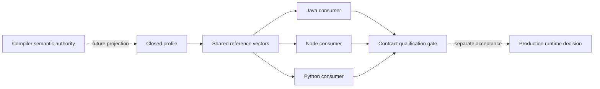

# ADR-0088: Polyglot contract qualification precedes runtime selection

## Context

[Contracts #52](https://github.com/The-Pipeline-Framework/pipelineframework-contracts/issues/52)
asks for a closed execution profile and cross-language conformance before production native
runtime work. [ADR-0080](./0080-native-runtimes-consume-compiler-owned-execution-contracts.md)
remains a draft. Native same-process LOCAL, streaming, Connectors and durable Await remain
requirements of the intended developer experience. A unary probe cannot be called that product's MVP.

The authorised increment is a contract proposal, shared vectors, Java/Node/Python consumer
checks and bounded probes. It does not select native kernels over Detroit, select a local
Java daemon, ship a native runtime, or authorise the rest of the epic. This proposal makes
the first boundary reviewable without changing existing Java wire formats or execution.

## Proposed decision

### A closed research profile, not a product ceiling

Use the provisional identity `tpf-polyglot-probe/0`. Its executable probe is COMPUTE,
LOCAL, direct, finite linear unary execution with explicit policies. It has no coordinator,
provider SDK, credentials or durable store. Java, Node and Python independently consume
the same versioned fixtures. The fixtures simulate an already projected compiler contract;
they are not generated artifacts and must not parse YAML or claim compiler conformance.

The compiler owns DSL meaning, logical type/step identities, placement and policy projection.
Contracts owns shared value and protocol meaning; runtime owns execution and lifecycle.
Consumer-local implementation of these checks does not give a language authority to add
DSL semantics, silently default missing policies, or declare an unsupported feature supported.

Unknown profile versions, required capabilities, logical types, structured failure variants
and incompatible pinned identities fail explicitly before invoking business functions.
Streaming, branching, nested invocation/recurrence, Await, Query/Command, object boundaries,
checkpoints and plugins are rejected **by this probe**. They remain required or separately
qualified capabilities of the wider programme. Adding any of them requires a revised closed
profile, named semantic owner and affected-language conformance; it is not an adapter convenience.

### Values and compatibility

Preserve [ADR-0016](./0016-field-presence-nullability-and-compatibility.md) and
[ADR-0074](./0074-canonical-presence-json.md): object omission, explicit null and a value
are distinct; false, zero and empty values are present. Required/non-null constraints are
independent. Do not infer protobuf field identities from field order. Union identity comes
from the compiler's IDL lock, never a Java class name or a language's runtime type spelling.

The initial vectors distinguish existing Java JSON behaviour from candidate portable numeric
representations. Exact integers and decimals must not pass through a JavaScript Number when
that loses information. Candidate decimal/string atoms in fixtures are not a change to
`PipelineJson`, generated protobuf JSON, or deployed payload encodings. Their eventual wire
selection needs compiler/serialization compatibility evidence. NaN, infinity, negative-zero
and Unicode/decimal normalisation must have explicit rules or explicit rejection; a consumer
must not silently choose a host-language rule.

Hash the specified bytes, not a language's incidental object rendering. Request signature
vectors reuse the existing shared `TransitionWorkerSignature` rules. These byte hashes do
not define a new pipeline contract hash: compiler-owned contract/IDL hashes and pinned
release/artifact digests remain distinct identities. Re-encoding a signed body requires a
new signature; semantically similar JSON is not necessarily the same signed byte sequence.

### Three different interfaces

| Surface | Responsibility | Not authority to |
|---|---|---|
| Application API | Direct typed invocation, or separately authenticated durable admission/status/result retrieval and completion | Execute a coordinator transition without admission |
| Step invocation | Invoke one projected business operation under its owning policy shell | Decide durable retry, resolve credentials, or mutate capture/effect stores |
| Transition-worker protocol | Execute an admitted range under pinned identity and return completed/failed/suspended data | Re-admit execution, select another release, or own recovery |

Current transition payloads use Java type names and failure envelopes carry Java failure
classes. A native consumer must not interpret arbitrary names with class loading or pretend
its logical type ID is accepted by the existing JSON codec. A future interoperable encoding
must be explicitly advertised and release-bound, with generated logical-type bindings and
a negotiated structured failure representation. Keep existing Java encoding/version support
unchanged until that migration is implemented and tested. No fallback to a different decoder
or generic retryable error is permitted after a compatibility failure.

### A returning to B: ownership and stopping points

The table is the proposed ownership contract, not a claim that these remote services exist.
“Shell” means the runtime in the process executing the business function; compiler decisions
arrive in a pinned executable projection. “Host” identifies the Java semantic owner and
current implementation; remotely callable Query, Await and authentication bindings remain
unqualified. It does not imply that these services already exist.

| Operation | Decision owner | Executor / state owner | Data crossing a process boundary | Retry owner | Acknowledgement and failure rule |
|---|---|---|---|---|---|
| Accept A's result and select B | Compiler projection | Shell / invocation-local state | Canonical result plus logical type and step identity when remote | Shell for the invoked step only | Validate result before advancing; malformed result never invokes B |
| Pure unary failure/rejection | Runtime policy projected by compiler | Shell / invocation-local attempt state | Structured outcome, failed step, safe diagnostic | Shell at the business-function host | Terminal failure or rejection stops this unary chain; no B |
| Remote step binding | Compiler placement and runtime protocol | Caller binding, then callee shell / each invocation's state | Canonical input/output, bounded context, identity | Callee shell for logical step retries; caller adds none | Lost response is ambiguous, not proof no invocation occurred |
| Coordinator dispatch/redelivery | Java coordinator | Worker shell; coordinator owns durable execution/lease state | Existing admitted range and pinned identity plus negotiated payload/outcome | Coordinator owns transition redelivery; shell owns only declared per-step attempts | Worker completion is not coordinator settlement; lost acknowledgement may repeat invocation |
| Context and cancellation | Runtime contract, caller cancellation signal | Shell / task-local state | Allowlisted immutable identity/trace data, cancellation signal | No retry after terminal cancellation | A late result cannot start B after cancellation has won; cancellation is not rollback |
| Telemetry | Runtime event contract | Shell; configured host exporter owns its delivery state | Bounded semantic observations | Exporter policy, never implicit business retry | Local probe records ordered events; production exporter loss policy remains unqualified |
| Cache and persistence aspects | Compiled aspect and runtime/plugin policy | Existing Java plugin host / its own state | Not defined by this profile | Plugin/runtime policy, never inferred by native adapter | Excluded; reject declaration before A, do not omit hook or substitute capture storage |
| Query capture/replay | Query contract | Existing Java Query host / capture store | Future typed request, canonical result, capture identity and bounded observation | Query host | Capture commit before success; replay bypasses provider; no such remote binding qualified here |
| Command effects | Application effect authority and Command contract | Java Command host / effect store | Future typed command, effect identity, confirmation and outcome | Command host/recovery authority | Unknown effect outcome remains ambiguous; no automatic generic redispatch |
| Connections | Host tenant/actor authorisation policy | Existing host / credential and connection lifecycle | Authorised logical connection reference only | Host | Denial precedes provider call; no credential/client handle returned to business context |
| Await | Compiler boundary plus Java durable authority | Host / Await and execution stores, distinct from live sessions | Future canonical suspension/continuation, correlation and pinned release | Java durable authority | Persist registration before acknowledgement; completion/resume must survive worker restart |
| Checkpoint, streaming and nested invocation | Their existing semantic owners | Not implemented in this probe | No portable binding admitted by profile 0 | Not silently assigned | Reject required capability; qualify lineage, demand/cleanup, handoff and continuation in later profiles |

Under the proposed profile policy, for a pure step with two retries, the maximum is three invocations, not two. A remote caller
must not multiply that budget by retrying the same logical step independently. A durable
redelivery can repeat the range: two deliveries with a three-attempt step can invoke it six
times. These are policy-history probe expectations, not an exactly-once promise or a claim
that existing Java transports implement a new policy. Physical network requests, logical
step attempts and coordinator deliveries must be counted separately.

There is no newly invented universal step timeout. Propagate only an explicitly supported
deadline/budget, with its clock and owner specified. Unsupported policies fail qualification.

### Authentication, release identity and restart

The proposed future remote admission contract requires the host to validate authentication,
timestamp window, nonce replay protection and tenant
authorisation before decoding/executing a worker command. Signature algorithms/canonicalisation
remain shared contracts; secret resolution, nonce state and authorisation remain host concerns.
Fixture clocks and an in-memory nonce probe prove neither production replay protection nor HA.
Worker capability negotiation must compare pipeline, contract, release, artifact and digest
pins as well as protocol/profile/capabilities. Package versions alone are insufficient.

Business context never contains provider credentials, resolved clients or coordinator stores.
An allowlisted serializable context is not a sandbox: deployment isolation and malicious
application code remain separate security concerns.

Durable Await is not a suspended JS Promise or Python coroutine. A future native worker
must stop and return a canonical suspension; the Java authority persists/reconciles it and
later dispatches a compatible pinned continuation. The current Java path requires QUEUE_ASYNC.
Restart acceptance must kill the worker, accept completion while it is offline, recreate it
with no live language state, and resume correctly, including duplicate/lost acknowledgement,
itemized completion and invocation-path identity. This increment does not run that test or
claim a remotely callable Await service already exists.

### Selection and extension gates

Native pure LOCAL development requires no coordinator, Cloud account or local JVM, including
the eventual changed-project generation workflow. Java is needed by this repository's Java
reference check, not by the Node/Python-only consumer commands. A remote compiler build service
is still a tooling gap. Real QUEUE_ASYNC development uses a remote coordinator and deployed
development workers; laptop reachability is optional.

The Java-daemon option could retain durable authorities behind semantic calls; its service
contracts are not settled here. Detroit could instead retain the Java execution shell, but
must pass the assessment's streaming, Await-restart and real-project experience gates. V8
embedding is not Node compatibility. A required local JVM would revise the no-local-JVM
requirement and needs an explicit product decision. Neither option is selected by these vectors.

Completion of this bounded gate means a reviewable profile, ownership map, shared positive
and negative vectors consumed by all three languages, actual bounded invocation probes,
and independently assessed evidence. Stop there. The next gate is a compiler-owned projected
artifact consumed by an examples-owned native LOCAL proof, with generated types and explicit
unsupported diagnostics; it is not authorisation for a production runtime. Streaming,
Connector and durable-Await contracts must then be qualified before proposing a credible MVP.

## Evidence and limitations

- Contracts source baseline: [`acf6bd2`](https://github.com/The-Pipeline-Framework/pipelineframework-contracts/tree/acf6bd2db310462d526695ec65a5479b2c7f134f).
  [`TransitionWorkerSignature`](https://github.com/The-Pipeline-Framework/pipelineframework-contracts/blob/acf6bd2db310462d526695ec65a5479b2c7f134f/runtime-protocol/src/main/java/org/pipelineframework/orchestrator/TransitionWorkerSignature.java#L11-L79),
  [`TransitionFailureEnvelope`](https://github.com/The-Pipeline-Framework/pipelineframework-contracts/blob/acf6bd2db310462d526695ec65a5479b2c7f134f/runtime-protocol/src/main/java/org/pipelineframework/orchestrator/TransitionFailureEnvelope.java#L8-L45)
  and [`PipelineWorkerCapability`](https://github.com/The-Pipeline-Framework/pipelineframework-contracts/blob/acf6bd2db310462d526695ec65a5479b2c7f134f/runtime-protocol/src/main/java/org/pipelineframework/orchestrator/worker/PipelineWorkerCapability.java#L20-L83)
  establish existing value/signature boundaries, not a native worker implementation.
- Runtime source baseline: [`60dce3e`](https://github.com/The-Pipeline-Framework/pipelineframework-runtime/tree/60dce3e400f51656631230ab9fe910ecb9a6c972).
  [`JsonTransitionPayloadCodec.encode/decode`](https://github.com/The-Pipeline-Framework/pipelineframework-runtime/blob/60dce3e400f51656631230ab9fe910ecb9a6c972/runtime/src/main/java/org/pipelineframework/orchestrator/JsonTransitionPayloadCodec.java#L61-L141)
  still uses Java class identities;
  [`StepOneToOne.apply`](https://github.com/The-Pipeline-Framework/pipelineframework-runtime/blob/60dce3e400f51656631230ab9fe910ecb9a6c972/runtime/src/main/java/org/pipelineframework/step/StepOneToOne.java#L55-L125)
  bypasses generic retry/recovery at `TransportBoundaryInvocation`.
- New since the earlier audit:
  [`PipelineInvocationPath`](https://github.com/The-Pipeline-Framework/pipelineframework-contracts/blob/acf6bd2db310462d526695ec65a5479b2c7f134f/runtime-core/src/main/java/org/pipelineframework/invocation/PipelineInvocationPath.java#L6-L50)
  carries versioned return positions. Ignoring it would weaken restart semantics; profile 0
  rejects nested-invocation requirements rather than treating older vectors as sufficient.
- The consumer corpus and reproducible commands live with contracts under
  `conformance/polyglot-v0/`. Its evidence report distinguishes real Java contract calls,
  candidate codecs, simulated policy histories and live async unary calls. Passing those
  checks is not evidence of compiler generation, networking, streaming, provider capture,
  durable recovery, production hosting or language ecosystem parity.

## Consequences

No production API or existing Java encoding changes in this increment. The profile remains
provisional until reviewed; it cannot be advertised by a production worker. Extension work
must name the operation and owner, update the shared contract and every claimed consumer,
and provide the lifecycle evidence for its claimed layouts. Existing Spring work and the
epic's remaining implementation stay unchanged and unscheduled.
