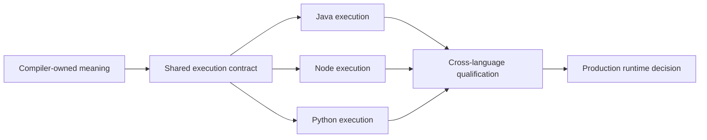

# ADR-0088: Polyglot contract qualification precedes runtime selection

## Context

Native same-process LOCAL execution is a requirement for the proposed polyglot developer
experience. Streaming, Connectors and durable Await also remain requirements. A unary
experiment can clarify the execution boundary, but cannot define that product's MVP.

[ADR-0080](./0080-native-runtimes-consume-compiler-owned-execution-contracts.md) proposes
language-specific execution runtimes that consume compiler-owned contracts. The precise
execution profile and compatibility rules remain open. Native kernels, an embedded-language
host such as Detroit and a Java daemon also have different developer-workflow consequences.
A small successful example is not enough to select between them.

## Proposed decision

Qualify a shared execution contract before selecting or implementing production language
runtimes. Keep the Java compiler as semantic authority and the Java coordinator as durable
authority. Each execution host implements the supported policies under that contract.

### Declare the supported profile

A versioned profile defines supported canonical types, cardinalities, policies and runtime
arrangements. Unknown versions, required capabilities, logical types or failure variants
must be rejected explicitly. The compiler rejects unsupported authored features; the
runtime rejects incompatible generated artefacts before invoking business functions.

The compiler owns DSL meaning, composition, identity, placement and policy projection.
Contracts owns portable data and protocol meaning. Runtime owns execution and lifecycle.
A language implementation must not independently interpret YAML, infer missing policies
or silently omit a configured operation.

Research profiles may be deliberately small. Their exclusions describe the experiment,
not a permanent ceiling on TPF or a reduction of the intended product requirements.

### Preserve values and identity

Preserve [field presence and nullability](./0016-field-presence-nullability-and-compatibility.md)
and [canonical JSON presence](./0074-canonical-presence-json.md). Omission, explicit null
and a value are distinct. Required and non-null constraints are independent; false, zero
and empty values remain present.

Cross-language representations must preserve numeric precision and define any permitted
normalisation. Wire identity comes from the compiler's canonical model and IDL lock,
not declaration order, Java class names or native type names. Hashes and signatures apply
to their specified bytes; semantic similarity does not make differently encoded bodies
interchangeable. Contract identity, release identity and artefact digests remain distinct.

New payload or structured-failure encodings require explicit compatibility rules and
release-bound support. A failed compatibility check must not trigger a fallback decoder
or turn an unknown failure into a retryable one. Existing Java encodings remain unchanged
until an explicit migration is implemented and qualified.

### Keep the three interfaces separate

| Interface | Responsibility |
|---|---|
| Application API | Typed direct invocation or authenticated durable admission, status, results and completion |
| Step invocation | One business operation under its owning execution policy |
| Transition-worker protocol | An admitted range under pinned identity, returning completion, failure or suspension |

An application API does not grant transition authority. A worker does not re-admit its
execution, select a different release or take ownership of durable recovery.

### Assign every operation an owner

A returns to its execution shell. That shell validates the supported result and follows
the compiler-defined flow before invoking B. Every enabled operation at that boundary
needs a named policy owner, executor, state owner, retry owner and acknowledgement rule.

| Operation | Proposed ownership |
|---|---|
| Sequencing, result validation and local attempts | Language execution shell, following the compiler projection and shared runtime policy |
| Remote step binding | Generated caller/callee bindings; the callee owns logical step retries, without an additional caller retry budget |
| Transition delivery, settlement and recovery | Java coordinator; worker completion and durable settlement are separate events |
| Context, cancellation and semantic observations | Shared runtime contract with explicit language bindings and exporter policy |
| Cache and persistence aspects | Existing plugin/runtime owner; declared hooks cannot be silently omitted or substituted for capture storage |
| Query capture and replay | Authorised capability host and capture store; capture commits before success and replay bypasses the provider |
| Command effects | Application effect authority and Command host; ambiguous outcomes require explicit reconciliation |
| Connections | Host tenant/actor authorisation and credential lifecycle; only authorised logical references cross the boundary |
| Await | Java durable authority and persisted continuation data, independent of the live language process |
| Streaming, checkpoints and nested invocation | Their existing semantic owners; each portable binding must preserve its own lifecycle and identity guarantees |

Logical attempts, physical network requests and coordinator redeliveries are different
counts. A lost response may cause repeated execution; there is no exactly-once
business-function invocation promise. Cancellation is not rollback, and a late result
must not start the next operation after cancellation has won. Only explicitly supported
deadlines and budgets may be propagated; this decision introduces no universal timeout.

Empty completion, business rejection and failure require distinct agreed representations.
Language exceptions alone do not establish retry safety. Context fields need an explicit
binding to the host's context mechanism. These mappings must be settled rather than
made to appear equivalent through test-only translations.

### Preserve authority across process boundaries

Remote admission requires authentication, timestamp and nonce handling, tenant
authorisation and compatible pinned identity before execution. Signature rules belong to
shared contracts; secrets, replay protection and authorisation state belong to the host.
A package version alone does not establish release or capability compatibility.

Business context must not contain provider credentials, resolved clients or coordinator
stores. An allowlisted context is not a sandbox; deployment isolation remains separate.

Await registration must be durable before acknowledgement. A restarted worker resumes
from canonical continuation data, correlation and the pinned release, including any
item or nested-invocation identity. Promises, coroutines, closures and interpreter handles
are not durable continuations. Lost acknowledgements and duplicate completions must not
change ownership or silently repeat an external effect.

## Qualification and extension

Each claimed language and layout needs shared conformance for its declared profile.
Qualification must distinguish supplied fixtures, generated artefacts, actual execution
and deployed recovery. Substituted boundaries remain explicit limitations.

The intended native developer workflow requires no local JVM or coordinator for pure
LOCAL execution, and no local JVM for changed-project generation. Real QUEUE_ASYNC uses a
remote coordinator and deployed development workers; laptop reachability is optional.
A mandatory local JVM would require an explicit product decision. Remote generation does
not promise offline regeneration.

Semantic extensions require a shared-contract revision, named owners and checks for every
affected language. Passing a declared research profile is a stopping point for that
experiment; it does not authorise importing adjacent provider or coordinator internals.
Streaming, Connector guarantees and durable Await must be qualified before accepting a
credible product MVP.

## Consequences

This draft does not select a production runtime, create a Provider SDK or change existing
Java execution. Existing Spring work remains intact. Production implementation is
unscheduled and depends on acceptance of the relevant contracts.

The [polyglot architecture discussion](../evolve/polyglot-applications-assessment.md)
explains the alternatives. Dated source audits, experiments, results, remaining decisions
and delivery tracking belong to [contracts #52](https://github.com/The-Pipeline-Framework/pipelineframework-contracts/issues/52)
and the [polyglot epic](https://github.com/The-Pipeline-Framework/pipelineframework/issues/1055).
