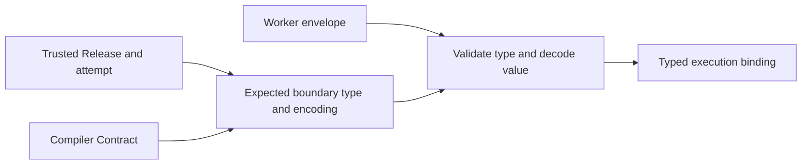
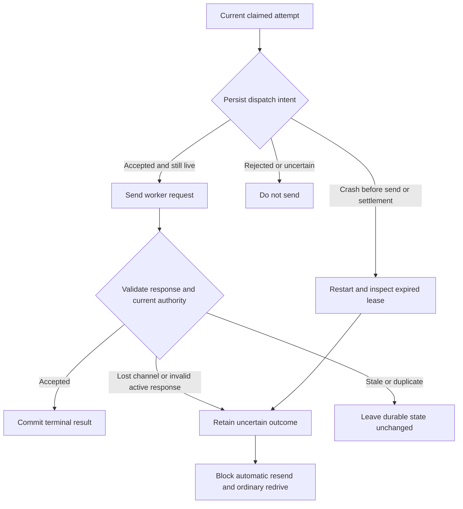

# ADR-0089: Native worker payloads and compiler metadata have separate bindings

## Context

A Node or Python worker needs to exchange application values with a Java coordinator
without pretending that a logical type name is a Java class. The existing outer worker
envelope can carry a declared type, an encoding and payload text, but accepting that
envelope does not establish how its payload should be decoded.

The compiler also needs to identify the same logical pipeline across language targets.
A language-specific executable projection identifies one realisation; it is not a
replacement for the pipeline Contract or a Release Descriptor.

This decision refines [ADR-0088](./0088-polyglot-contract-qualification-precedes-runtime-selection.md)
for the experimental four-record, linear unary binding. It does not extend that execution
profile or qualify a deployed worker.

## Decision

### Select the payload format before receiving a value

Use a distinct, explicitly selected inner encoding, `tpf-polyglot-int32-json/1`, for the
bounded application record. Its value is a JSON object with exactly one required,
non-null `value` field containing a signed 32-bit integer token. Decimal and exponent
spellings are rejected; there is no numeric coercion. Negative zero normalises to zero.
Encoding produces compact JSON with a decimal integer. JSON whitespace and an escaped
spelling of the field name are accepted, but duplicate decoded field names, unknown
fields and trailing values are rejected.

The type identity remains outside that JSON value. Each binding receives the four
compiler-owned logical type identities and requires the expected boundary type on
encode or decode. A different known type is still the wrong type for that boundary.
The caller obtains the expectation from the verified compiler metadata, never from the
incoming payload. The binding neither loads Java classes nor reconstructs arbitrary
native objects.

The outer envelope encoding, inner payload encoding, execution profile and failed-result
profile retain separate identities. This encoding does not widen the earlier research
codec or replace the legacy Java codec. A mismatch rejects rather than selecting another
decoder. Configuration and authorisation remain prerequisites owned by the deployment
and coordinator; successfully decoding a record grants no execution authority.

### Bind language-neutral meaning and language-specific bytes separately

The compiler owns the pipeline Contract and its deterministic identity. Worker generation
uses the existing semantic model and metadata authority, with logical type identities
and capabilities appropriate to the selected target. A Node and Python realisation of
the same admitted flow must share its logical Contract, while retaining their own
executable projection and release artefacts. Changing execution policy must change the
logical identity even when the released Contract schema has no dedicated policy field.
The admitted policy inputs are the execution profile and the ordered step retry limits.

Compiled Truth carries the exact emitted Contract and projection bytes. Existing Release
Descriptors bind the runnable artefact and Compiled Truth through their pinned digests;
there is no second native release manifest. Before execution, a host must verify that
its loaded executable, dependencies and projection belong to that verified combination.
Contract equality and matching projection hashes alone do not prove that association.

The Contract advertises `local` and `rest` worker capabilities that the selected runnable
must cover. This does not prove that a worker is deployed, authenticated or ready. Legacy Java Contract
production, payload decoding and worker selection keep their existing meaning.

### Prepare the code that will actually run

The deployment host pins the exact Release Descriptor bytes before resolving its
artefacts. Reusing a Release version with a different descriptor cannot change an
existing trusted selection. The existing producer and resolver remain responsible for
the descriptor, artefact digests, closure and recovered Compiled Truth.

For the bounded native binding, the runnable archive contains the generated application,
authored functions and packaged native runtime dependencies. Preparation materialises
that verified archive into a fresh deployment-owned tree and retains its complete file
inventory. Validate that inventory before use, and load the application and its runtime
from that tree. Installing dependencies afterwards or importing an ambient runtime would
break the association being verified.

The native runtime accepts an optional host-owned expectation for the exact projection
bytes. At its existing load boundary, the generated application's projection must match
that expectation before handler admission or invocation. The expectation comes from
verified Compiled Truth; an application-supplied digest is not a substitute. Ordinary
LOCAL execution keeps its existing load behaviour and needs no local Java process.

The interpreter, standard library and isolation of the prepared tree remain deployment
responsibilities. File verification is not a sandbox, remote attestation or protection
against a privileged actor changing the tree during execution. Authored module
initialisation also executes code: the host must trust and verify the runnable before
importing it, not merely check a projection after import.

### Retain the trusted selection with the attempt

A prepared binding snapshots the deployment-owned tenant, worker, HTTPS endpoint,
credential reference, Release and artefact identities, and explicit profile selections.
An admitted command supplies execution identity, version, attempt, transition key, range
and context. Validate the supported whole-bundle shape and scoped identities before
parsing the application payload, then retain those values together as an immutable
attempt selection. Credential values do not enter business context.

A later configuration replacement affects new selections. It cannot change an existing
attempt's decoder, endpoint or Release. Comparing a presented command with its retained
attempt rejects a different execution, version, key or range; it does not independently
establish that the coordinator's lease is still current. The coordinator retains that
authority and the separate responsibility for durable attempt storage and settlement.

This preparation and selection boundary does not authenticate a network request or
implement a worker endpoint. Network authentication, response-channel association and
uncertain-outcome handling must still satisfy ADR-0088 before transport integration can
claim support.

### Validate a response under its retained attempt

The explicit paired client uses the existing REST worker request signature and the
retained deployment endpoint over direct HTTPS. It does not follow redirects, select a
decoder from response claims, or retry a request automatically. A configuration change
cannot replace the endpoint, credential reference or result profile of an existing
attempt.

A completed response must contain exactly one value of the expected logical output
type and payload encoding. A failed response must use the selected portable result
profile, a step in the admitted range, and one of its closed codes with the fixed safe
diagnostic. Keep this classification in the runtime result model; do not disguise it as
a Java exception class in the legacy wire representation.

For this bounded paired binding, all three portable failure codes are terminal at the
coordinator. In particular, `TRANSIENT_EXHAUSTED` records that the native runtime has
spent its local retry budget; it does not create another retry budget at the caller.
Any future coordinator recovery policy needs a separately admitted choice. Existing
Java failure handling keeps its current policy.

The result remains an observation until the coordinator accepts it against the current
attempt. A stale or duplicate response must not publish output, record a new terminal
decision or enqueue another execution. Once sending may have started, a lost channel or
invalid response cannot prove that the worker did nothing: preserve
`REMOTE_OUTCOME_UNKNOWN` rather than silently retrying.

The bounded binding excludes terminal checkpoint and object-output publication.
If either is configured, the coordinator must reject paired completion under the
same current-lease fence; it must not record success while silently omitting the
publication. Supporting that combination requires a separate recoverable publication
design. Existing Java publication behaviour is unchanged.

### Persist dispatch intent before sending

The coordinator must durably record that an attempt may be dispatched before it sends
the request. Record the selected worker, endpoint, credential reference, Release and
artefact identities, profiles, and exact command digest. Store credential references,
never credential values. A later configuration change cannot rewrite this evidence.

The execution state owner atomically records this immutable fact and associates it with
the current execution lease. That association requires the admitted pipeline, Contract,
Release, attempt and range to match. Only a newly accepted reservation permits sending;
a duplicate, stale reservation or uncertain storage response does not authorise another
request. Recording a fact separately from checking the lease would leave a race in which
an expired coordinator could still send.

### Recover uncertainty without repeating work

An expired lease with unresolved paired dispatch intent is not ordinary retryable work.
Both periodic recovery and direct queue redelivery must preserve
`REMOTE_OUTCOME_UNKNOWN` and refuse another invocation. The rule also covers a crash
between recording intent and actually sending: the durable evidence cannot prove whether
the worker ran. This conservative outcome is not an exactly-once execution guarantee.

A validated response may settle only the same retained intent under its current lease.
A stale or duplicate result cannot overwrite terminal state, publish output or schedule
another attempt. Generic retry and failure paths must not bypass the paired fence.
Ordinary `allowFailed` redrive is insufficient for unresolved paired work; a future
reconciliation policy needs its own explicit authority and evidence. Unmarked Java
executions retain their existing recovery policy.

### Admit portable input through a trusted deployment binding

A request's encoding or type name cannot opt an execution into a native runtime.
The deployment explicitly supplies a prepared Release binding. Hosted admission
checks that binding against the registered Release and its compiler Contract, then
validates the declared input shape, type, encoding and value before durable admission.
Admission must also establish that the escaped worker envelope fits the host's
request bound, including coordinator-generated attempt metadata. Valid application
JSON alone does not establish that it can be dispatched.
The response to the authenticated capability request must match the selected
runnable's identity and the exact projection from its verified Compiled Truth.
The same logical Contract can have different language bindings or compiler provenance.
Matching the Contract, Release label and runnable digest alone does not establish
which projection a separately prepared host loaded.

For the paired HTTPS boundary, the worker reports its startup-validated projection
in the `X-TPF-Worker-Projection-Digest` capability response header. The client requires
exactly one matching SHA-256 value before admission or dispatch-intent reservation.
Ordinary capability JSON and Java worker behaviour remain unchanged. TLS authenticates
the response channel; this claim is not remote attestation or an HMAC-signed response.

Paired admission derives execution identity from the exact tenant, pipeline and client
key, independently of the ordinary submission idempotency policy. Two distinct keys
must not collapse because their payloads match or because whitespace is trimmed.
The same admission key still conflicts with a different immutable intent; changing
Release does not create another admission namespace. Retained receipts remain the
lookup and replay authority for executions admitted before a configuration change.

Retain the original validated payload and descriptor pin in coordinator-owned execution
state. Reconstruct the worker command from that state and the claimed execution's
identity. Application payload fields cannot supply coordinator authority or choose the
worker. A replacement binding must still match the admitted descriptor; an absent or
incompatible binding rejects rather than falling back to a Java payload decoder.

Use the existing queue, lease, dispatch-intent and settlement paths for this explicit
selection. Do not introduce a separate dispatcher for native executions. Existing Java
admission and routing retain their behaviour when no native binding is supplied, and
existing admission receipts remain retrievable independently of worker availability.

### Host the existing native executor behind the worker protocol

The native worker host wraps the same application and LOCAL executor used by the
developer. It does not interpret DSL, add retries or reproduce coordinator recovery.
The deployment supplies the verified runnable, exact compiler projection, expected
Release identity and transport credentials before the listener starts. Requests cannot
replace those choices. Prepared-file verification remains a deployment responsibility;
a configured digest is not remote attestation or a sandbox for authored code.

The host exposes the existing authenticated capability and execute routes over HTTPS.
Authenticate the exact request bytes before decoding application data, and validate
scoped identities, the admitted range and payload binding before entering a business
function. Preserve integer command identities exactly across languages. Unknown or
malformed fields must not silently select another execution policy.

Only the accepted completed payload and closed portable failure codes cross the result
boundary. Transport failure or an invalid response remains an uncertain outcome at the
coordinator. A host's bounded nonce cache rejects replays during its process lifetime
and fails closed at capacity; it is not durable deduplication across worker restarts or
replicas. Durable resend authority remains with the coordinator's recorded intent.

The explicit host and admission binding do not enable automatic worker registration
or establish production hosting or HA support. The existing pure LOCAL developer
workflow remains independent of the coordinator, TLS listener and transport credentials.

## Rationale

Separate bindings avoid three accidental authorities: a payload choosing its decoder,
a native class name choosing its logical type, and a capability advertisement choosing
its own release. They also let the bounded experiment reuse released carriers without
making them appear compatible with an unmodified Java worker configuration.

An integer-token-only format has an exact representation in all three languages. Its
narrow value shape is an experimental compatibility choice, not a permanent limit on
canonical TPF types. Wider types require an explicit shared-contract extension and
cross-language conformance.

## Consequences

Contracts owns the payload encoding. Compiler owns logical metadata, policy identity and
executable projections. Runtime owns the explicit bindings and eventual deployment and
attempt selection. Examples owns shared cross-language conformance over the actual
packaged consumers.

Native listeners and coordinator routing require explicit deployment bindings. They
do not by themselves establish production hosting or deployed native-worker recovery.
Streaming, Connectors and durable Await remain requirements of the broader product.
Evidence, remaining integration gates and scheduling belong to
[runtime #82](https://github.com/The-Pipeline-Framework/pipelineframework-runtime/issues/82)
and [epic #1055](https://github.com/The-Pipeline-Framework/pipelineframework/issues/1055).
