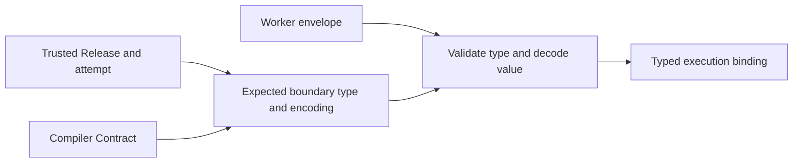

# ADR-0089: Native worker payloads and compiler metadata have separate bindings

## Context

A Node or Python worker needs to exchange application values with a Java coordinator
without pretending that a logical type name is a Java class. The existing outer worker
envelope can carry a declared type, an encoding and payload text, but accepting that
envelope does not establish how its payload should be decoded.

The compiler also needs to identify the same logical pipeline across language targets.
A language-specific executable projection identifies one realisation; it is not a
replacement for the pipeline Contract or a Release Descriptor.

This decision refines [ADR-0088](./0088-polyglot-contract-qualification-precedes-runtime-selection.md)
for the experimental four-record, linear unary binding. It does not extend that execution
profile or qualify a deployed worker.

## Decision

### Select the payload format before receiving a value

Use a distinct, explicitly selected inner encoding, `tpf-polyglot-int32-json/1`, for the
bounded application record. Its value is a JSON object with exactly one required,
non-null `value` field containing a signed 32-bit integer token. Decimal and exponent
spellings are rejected; there is no numeric coercion. Negative zero normalises to zero.
Encoding produces compact JSON with a decimal integer. JSON whitespace and an escaped
spelling of the field name are accepted, but duplicate decoded field names, unknown
fields and trailing values are rejected.

The type identity remains outside that JSON value. Each binding receives the four
compiler-owned logical type identities and requires the expected boundary type on
encode or decode. A different known type is still the wrong type for that boundary.
The caller obtains the expectation from the verified compiler metadata, never from the
incoming payload. The binding neither loads Java classes nor reconstructs arbitrary
native objects.

The outer envelope encoding, inner payload encoding, execution profile and failed-result
profile retain separate identities. This encoding does not widen the earlier research
codec or replace the legacy Java codec. A mismatch rejects rather than selecting another
decoder. Configuration and authorisation remain prerequisites owned by the deployment
and coordinator; successfully decoding a record grants no execution authority.

### Bind language-neutral meaning and language-specific bytes separately

The compiler owns the pipeline Contract and its deterministic identity. Worker generation
uses the existing semantic model and metadata authority, with logical type identities
and capabilities appropriate to the selected target. A Node and Python realisation of
the same admitted flow must share its logical Contract, while retaining their own
executable projection and release artefacts. Changing execution policy must change the
logical identity even when the released Contract schema has no dedicated policy field.
The admitted policy inputs are the execution profile and the ordered step retry limits.

Compiled Truth carries the exact emitted Contract and projection bytes. Existing Release
Descriptors bind the runnable artefact and Compiled Truth through their pinned digests;
there is no second native release manifest. Before execution, a host must verify that
its loaded executable, dependencies and projection belong to that verified combination.
Contract equality and matching projection hashes alone do not prove that association.

The Contract advertises `local` and `rest` worker capabilities that the selected runnable
must cover. This does not prove that a worker is deployed, authenticated or ready. Legacy Java Contract
production, payload decoding and worker selection keep their existing meaning.

### Prepare the code that will actually run

The deployment host pins the exact Release Descriptor bytes before resolving its
artefacts. Reusing a Release version with a different descriptor cannot change an
existing trusted selection. The existing producer and resolver remain responsible for
the descriptor, artefact digests, closure and recovered Compiled Truth.

For the bounded native binding, the runnable archive contains the generated application,
authored functions and packaged native runtime dependencies. Preparation materialises
that verified archive into a fresh deployment-owned tree and retains its complete file
inventory. Validate that inventory before use, and load the application and its runtime
from that tree. Installing dependencies afterwards or importing an ambient runtime would
break the association being verified.

The native runtime accepts an optional host-owned expectation for the exact projection
bytes. At its existing load boundary, the generated application's projection must match
that expectation before handler admission or invocation. The expectation comes from
verified Compiled Truth; an application-supplied digest is not a substitute. Ordinary
LOCAL execution keeps its existing load behaviour and needs no local Java process.

The interpreter, standard library and isolation of the prepared tree remain deployment
responsibilities. File verification is not a sandbox, remote attestation or protection
against a privileged actor changing the tree during execution. Authored module
initialisation also executes code: the host must trust and verify the runnable before
importing it, not merely check a projection after import.

### Retain the trusted selection with the attempt

A prepared binding snapshots the deployment-owned tenant, worker, HTTPS endpoint,
credential reference, Release and artefact identities, and explicit profile selections.
An admitted command supplies execution identity, version, attempt, transition key, range
and context. Validate the supported whole-bundle shape and scoped identities before
parsing the application payload, then retain those values together as an immutable
attempt selection. Credential values do not enter business context.

A later configuration replacement affects new selections. It cannot change an existing
attempt's decoder, endpoint or Release. Comparing a presented command with its retained
attempt rejects a different execution, version, key or range; it does not independently
establish that the coordinator's lease is still current. The coordinator retains that
authority and the separate responsibility for durable attempt storage and settlement.

This preparation and selection boundary does not authenticate a network request or
implement a worker endpoint. Network authentication, response-channel association and
uncertain-outcome handling must still satisfy ADR-0088 before transport integration can
claim support.

## Rationale

Separate bindings avoid three accidental authorities: a payload choosing its decoder,
a native class name choosing its logical type, and a capability advertisement choosing
its own release. They also let the bounded experiment reuse released carriers without
making them appear compatible with an unmodified Java worker configuration.

An integer-token-only format has an exact representation in all three languages. Its
narrow value shape is an experimental compatibility choice, not a permanent limit on
canonical TPF types. Wider types require an explicit shared-contract extension and
cross-language conformance.

## Consequences

Contracts owns the payload encoding. Compiler owns logical metadata, policy identity and
executable projections. Runtime owns the explicit bindings and eventual deployment and
attempt selection. Examples owns shared cross-language conformance over the actual
packaged consumers.

This gate adds no network listener, coordinator integration or durable recovery behaviour.
Streaming, Connectors and durable Await remain requirements of the broader product.
Evidence, remaining integration gates and scheduling belong to
[runtime #82](https://github.com/The-Pipeline-Framework/pipelineframework-runtime/issues/82)
and [epic #1055](https://github.com/The-Pipeline-Framework/pipelineframework/issues/1055).
