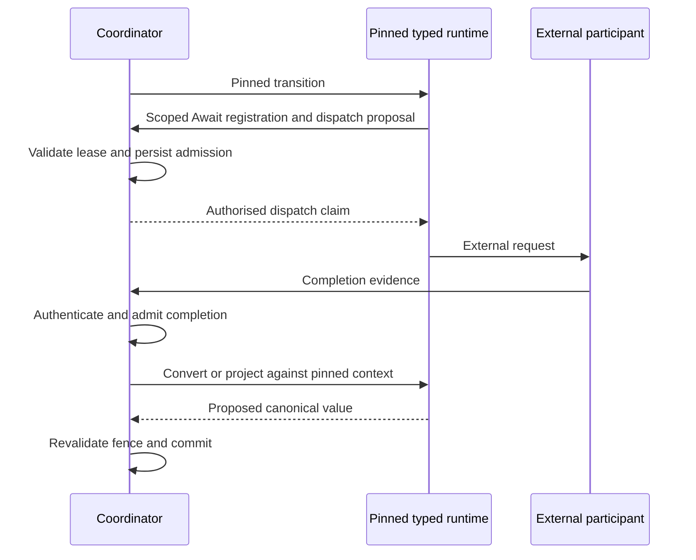

# ADR-0089: Typed worker operations preserve Coordinator authority

## Context

The Coordinator owns durable execution state, scheduling, leases, retries, Await admission and recovery. An application runtime owns compiled application types, business transitions, representation conversion and application-specific completion projection. These responsibilities already exist; separating their classpaths must preserve their semantic owners.

A Coordinator serving independently packaged applications cannot reconstruct application objects or execute their completion projectors. It still needs enough pinned metadata to validate scope and decide whether a proposed result may change authoritative state. Copying a worker's provisional Await record after external dispatch is insufficient: a worker can fail after sending the request but before returning that record.

## Decision

Keep canonical payloads serialised at the class-independent Coordinator boundary. Validate their pinned canonical identity, schema, encoding and framing there using the existing canonical catalogue; execute application conversion and application-specific type validation in the original pinned typed runtime. A matching fingerprint alone is not evidence that a payload satisfies its application schema. Metadata and status reads must remain possible without an available worker or application classes.

The compiler records the exact Await descriptor facts produced by its existing boundary resolution in the pinned compiled contract. These facts include the stable descriptor identity, canonical and transport boundary identities, completion projector and callback identity where applicable. Runtime code must not infer these identities from an authored name, generated cursor or Java class name. Semantic contract step counts are not a substitute for the generated execution order. The existing order metadata gains versioned canonical boundaries aligned with its physical root steps and each generated invocation class's actual child steps. Nested continuation positions use those callsite-specific facts. The contract also records explicit canonical root input and output identities: valid aliases can share a Java class, and a declared root alias can differ from a step alias. These additions preserve existing step identities and execution semantics.

Result cardinality comes from the pinned root composition where present, otherwise the pinned root contract. The Coordinator does not share a process-wide application result-shape cache across Releases. Initial JSON input is validated and framed against the canonical root boundary; intermediate canonical envelopes retain their identity, and the receiving typed runtime validates the exact compiled boundary.

Typed completion operations propose canonical values. Their requests and results bind the original execution, interaction, Release, operation and expected interaction version. The Coordinator authenticates the boundary, validates the result against the admitted request, and conditionally commits against the expected authoritative snapshot. A request digest provides correlation; it does not authenticate a worker or grant completion authority.

A typed Command projector's identity rejection remains distinct from an unavailable operation. Only an authenticated, request-bound rejection may trigger the existing rejection policy. A malformed, foreign or unavailable response preserves the evidence needed for retry rather than being interpreted as application rejection. Application exception details do not enter this error contract.

A stale snapshot requires a fresh authoritative read and semantic revalidation. The Coordinator must not apply a value projected from stale input by retrying a write against a refreshed version. Stores that cannot provide the required atomic fence fail closed.

Before an external Await dispatch, a remote worker uses scoped lifecycle operations to obtain authoritative registration and dispatch admission. Those operations reuse the existing Await unit, interaction and admission lifecycle. They do not expose general store mutation, resume-token authority or an unrestricted completion API. An uncertain dispatch outcome remains subject to the existing recovery rules; durable admission does not imply exactly one physical invocation.

The Coordinator rejects an execution scope that is already stale when it validates the request. That validation authorises the same immutable Await occurrence and retained request; it is not an atomic snapshot spanning the execution and interaction stores. A subsequent parent lease change fences parent progress commits but cannot revoke already admitted external work. Conditional interaction updates govern dispatch state. Losing a response to the first remote dispatch claim does not make an existing `DISPATCHING` record a fresh grant. Existing live-dispatch retries retain their external idempotency and uncertain-outcome rules.

Shared value-only wire records belong in `pipelineframework-contracts`; compiler-produced facts belong in `pipelineframework-compiler`; lifecycle policy, stores, clients and authenticated endpoints belong in `pipelineframework-runtime`. Existing Release bindings and activation remain the identity authority. Running work retains its admitted binding and original Release across retries and recovery. The initial execution admission persists an `ExecutionDispatchPin` containing the selected declared entry identity and its immutable deployment observation. The existing tenant, pipeline, contract and Release identity supplies the rest of the binding key. Endpoint, artifact and credential identity come from that retained entry; changing current configuration cannot redirect an admitted execution. An immutable entry cannot be enriched or replaced in place.

## Compatibility

The existing typed local path and released payload formats remain supported. Class-independent operation requires explicit compatible worker capabilities and the required compiled facts. Missing or unknown protocol versions must fail closed rather than falling back to unchecked payloads, guessed descriptor identities or local application loading.

Existing immutable Releases do not acquire new descriptor metadata retroactively. Executions pinned to older Releases continue through their compatible typed runtime; moving them to class-independent coordination is not an automatic record migration. The new mode is opt-in for compatible compiled Releases. Activation of a newer Release must not change the runtime or projector selected for an earlier execution.

Absent root-boundary metadata is omitted during serialisation, preserving the existing metadata fingerprint of retained Release evidence. Reading old evidence must not rehash it or add an empty field to its signed or fingerprinted representation.

The optional dispatch pin is additive to execution creation and retained execution records. Existing constructors remain available, and the new reader accepts records without that field. This is backward readability, not a claim that older strict readers accept new records or that existing executions can safely acquire a dispatch target from current configuration. Roll out compatible readers before creating pinned records; retain the compatible runtime for their lifetime. Provider records reject a partially stored pin rather than guessing the missing identity.

The generic authenticated completion API supports serialised coordination. The existing connector HTTP `ProviderCallbackResource` still requires its typed application-local assembly to authenticate and map provider callbacks. It is not a class-independent callback ingress: moving that resource to a worker would also require separating its local token and state lookup. This adapter integration is outside this increment. Serialised mode rejects its typed descriptor lookup explicitly; the existing typed local path remains supported.

New shared wire operations require matching client/server tests and exact component compatibility evidence. Retained records must remain readable, including by existing typed APIs where their application runtime is available. A local preview build is not immutable candidate acceptance.

## Verification obligations

Use independently packaged applications and a Coordinator process whose production classpath excludes their types, generated beans and resources. Verify incompatible applications, original-Release completion after activation changes, unavailable-worker metadata reads, scope and version rejection, durable admission before dispatch, early callbacks, timeout races and recovery from lost replies. Preserve affected local execution, Command, Query, paging and terminal-publication behaviour.

This decision is proposed while implementation and integrated compatibility verification are in progress. It does not declare those obligations satisfied.

## Related decisions

- [Shared transition requests](./0047-transition-requests-are-shared-runtime-protocol.md).
- [Wire results and runtime outcomes](./0049-transition-results-separate-wire-data-from-runtime-outcomes.md).
- [Shared remote-worker protocols](./0050-remote-worker-protocols-are-shared-runtime-contracts.md).
