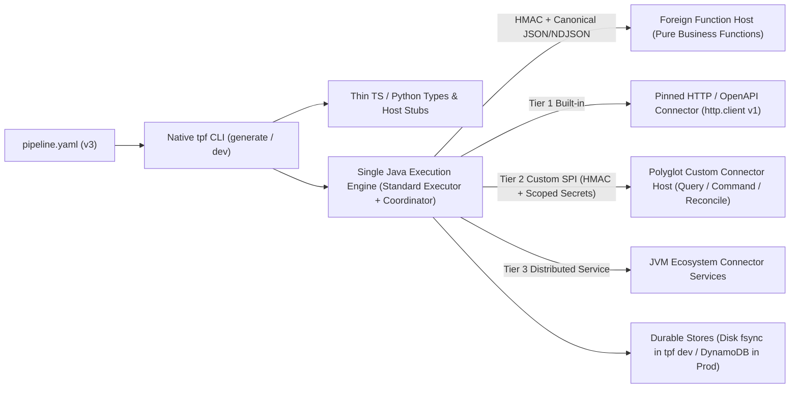

# ADR-0092: Polyglot applications execute on one Java engine with thin foreign function and connector hosts

## Context

Earlier polyglot decisions ([ADR-0080](./0080-native-runtimes-consume-compiler-owned-execution-contracts.md),
[ADR-0088](./0088-polyglot-contract-qualification-precedes-runtime-selection.md), and
[ADR-0089](./0089-native-worker-payload-and-contract-binding.md)) explored whole-bundle native
execution runtimes in Node and Python paired with a dedicated coordinator transition worker seam
(`paired-native`, `tpf-polyglot-int32-json/1`, and `tpf-polyglot-failed-result/1`).

That whole-bundle model introduced two structural maintenance multipliers:

1. Every target language had to re-implement TPF's execution shell: graph sequencing, retries,
   streaming backpressure and cancellation, deterministic lineage, durable Await suspension and
   resume, and Connector capture/effect/reconciliation semantics.
2. Whole-bundle transition workers could not natively compose mixed-language steps, durable
   Java Await boundaries, and TPF Connectors inside one standard execution graph without a
   parallel coordinator protocol.

At the same time, non-Java developers require a JVM-free local authoring, generation, and
crash-safe development workflow without installing a JDK, Maven, or Docker.

Four empirical feasibility spikes on [epic #1055](https://github.com/The-Pipeline-Framework/pipelineframework/issues/1055)
established that a compiled GraalVM native `tpf` executable embedding TPF's standard Java
execution engine, paired with thin foreign function and connector hosts, satisfies both
requirements while eliminating whole-bundle native runtimes.

## Decision

TPF adopts a **single Java execution engine** paired with **thin foreign function hosts**, a
**standalone native `tpf` CLI**, and a **three-tier Connector architecture**. This decision
supersedes [ADR-0080](./0080-native-runtimes-consume-compiler-owned-execution-contracts.md),
[ADR-0088](./0088-polyglot-contract-qualification-precedes-runtime-selection.md), and
[ADR-0089](./0089-native-worker-payload-and-contract-binding.md) (while preserving the
durable invariants established in [ADR-0014](./0014-remote-transition-outcome-uncertainty.md),
[ADR-0016](./0016-field-presence-nullability-and-compatibility.md),
[ADR-0021](./0021-host-owned-connector-authentication.md),
[ADR-0034](./0034-pinned-http-operations-execute-as-ordinary-connector-capabilities.md), and
[ADR-0074](./0074-canonical-presence-json.md)).

### 1. One Java execution engine owns pipeline semantics

TPF's standard Java execution engine (`PipelineExecutionService`, `QueueAsyncCoordinator`,
`PipelineRunner`, `PipelineStepExecutor`, `ExecutionFailureHandler`, `AwaitCoordinator`,
`CommandStepSupport`, `QueryStepSupport`) remains the single execution authority for polyglot
applications:

- Graph sequencing, branching, deterministic split/merge lineage, retries, telemetry, durable
  Await suspension/resume, and crash recovery execute in Java — both locally inside `tpf dev`
  and distributed in production.
- Target-language SDKs (Node/TypeScript, Python, and future languages) host **individual
  business functions** and **custom Connector adapters**; they do **not** implement YAML
  interpreters, pipeline graph runners, retry loops, Await state machines, or effect/capture
  stores.
- Standard canonical boundaries support class-free execution (`runtimeClass` absent), validating
  canonical v3 payloads (`TypedDurablePayload`) directly against `CanonicalTypeCatalogue`
  without requiring user-authored Java domain classes on the classpath.
- Initial polyglot cardinalities are `ONE_TO_ONE`, `ONE_TO_MANY`, and `MANY_TO_ONE`.
  **Full-duplex `MANY_TO_MANY` streaming** is a relevant future capability for TPF and is
  intentionally deferred from the initial polyglot delivery surface.

### 2. Thin Foreign Function Host boundary

Java invokes foreign business functions per step over authenticated HTTP with HMAC-SHA256
request signing (`X-TPF-Worker-Timestamp`, `X-TPF-Worker-Nonce`, `X-TPF-Worker-Signature`) and
pinned step/type metadata (`X-TPF-Step-Id`, `X-TPF-Step-Index`):

- **Unary (`ONE_TO_ONE`):** Request and response bodies carry canonical v3 JSON validated
  fail-closed on both boundaries against the pinned `CanonicalTypeCatalogue`.
- **Incremental streaming (`ONE_TO_MANY` and `MANY_TO_ONE`):** Streamed over newline-delimited
  canonical JSON (NDJSON) with demand-driven backpressure, downstream cancellation propagation,
  explicit completion-sentinel framing (so truncated streams fail closed rather than silently
  completing), and per-frame idle deadlines.
- **Portable failures and uncertainty:** Foreign functions classify failures into a closed
  disposition set (`TRANSIENT`, `BUSINESS_REJECTION`, `UNCLASSIFIED`), preserving
  `failedStepIndex` and `failedCommandId` across coordinator round-trips. Coordinator-owned
  retry authority, pre-send dispatch-intent durability, stale-settlement fencing, and
  [ADR-0014](./0014-remote-transition-outcome-uncertainty.md) `REMOTE_OUTCOME_UNKNOWN`
  protections apply on the standard path before the experimental `paired-native` seam is
  removed.
- **Cross-language value precision:** Generated language types preserve
  [ADR-0016](./0016-field-presence-nullability-and-compatibility.md) and
  [ADR-0074](./0074-canonical-presence-json.md) presence/nullability distinctions and must not
  silently lose precision on `int64` or `decimal` values in target languages whose default
  numeric type is IEEE-754 float64 (for example, TypeScript/JavaScript maps `int64` and
  `decimal` to exact string or `bigint` carriers rather than `number`).
- **Strict secret isolation:** Pure business functions never receive provider credentials,
  resolved connections, or coordinator stores.

### 3. Standalone native `tpf` CLI for JVM-free local development

The JVM-free developer workflow is delivered by a standalone ahead-of-time compiled native
`tpf` executable (GraalVM Native Image), rather than re-implementing TPF's execution engine in
each target language:

- **`tpf generate`:** Runs offline using TPF's compiler and canonical semantic model to emit
  canonical v3 contracts and thin typed target-language interfaces and host bindings (e.g.
  `types.ts` + typed `startAppHost(...)` in TypeScript, equivalent typed stubs in Python).
- **`tpf dev`:** Runs the standard TPF execution engine locally with crash-safe disk-backed
  stores (`FileChannel.force(true)` + atomic file replacement, zero JNI, zero Docker) for
  execution state, Await units/interactions, Command effects (reusing `CommandEffectRecordCodec`
  schema v3), and Query captures — surviving `SIGKILL` and process restarts identically to
  production durable stores.
- Developers author and unit-test plain language functions (`async function` /
  `async function*` in TypeScript, `async def` in Python) directly with their native toolchain
  without installing a JDK or Maven.

### 4. Three-tier Connector architecture

Connectors are first-class resources and are supported across polyglot applications without
loading arbitrary JVM Connector JARs dynamically into the native `tpf` binary:

| Tier | Mechanism | Authoring Experience | Credential & Durability Ownership |
|---|---|---|---|
| **Tier 1 — Built-in pinned Connectors** | Portable Connectors such as `http.client` v1 ([ADR-0034](./0034-pinned-http-operations-execute-as-ordinary-connector-capabilities.md), [ADR-0035](./0035-openapi-imports-release-pinned-capabilities-not-authority.md), [ADR-0038](./0038-openapi-callbacks-are-pinned-connector-completion-contracts.md)), and compatible portable providers (`mcp`, `object-ingest`), compiled directly into native `tpf` using class-free `JsonNode` / `DIRECT` boundaries. | **Zero foreign code** — declared in `pipeline.yaml` and release-pinned contracts. | 100% in Java/`tpf` via host `ConnectionResolver` ([ADR-0021](./0021-host-owned-connector-authentication.md)); credentials never leave the engine process. |
| **Tier 2 — Polyglot Custom Connector Host SPI** | `PolyglotConnectorProvider` (standard `ConnectorProvider`) invoking app-authored Node/Python `QueryOperation` (`/query/{op}`) and `CommandOperation` (`/command/{op}/dispatch` and `/command/{op}/reconcile`) handlers over HMAC-authenticated HTTP. | Developers write only provider-specific `query`, `dispatch`, and optional `reconcile` adapters in Node/Python using native SDKs. | Java owns 100% of `CommandEffectStore`, `QueryCaptureStore`, `providerIdempotencyKey`, pre-send `CommandRecoveryBinding`, `RETURN_RECORDED` replay, automatic `AMBIGUOUS` reconciliation, and fail-closed schema validation. Host `ConnectionResolver` delivers only scoped credentials to the authorized Connector host — never to pure business functions. |
| **Tier 3 — JVM Ecosystem Connectors** | Heavy Java Connector implementations (Hibernate/JPA, pgvector, LangChain4j, enterprise Java SDKs) deployed as ordinary Java TPF Connector services/containers. | Standard Java Connector deployment in distributed topologies. | Standard Java host ownership and durability. |

### 5. Retirement of superseded whole-bundle experiments

- The experimental `paired-native` transition worker seam, `experimentalNativeWorkerEnabled`
  killswitch, `tpf-polyglot-int32-json/1` and `tpf-polyglot-failed-result/1` encodings,
  whole-bundle `native-bindings.json` emitter, and `int32` native-LOCAL example prototypes are
  frozen (`enabled=false` by default) and will be deleted once standard-path
  `CanonicalFunctionHost` steps satisfy pre-send dispatch-intent, stale-settlement, and
  ambiguous-outcome durability parity.
- Spring-hosted polyglot parity is consolidated to qualifying `CanonicalFunctionHost` steps on
  Spring when prioritized, replacing earlier whole-bundle Spring native-profile backlog items.

## Rationale

- **Eliminates cross-language engine drift:** Streaming backpressure, deterministic split/merge
  lineage, durable Await, Command reconciliation, Query capture/replay, and crash recovery live
  in one battle-tested Java engine instead of N divergent language runtimes.
- **Preserves true JVM-free developer ergonomics:** A ~65 MB (~26 MB gzip) standalone native
  `tpf` executable boots in ~20 ms, runs offline generation in ~14 ms, embeds real TLS and
  `http.client` v1, and recovers from `SIGKILL` without requiring Java, Maven, or Docker.
- **Preserves TPF's functional core / imperative shell guarantee:** Non-Java developers write
  ordinary typed business functions and focused Connector adapters while TPF enforces schema
  contracts, effect idempotency, reconciliation, and secret isolation automatically.
- **Avoids dynamic JAR loading traps in Native Image:** Separating built-in portable Connectors
  (Tier 1), polyglot custom Connectors (Tier 2), and distributed JVM Connectors (Tier 3) keeps
  GraalVM Native Image closed-world and auditable.

## Consequences

- **`pipelineframework-contracts`:** Owns canonical v3 scalar precision rules, class-free
  boundary contracts, and shared foreign function/connector wire contracts.
- **`pipelineframework-runtime`:** Productionizes `CanonicalFunctionHost` steps (`ONE_TO_ONE`,
  `ONE_TO_MANY`, `MANY_TO_ONE`), `PolyglotConnectorProvider`, pre-send dispatch-intent/failure
  parity on the standard path, and crash-safe local file stores, then retires the experimental
  `paired-native` seam.
- **`pipelineframework-compiler`:** Emits class-free canonical v3 contracts,
  `CanonicalFunctionHost` placement wiring, and thin typed target-language stubs (`types.ts` /
  `types.py` and host registration helpers), replacing whole-bundle runner generation.
- **`pipelineframework-connectors`:** Existing `http-connector` (`http.client` v1) operates
  directly inside native `tpf` on `JsonNode` / `DIRECT` bindings without Java POJOs.
- **`pipelineframework` & `pipelineframework-examples`:** Package the native `tpf` CLI across
  target platforms, publish multi-field canonical + streaming + Connector + `SIGKILL`-recovery
  examples, and remove superseded `research/*` and `int32` whole-bundle prototypes.
- **Explicit trust boundary for Tier 2:** Unlike Tier 1 (`http.client`), a Tier 2 custom
  Node/Python Connector process necessarily receives or accesses its scoped external credential
  to call proprietary SDKs; deployment isolation remains separate, and pure business functions
  stay strictly credential-free.

See [epic #1055](https://github.com/The-Pipeline-Framework/pipelineframework/issues/1055),
[ADR-0014](./0014-remote-transition-outcome-uncertainty.md),
[ADR-0021](./0021-host-owned-connector-authentication.md),
[ADR-0034](./0034-pinned-http-operations-execute-as-ordinary-connector-capabilities.md), and
[ADR-0074](./0074-canonical-presence-json.md).
