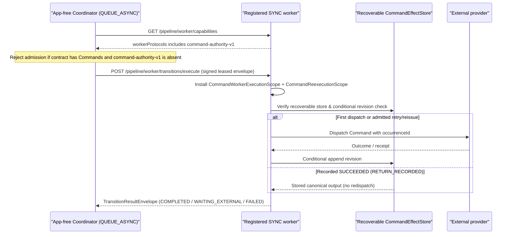

# ADR-0093: Registered SYNC transition workers execute admitted Commands under verified scope and recoverable store authority

## Context

In a separated Coordinator and worker topology, the shared `QUEUE_ASYNC` Coordinator owns durable execution records, leases, release pinning, Await admission, retries, and re-drive while keeping its classpath free of application DTOs, Connector implementations, and generated steps ([ADR-0089](./0089-typed-worker-operations-preserve-coordinator-authority.md)). Standalone registered transition workers run in `SYNC` mode (`pipeline.orchestrator.mode=SYNC` with `pipeline.orchestrator.worker.rest.server-enabled=true`) so they do not start a second Coordinator, claim queue leases, or hold Coordinator signing keys.

Previously, `CommandStepSupport` unconditionally rejected every mode other than `QUEUE_ASYNC`. A registered `SYNC` transition worker executing an admitted, leased segment from the shared Coordinator could not run ordinary `kind: command` steps or Command callback completions, even when configured with remote Await authority.

## Decision

Admitted, leased Command execution in registered `SYNC` transition workers is governed by a framework-owned worker Command authority contract across packaging, capability probing, admission, and execution:

1. **Verified leased worker scope (`CommandWorkerExecutionScope`)**:
   - `PipelineExecutionService` constructs and installs an immutable `CommandWorkerExecutionScope` (tenant, execution, pipeline, contract/release version, claimed execution version, transition key, leased segment step bounds, worker transport, artifact id, and artifact digest) **only** for portable remote transitions (`policy != IN_PROCESS`) when a remote worker server is enabled.
   - `CommandReexecutionScope` carries both retry/reissue admission and `CommandWorkerExecutionScope` in its `Snapshot`, preserving them across nested invocation snapshots, `CommandDeferredCompletionSupport` async Await calls, asynchronous `Uni<CommandDescriptor>` resolution, and `CommandEffectStore.find(...)` worker-pool hops.
   - Local and in-process calls clear any worker scope; unscoped `SYNC` invocations remain rejected.

2. **Explicit recoverable effect-store authority**:
   - In `SYNC` mode, `CommandStepSupport` requires both a present `CommandWorkerExecutionScope` matching `PipelineExecutionContext` and a single explicit recoverable `CommandEffectStore` (`supportsRecovery()`, `supportsNativeOutcomeSnapshots()`, `RETRY`, and `REISSUE`).
   - `InMemoryCommandEffectStore` and `pipeline.command.effect-store.provider=memory` are rejected unconditionally for admitted `SYNC` worker execution.
   - Local `QUEUE_ASYNC` behaviour remains unchanged.

3. **Capability advertisement and admission gating (`command-authority-v1`)**:
   - `RestTransitionWorkerResource` advertises `command-authority-v1` in `PipelineWorkerCapability.workerProtocols()` only when a remote worker server is enabled and wired to a single explicit recoverable `CommandEffectStore`.
   - `RegisteredRestWorkerTargets` checks whether the pinned Release contract contains any `kind: command` step (root or nested) and rejects workers lacking `command-authority-v1` during both availability/admission checks and transition dispatch.

4. **Release packaging and deployment enforcement**:
   - `AwsDurableHostedProfile.requireRestWorkerRelease` requires exactly one `aws:dynamodb:command-effects` binding on both the deployment and the `AWS_DURABLE_REST_WORKER` entry when the compiled contract contains `kind: command` steps (and zero otherwise).
   - `PipelineReleasePackageVerifier` verifies `META-INF/tpf/runtime-capabilities.properties` against that binding so packages built with the default in-memory store fail Release production before deployment.
   - `AwsDurableDeploymentConfigSourceFactory` maps optional `tpf.aws.durable.command-effect-table` to `pipeline.command.effect-store.*` for pinned workers.

## Rationale

Separating execution leasing (Coordinator) from external effect recording (worker's explicit recoverable `CommandEffectStore`) preserves the app-free Coordinator boundary without forcing applications to start a second Coordinator, distribute native signing keys to workers, disguise ordinary Commands as artificial Await boundaries, or weaken durability by accepting the default in-memory store.

## Consequences

- Ordinary `kind: command` steps and deferred Command/Await callbacks execute cleanly on registered `SYNC` REST workers while keeping the Coordinator free of application DTOs, Connector providers, and generated steps.
- Captured Command/occurrence/attempt identities, duplicate replay (`RETURN_RECORDED` / `FAIL`), deliberate `RETRY_FAILED_COMMAND` and `REISSUE_COMMAND` redrive, and uncertain `AMBIGUOUS` provider reconciliation preserve the guarantees of [ADR-0006](./0006-command-owns-logical-effects.md), [ADR-0018](./0018-command-effects-use-immutable-durable-revisions.md), [ADR-0025](./0025-command-reissue-uses-occurrence-identity.md), and [ADR-0037](./0037-command-deferred-completion-joins-effect-and-callback.md).
- Workers built with `pipeline.command.effect-store.provider=memory` fail closed at Release packaging, capability probing, admission, and execution time rather than silently losing effect history across restarts.
- `PipelineWorkerCapability` keeps its existing wire schema ([ADR-0050](./0050-remote-worker-protocols-are-shared-runtime-contracts.md)); `command-authority-v1` is advertised through the existing `workerProtocols` list.

## Related decisions

- [Command owns logical external effects](./0006-command-owns-logical-effects.md)
- [Command effects use immutable durable revisions](./0018-command-effects-use-immutable-durable-revisions.md)
- [Command reissue uses occurrence identity](./0025-command-reissue-uses-occurrence-identity.md)
- [Command deferred completion joins effect dispatch with correlated completion](./0037-command-deferred-completion-joins-effect-and-callback.md)
- [Shared remote-worker protocols](./0050-remote-worker-protocols-are-shared-runtime-contracts.md)
- [Typed worker operations preserve Coordinator authority](./0089-typed-worker-operations-preserve-coordinator-authority.md)
