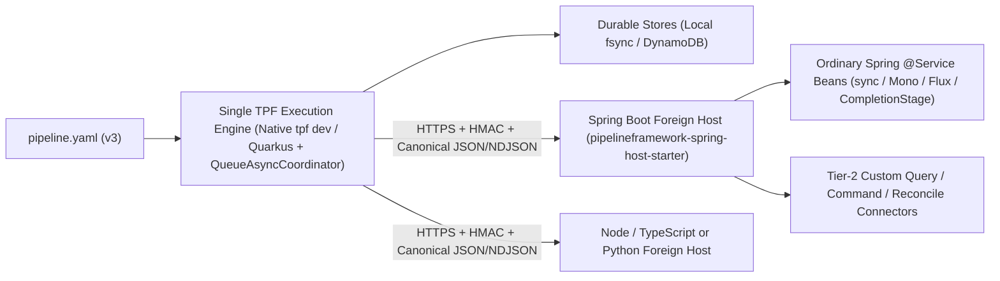

# ADR-0094: Non-Quarkus JVM frameworks integrate as ADR-0092 foreign function and connector hosts

## Context

Earlier portability work introduced a Spring-hosted runtime adapter (`pipelineframework-runtime-spring`)
and Spring-specific compiler renderers (`-Apipeline.codegen.rendererProfile=spring`) in an attempt to
re-host TPF's execution engine directly inside Spring Boot. Even after adding Spring-hosted polyglot
adapters (issue #1121), maintaining a second execution engine for Spring Boot — and potentially a third
or fourth for Micronaut, Helidon, or Ktor — recreates the exact structural maintenance multiplier that
[ADR-0092](./0092-polyglot-java-execution-engine-and-foreign-function-host.md) eliminated for Node and
Python:

1. Every JVM application framework would need its own durable coordinator wiring, Await suspension and
   resumption store, pre-send dispatch-intent ledger, Command effect reconciliation, Query capture and
   replay, streaming backpressure and cancellation, deterministic split/merge lineage, telemetry, and
   compiler renderer profile.
2. Spring Boot developers who already run Spring Data, Spring Security, Spring WebFlux, and ordinary
   `@Service` beans do not want a parallel generated code surface or a partial subset of TPF's durable
   runtime; they want full TPF durability (`ONE_TO_ONE`, `ONE_TO_MANY`, `MANY_TO_ONE`, `MANY_TO_MANY`
   full-duplex streaming, durable Await, Command reconciliation, Query capture, and `tpf dev` crash
   recovery) while keeping their business logic in plain Spring Boot beans with zero Quarkus, Vert.x,
   or Mutiny dependencies.

[ADR-0092](./0092-polyglot-java-execution-engine-and-foreign-function-host.md) already established that
TPF executes every polyglot pipeline on **one canonical Java execution engine** (Quarkus in production,
and the standalone native `tpf` CLI locally) invoking thin, authenticated Foreign Function & Connector
Hosts over HTTP/1.1 + HMAC-SHA256 + canonical JSON/NDJSON.

## Decision

Non-Quarkus JVM frameworks — starting with **Spring Boot** — integrate with TPF through the **ADR-0092
Foreign Function & Connector Host** model rather than re-hosting TPF's durable execution engine or
maintaining per-framework compiler renderer profiles.

### 1. Thin Spring Boot Foreign Function & Connector Host starter

TPF publishes `org.pipelineframework:pipelineframework-spring-host-starter` from
`pipelineframework-runtime`:

- Exposes the complete ADR-0092 Foreign Function Host contract:
  - `POST /tpf/functions/{stepId}` (`ONE_TO_ONE` canonical JSON)
  - `POST /tpf/functions/{stepId}/stream` (`ONE_TO_MANY` NDJSON with explicit `complete` sentinel)
  - `POST /tpf/functions/{stepId}/reduce` (`MANY_TO_ONE` chunked NDJSON request to JSON response)
  - `POST /tpf/functions/{stepId}/duplex` (`MANY_TO_MANY` true interleaved full-duplex chunked NDJSON)
- Exposes the complete ADR-0092 Tier-2 Custom Connector Host contract:
  - `POST /tpf/connector/auth/challenge` (mutual per-session HMAC loopback authentication)
  - `POST /tpf/connector/query/{operation}`
  - `POST /tpf/connector/command/{operation}/dispatch`
  - `POST /tpf/connector/command/{operation}/reconcile`
- Binds ordinary Spring `@Service` / `@Component` methods annotated with `@TpfFunction`,
  `@TpfQueryConnector`, `@TpfCommandConnector`, and `@TpfCommandReconciler` (supporting synchronous
  methods offloaded to Reactor's bounded elastic scheduler, `Mono`, `Flux`, `CompletionStage`,
  `Stream`, and `Iterable`).
- Preserves exact canonical `BigDecimal` precision (including trailing zeroes) and 64-bit `long`
  values without IEEE-754 rounding, maps `TpfBusinessRejectionException` and `TpfTransientException`
  to ADR-0092 portable failure dispositions, enforces strict secret isolation (pure business functions
  never receive connector credentials), and enforces HMAC-SHA256 signature, clock-skew, and nonce
  replay protection.
- Carries **zero Quarkus, Vert.x, Mutiny, CDI, or JAX-RS dependencies**, verified at build time via
  Maven Enforcer and classpath guard tests.

### 2. One execution engine, zero per-framework compiler renderer profiles

- Quarkus (in production) and the standalone native `tpf` executable (in local development) remain the
  single TPF execution engine owning graph sequencing, retries, streaming backpressure, durable Await
  suspension/resume, pre-send dispatch intents, Command reconciliation, Query capture/replay, and
  checkpoint handoff.
- The Spring host-parity direction (including `pipelineframework-runtime-spring`, Spring-hosted
  polyglot parity from issue #1121, Spring compiler renderers `rendererProfile=spring`, and Spring
  gRPC/REST host-parity smoke suites) is superseded by this decision and retired once the Spring Boot
  Foreign Host starter and end-to-end proofs are published.
- Future non-Quarkus JVM frameworks (such as Micronaut, Helidon, or Ktor) follow this same starter
  pattern over ADR-0092 rather than introducing new execution engines or compiler renderer profiles.

## Rationale

- **Full durable feature parity on day one:** Spring Boot applications immediately gain `ONE_TO_ONE`,
  `ONE_TO_MANY`, `MANY_TO_ONE`, `MANY_TO_MANY` full-duplex streaming, durable Await, Command
  reconciliation, Query capture, DynamoDB `QueueAsyncCoordinator`, and crash-safe `tpf dev` without
  re-implementing a single durable state machine in Spring.
- **Native Spring Boot ergonomics:** Teams keep ordinary `@SpringBootApplication`, Spring WebFlux,
  Spring Data, Spring Security, and `@Service` beans with zero Quarkus/Mutiny leakage and zero
  Spring-specific code generation.
- **Mixed-language and mixed-framework composition:** A single TPF pipeline can seamlessly compose
  Spring Boot steps alongside Quarkus steps, Node/TypeScript steps, and Python steps over one
  authenticated wire contract.
- **Bounded maintenance surface:** Compiler code generation and durable engine maintenance stay
  focused on one execution engine instead of multiplying per JVM framework.

## Consequences

- **`pipelineframework-runtime`:** Publishes `pipelineframework-spring-host-starter` with enforced
  zero-Quarkus/Vert.x/Mutiny dependency hygiene, then retires `pipelineframework-runtime-spring` and
  its Spring host-parity smoke modules.
- **`pipelineframework-compiler`:** Retires the `spring` renderer profile (`Spring*Renderer`,
  `SpringRendererProfileSupport`, `SpringGrpcUnaryProtoRenderer`) and simplifies target resolution
  and generation phases.
- **`pipelineframework-examples`:** Proves a real Spring Boot application using
  `pipelineframework-spring-host-starter` end-to-end against both `tpf dev` and production
  `QueueAsyncCoordinator` + LocalStack DynamoDB, and retires the superseded `spring-smoke-tests` and
  `spring-blocking-smoke-tests` modules.
- **`pipelineframework`:** Updates the BOM, `framework/public-artifacts.json`, and Spring/polyglot
  documentation to present the Foreign Function & Connector Host starter as the canonical Spring Boot
  integration path.

See [issue #1126](https://github.com/The-Pipeline-Framework/pipelineframework/issues/1126),
[ADR-0092](./0092-polyglot-java-execution-engine-and-foreign-function-host.md),
[Spring Boot Integration](/develop/spring-support), and
[Deploying Polyglot Applications](/deploy/polyglot).
