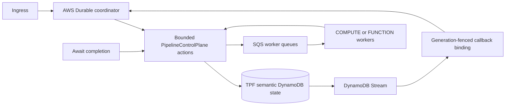
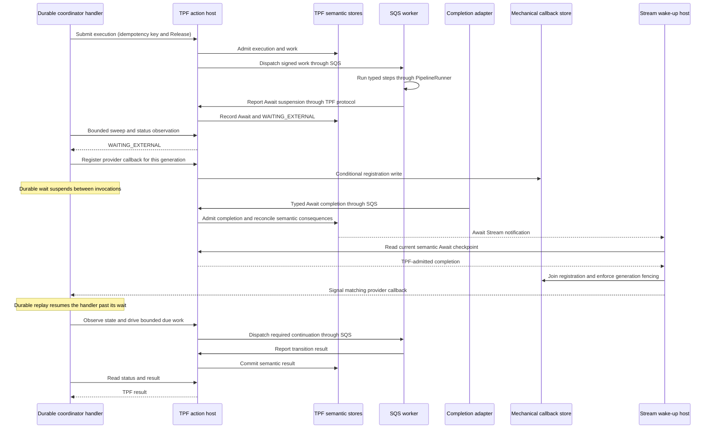
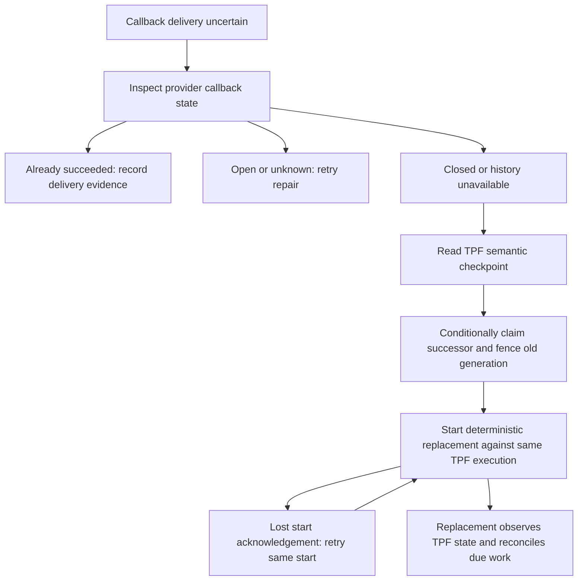
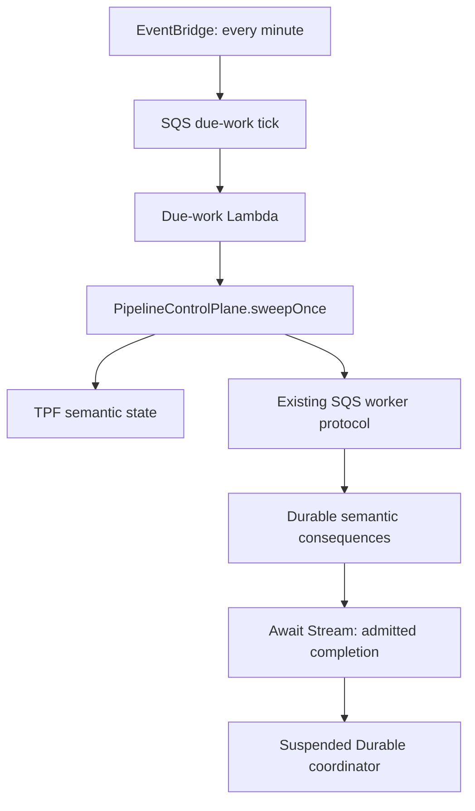

# AWS Durable Coordination

AWS Lambda Durable Functions is the preferred AWS coordination host for `QUEUE_ASYNC`. It owns mechanical orchestration liveness—checkpointing, suspension, wake-up, replay and retry timing—while TPF remains authoritative for execution identity, Await admission, release identity, transition commits, results, retry/DLQ evidence, uncertain outcomes and re-drive decisions.

The native coordinator remains the portable reference, conformance implementation and fallback. Selecting this host does not create a different execution model and does not change the meaning of `FUNCTION`.



## What the Durable function actually runs

The Durable function runs `AwsDurableCoordinatorHandler`, a small coordination
loop. It submits or resumes a TPF execution, calls bounded status/sweep actions,
waits for an Await wake-up when blocked, and reads the result when TPF reports
success. It does not run the application's typed business functions itself.
Those run on the workers through TPF's execution service and `PipelineRunner`.
See [the execution layers and their state](/architecture/state-model#from-running-steps-to-durable-coordination).

The following sequence shows one successful parked Await. Worker execution and
completion delivery can race callback registration; the Stream join handles either
arrival order. This is a responsibility diagram, not a guarantee that every Await
uses suspension: a live worker can also consume completions through a live Await
session.



A Lambda invocation can finish while the Durable execution remains waiting.
Resumption runs the handler using its recorded Durable operations. Calls that
reach TPF still rely on TPF's own stable identities and idempotent recovery;
provider history does not prove that every semantic consequence has finished.

## Recovery when provider history is lost

TPF's execution identity and pinned Release survive replacement of the provider
execution. The current recovery path reads the semantic Await checkpoint through
`PipelineControlPlane`, fences the old generation and starts a deterministic new
generation. It retries an uncertain start using the same identity.



This diagram describes the existing targeted replacement path when the required
mechanical locator and semantic checkpoint are available. Recovery after missing
mechanical rows and concurrent/itemised Await handling remain support gates below. A generation
claim alone does not finish recovery. Normal wake-up uses Streams; reconciliation
repairs exceptional failures.

## Dependencies and build selection

Import one `pipelineframework-bom` version. Declare the application runtime and AWS Durable host without versions; keep the compiler on the annotation-processor path using the BOM-managed version.

Use a published BOM version that manages the runtime, model, host, deployment and compiler artifacts together. If the documentation for this topology appears ahead of that coordinated release, it is not yet available to applications from the latest published BOM.

```xml
<dependencyManagement>
  <dependencies>
    <dependency>
      <groupId>org.pipelineframework</groupId>
      <artifactId>pipelineframework-bom</artifactId>
      <version>${tpf.version}</version>
      <type>pom</type>
      <scope>import</scope>
    </dependency>
  </dependencies>
</dependencyManagement>

<dependencies>
  <dependency>
    <groupId>org.pipelineframework</groupId>
    <artifactId>pipelineframework</artifactId>
  </dependency>
  <dependency>
    <groupId>org.pipelineframework</groupId>
    <artifactId>pipelineframework-aws-durable-coordination-host</artifactId>
  </dependency>
</dependencies>
```

Pass `-Apipeline.coordination.host=AWS_DURABLE` to compilation. The compiler requires `pipeline.platform=FUNCTION` and generates the application-specific input decoder consumed by the generic host handlers. The default is `NATIVE`.

The deployment artifact `pipelineframework-aws-durable-coordination-deployment` contains the reference SAM contract. It is a template resource, not an application runtime dependency.

## Deployment contract

Deploy these resources together:

- a versioned Lambda Durable coordinator and stable alias;
- a generated Quarkus action/worker package containing the application pipeline and generated input decoder;
- TPF semantic DynamoDB execution and Await stores, including execution-scoped Await lookup and an Await stream;
- the append-only callback binding table and its provider-execution index;
- SQS work, Await-completion and transition queues with DLQs;
- the Await/binding Stream wake-up handler and the bounded terminal reconciliation handler;
- alarms for worker DLQs and Stream failure destinations.

Set `pipeline.orchestrator.process-loops-disabled=true` in event-source-hosted Lambdas. This prevents native poll and sweep loops from competing with Lambda event sources. `PipelineControlPlane` actions remain available and initialise their providers without starting resident loops.

Keep each numbered Durable function version for at least the longest supported execution lifetime. New deployments move the alias for new executions; existing executions must retain their pinned code version and release identity.

The reference template retains the Durable function, numbered versions and callback binding table on stack deletion or replacement. Retained resources require explicit cleanup after all executions and their recovery windows have expired. Retain the compatible action and worker packages as well: a retained coordinator version alone does not protect an unqualified action target from a later deployment. Validate action-version and replacement-generation release compatibility before moving an alias.

### Semantic table upgrade

Before enabling the AWS Durable host against an existing Await interaction table, add these `ALL`-projected indexes and wait until both report `ACTIVE`:

| Index | Partition key | Sort key |
| --- | --- | --- |
| `await-interaction-by-execution` | `query_execution_key` (`S`) | `query_execution_sort` (`S`) |
| `await-interaction-continuation-work` | `query_continuation_key` (`S`) | `query_continuation_due_epoch_ms` (`N`) |

Backfill every non-expired interaction with its tenant-scoped execution key and deterministic execution sort key. For an already-completed item interaction, inspect the matching Await unit: when the unit has no durable continuation-completion fact for that item, write `query_continuation_key=ready`, a due timestamp and `continuation_attempt=1`; when the fact already exists, write `continuation_completed=true` without a ready key. New writes maintain these projections, and a duplicate completion conditionally repairs a missing ready projection, but neither mechanism can discover an older row that is absent from the new indexes.

Complete the backfill and verify the indexes before attaching the Await Stream event source or admitting new Durable executions. This keeps reconstruction and continuation discovery query-based; production hosts must not compensate with a table scan.

## Due work while the coordinator is suspended

The reference template sends an EventBridge tick to `DueWorkQueue` every minute.
`AwsDurableDueWorkHandler` invokes the existing bounded
`PipelineControlPlane.sweepOnce` action using fresh host time. TPF inspects its
semantic stores for expired Await interactions, due execution dispatch and durable
item-continuation work. No callback, tenant or execution identity in the tick body
can choose that work.



`DueWorkSweepLimit` defaults to 100 and accepts 1–1,000. It limits the existing
semantic sweep queries, rather than establishing a new deadline or retry policy.
The SQS event source caps delivery at two concurrent batches, and the dedicated
Lambda reserves two executions. Each batch contains one tick, with a 30-second
action wait inside its 120-second invocation timeout. Overlapping sweeps may
redispatch the same stable execution identity; the existing idempotent semantic
admission and continuation protocol handles that redelivery. Native
resident loops remain disabled. Duplicate and delayed ticks are harmless hints:
they re-inspect current semantic state, and future ticks rediscover unresolved work.
This periodic dispatch is normal liveness; provider-history reconciliation remains
exceptional repair.

EventBridge delivery retries for up to one hour and then sends failed deliveries
to `DueWorkDlq`. The tick queue has 720-second visibility, one-day retention and
redrives after five failed receives. Partial-batch failures leave unsuccessful
actions available for redelivery. Both failure paths use the same 14-day DLQ;
EventBridge delivery failures carry its error attributes, while consumer failures
retain the original tick. Inspect those attributes when responding to the DLQ alarm.
A queue-age alarm reports sustained age above three minutes. Subscribe the alarms
to the deployment's operational notification destination.

The due-work role accesses only the declared semantic tables/indexes and the
existing SQS work, transition-request and transition-response queues. It has no
callback-table or Durable API authority. Item continuation uses the application's
existing typed continuation handler and signed worker protocol; it does not invoke
business functions through AWS Durable directly. Use the same host with FUNCTION
or COMPUTE SQS workers where the current application protocol supports that placement.

Local handler tests cover fresh time, duplicates and failed delivery; existing
semantic tests cover timeout, dispatch and continuation convergence. Real-AWS
suspended-execution coverage remains a support gate. A semantic timeout can fail
the TPF execution while its provider callback is still waiting: prompt settlement
of that callback on terminal semantic status is not yet implemented. Keep the
configured provider execution timeout finite; do not interpret provider suspension
as an active TPF execution after semantic failure.

## Await callback binding

TPF-first admission is mandatory:

1. the Durable driver checkpoints the current semantic Await observation and its callback registration;
2. an immutable registration pins the callback to that interaction and a mechanical generation/occurrence;
3. TPF admits typed Await completion and releases the parent;
4. DynamoDB Streams join the admitted Await to the registration and wake the matching callback;
5. generation fencing prevents a stale execution from consuming a later wake-up.

Callback identifiers and provider execution ARNs are disposable hosting state. They never enter TPF Await records and cannot admit completion. Callback registration runs inside a Durable checkpointed step, while the binding store conditionally admits callback authority. The deployed proof injected failures after provider callback creation but before the mechanical registration write, and after the registration write but before the submitter checkpoint. Both windows recovered a mechanical correlation binding to the TPF Await. Recovery used provider history, Stream delivery and targeted reconciliation. This evidence does not establish submitter replay alone or a hard process kill at every window; see the [callback-window evidence](/evolve/durable-coordinator/durable-workflow-adapter-spike).

If provider history is unavailable or an execution closes before delivery, targeted reconciliation uses the provider-registration index and the TPF semantic checkpoint to start a replacement generation. Reconciliation is exceptional repair; Streams provide normal liveness and no broad scan is required.

The provider index is eventually consistent. Targeted reconciliation retries when a registration or required semantic checkpoint is unavailable, or replacement admission remains unresolved. The `provider-registration-index` uses `provider_execution_arn` as its partition key and `sk` as its sort key, with `ALL` projection. Its query selects the `REGISTRATION#` sort-key prefix before applying the result limit, so binding records cannot hide the registration or exhaust a page budget.

For an existing callback binding table, add this index and wait until it reports `ACTIVE` before upgrading the repair host. Existing records already contain both index keys and need no backfill. Keep the original `provider-execution-index` while retained host versions still use it.

### Stream source configuration

The wake-up handler requires the exact `TPF_AWS_DURABLE_AWAIT_STREAM_ARN` and `TPF_AWS_DURABLE_BINDING_STREAM_ARN`. The reference template sets these to the same ARNs used by its two event-source mappings. Keep the environment values and mappings aligned when a Stream is recreated; pause old mappings before replacing their source configuration. Unexpected sources and malformed interaction keys are reported as partial-batch failures.

Semantic Stream events identify an interaction through a runtime-owned DynamoDB key decoder. The host then calls the existing bounded `PipelineControlPlane.getAwaitSemanticCheckpoint(tenant, interaction)` read. The Stream image does not supply execution identity, correlation or completion authority. Missing semantic checkpoints and read failures remain retryable; `REMOVE` events do not admit completion. Mechanical registration events use their own decoder and never enter the semantic path.

### Generation authority upgrade

Generation claims and predecessor-successor fences are retained mechanical evidence, separate from disposable callback registrations and bindings. A replacement fences the old generation before its deterministic provider start. Registration and binding admission must condition on that authority atomically. If start acknowledgement is lost, retry the same replacement start; a generation claim alone does not complete recovery. The callback API cannot join the storage transaction, so a call already in flight may race replacement; TPF completion remains semantic authority.

Generation claims and fences do not inherit callback TTL. Remove them only after the execution and its recovery lifetime end. New installations can establish claims during registration. Existing live executions require a quiesced, validated claim-chain migration before enabling the fenced writers. The template requires `CallbackGenerationMigrationValidation=validated`, with no default, and rejects deployment without that attestation. Set it only after validating the migration, or confirming a fresh table has no retained executions; it does not inspect the table automatically. Keep unfenced retained action, wake-up and repair versions away from the upgraded table; a missing claim remains retryable rather than authorising a stale generation. Automated migration and retained-version coexistence must be validated before an in-place upgrade. Transaction conditions require scoped `dynamodb:ConditionCheckItem` alongside the existing callback-table write grants ([AWS transaction IAM rules](https://docs.aws.amazon.com/amazondynamodb/latest/developerguide/transaction-apis-iam.html)).

### Repeated Await and protocol upgrade

Each callback wait has a deterministic, positive occurrence number within its provider
generation. The driver records the observed interaction before registering its callback;
registration, binding, delivery evidence and callback signals carry that occurrence.
A late completion for an earlier interaction cannot bind or wake a later callback.
The receiver checks tenant, execution, interaction, correlation, generation, occurrence
and admitted completion status.

`PipelineControlPlane.getCurrentAwaitSemanticCheckpoint(tenant, execution)` follows the
execution's parked Await unit to its primary interaction through bounded point reads.
It retains a completed interaction while the parent is still `WAITING_EXTERNAL`:
completion can precede callback registration without losing the recovery locator.
This is a semantic observation of the execution's current wait, useful to native hosts
and status/recovery tooling as well. It accepts no AWS identities and exposes no
provider generation or backing-table schema. It does not enumerate concurrent items
or prove that the unit's consequences have finished.

Schema version 3 registrations store the pinned interaction, correlation and occurrence.
Occurrence one retains the existing `REGISTRATION#<padded-generation>` and
`GEN#<padded-generation>` keys; later occurrences append
`#OCCURRENCE#<padded-occurrence>`. Delivery evidence is also scoped to occurrence.
The provider-registration index reads descending keys to locate the latest registration.
Registration Stream repair reads the pinned interaction directly, including after
completion. Terminal repair reads the execution's current Await; if it has advanced,
the old callback is used only as a replacement locator and is never bound to the new
interaction.

The template requires `CallbackOccurrenceMigrationValidation=validated`, without a
default. Set it only for a fresh table, or after legacy callback executions drain and
old writers are quiesced or isolated on their original table. Retained coordinator,
action, wake-up and repair packages must use compatible protocols. Legacy registration
rows lack the pinned interaction and cannot be processed by the new registration
Stream or terminal repair path; no inferred backfill or automatic migration is provided.
Retained old callback signals and Durable checkpoints must not be replayed with the new
handler. The attestation does not inspect or migrate those resources.

Local tests cover sequential callback occurrences, late completion, completion before
registration, wrong wake-up identity, generation fencing and provider loss before a
later registration. Concurrent/itemised Await, complete recovery after lost mechanical
rows, migration tooling and real-AWS repeated-Await conformance remain support gates
in the [completion plan](/evolve/durable-coordinator/aws-durable-production-plan).

## Worker placement

SQS is the initial supported worker boundary because it preserves backpressure, redelivery, DLQ evidence and uncertain-outcome handling.

| Coordinator | Worker placement | Supported path |
| --- | --- | --- |
| Native | `COMPUTE` | Native loop hosts and bounded actions. |
| AWS Durable | `FUNCTION` | Lambda SQS event sources invoke the bounded work, Await and transition actions. |
| AWS Durable | `COMPUTE` | Compute pollers may consume the same signed SQS protocols when configured for the same release and secrets. |

Direct Durable-to-worker invocation is not supported. Worker placement remains orthogonal to coordination hosting.

## Operations and validation

Before promotion, validate the deployed region and account against the current Lambda Durable operation, duration, checkpoint-size and retention limits. Ensure SQS visibility exceeds worker timeout, set reserved/maximum concurrency deliberately, scope IAM to exact semantic resources, encrypt secrets, enable point-in-time recovery, and route every DLQ/Stream alarm to an owned response path.

For Lambda SQS event sources, configure visibility for at least six times the function timeout plus any batching window, following [AWS guidance](https://docs.aws.amazon.com/lambda/latest/dg/services-sqs-configure.html). The reference queues use this retry headroom and explicit encryption at rest. The Stream consumer requires a scoped send grant to its failure destination. Customer-managed keys, secret references, alarm routing and complete semantic provider configuration remain deployment-owned requirements.

The protected real-AWS conformance lane exercises callback/binding races, duplicate delivery, provider-history loss and expiry, generation replacement, worker failure, terminal Await result passthrough and cleanup. Ordinary repository verification remains deployment-free. Promotion requires that lane to pass against the exact runtime and compiler candidates.

For the ownership rationale, see [ADR-0069](/decisions/0069-aws-durable-hosts-mechanical-coordination).
