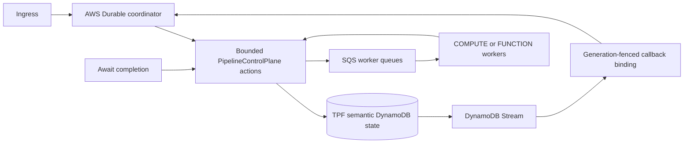
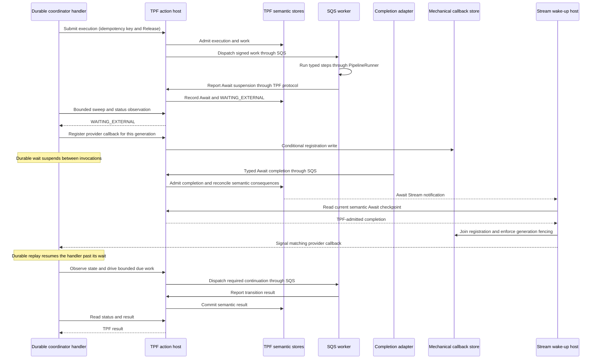
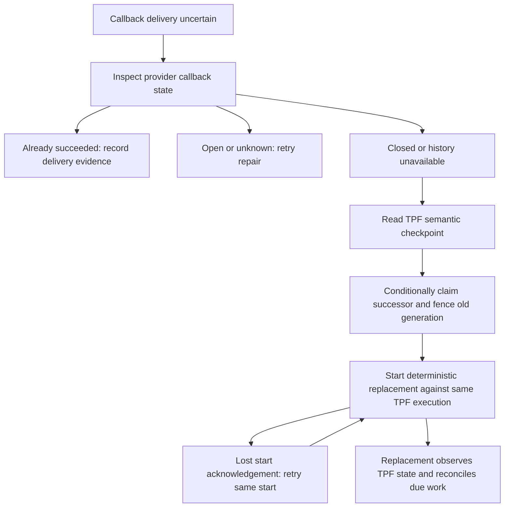
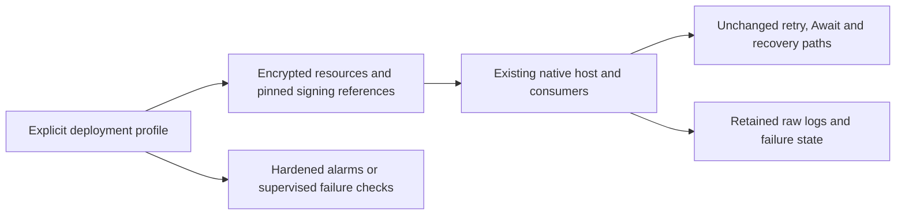

# AWS Durable Coordination

AWS Lambda Durable Functions is the preferred AWS coordination host for `QUEUE_ASYNC`. It owns mechanical orchestration liveness—checkpointing, suspension, wake-up, replay and retry timing—while TPF remains authoritative for execution identity, Await admission, release identity, transition commits, results, retry/DLQ evidence, uncertain outcomes and re-drive decisions.

The native coordinator remains the portable reference, conformance implementation and fallback. Selecting this host does not create a different execution model and does not change the meaning of `FUNCTION`.



## What the Durable function actually runs

The Durable function runs `AwsDurableCoordinatorHandler`, a small coordination
loop. It submits or resumes a TPF execution, calls bounded status/sweep actions,
waits for an Await wake-up when blocked, and reads the result when TPF reports
success. It does not run the application's typed business functions itself.
Those run on the workers through TPF's execution service and `PipelineRunner`.
See [the execution layers and their state](/architecture/state-model#from-running-steps-to-durable-coordination).

The following sequence shows one successful parked Await. Worker execution and
completion delivery can race callback registration; the Stream join handles either
arrival order. This is a responsibility diagram, not a guarantee that every Await
uses suspension: a live worker can also consume completions through a live Await
session.



A Lambda invocation can finish while the Durable execution remains waiting.
Resumption runs the handler using its recorded Durable operations. Calls that
reach TPF still rely on TPF's own stable identities and idempotent recovery;
provider history does not prove that every semantic consequence has finished.

## Recovery when provider history is lost

TPF's execution identity and pinned Release survive replacement of the provider
execution. Recovery reads current semantic state through `PipelineControlPlane`,
fences the old generation and starts a deterministic new generation. It retries
an uncertain start using the same identity.

The completion candidate retains a mechanical admission locator before submitting
to TPF and an execution locator after admission. If submission commits but its
acknowledgement or the later locator is lost, TPF resolves the existing execution
using its normalised client-key lookup. Recovery checks pipeline, contract and
Release identity before starting a replacement. An absent admission retries;
it does not permit another submission or re-drive. This path requires an explicit
client-key idempotency policy. Input-derived keys need a separately supported
recovery contract. The candidate remains subject to the production conformance
and coordinated release gates in the [production plan](/evolve/durable-coordinator/aws-durable-production-plan).



This diagram describes targeted replacement when both the retained locator
and semantic checkpoint are available. Loss of the retained locator, concurrent
completion and production conformance remain support gates below. A generation
claim alone does not finish recovery. Normal wake-up uses Streams; reconciliation
repairs exceptional failures.

## Dependencies and build selection

Import one `pipelineframework-bom` version. Declare the application runtime and AWS Durable host without versions; keep the compiler on the annotation-processor path using the BOM-managed version.

Use a published BOM version that manages the runtime, model, host, deployment and compiler artifacts together. If the documentation for this topology appears ahead of that coordinated release, it is not yet available to applications from the latest published BOM.

```xml
<dependencyManagement>
  <dependencies>
    <dependency>
      <groupId>org.pipelineframework</groupId>
      <artifactId>pipelineframework-bom</artifactId>
      <version>${tpf.version}</version>
      <type>pom</type>
      <scope>import</scope>
    </dependency>
  </dependencies>
</dependencyManagement>

<dependencies>
  <dependency>
    <groupId>org.pipelineframework</groupId>
    <artifactId>pipelineframework</artifactId>
  </dependency>
  <dependency>
    <groupId>org.pipelineframework</groupId>
    <artifactId>pipelineframework-aws-durable-coordination-host</artifactId>
  </dependency>
</dependencies>
```

Pass `-Apipeline.coordination.host=AWS_DURABLE` to compilation. The compiler requires `pipeline.platform=FUNCTION` and generates the application-specific input decoder consumed by the generic host handlers. The default is `NATIVE`.

The deployment artifact `pipelineframework-aws-durable-coordination-deployment` contains the reference SAM contract. It is a template resource, not an application runtime dependency.

For generated REST step hosts with `pipeline.platform=FUNCTION`, a finite
`ONE_TO_MANY` result is returned as one JSON array. The paired generated client
reads that array and restores the typed `Multi` used by the pipeline. Ordinary
`COMPUTE` REST step hosts retain their SSE response contract. This wire adaptation
does not change cardinality, Await identity or continuation semantics. The FUNCTION
bridge buffers to completion; it does not preserve incremental network delivery
or backpressure across this HTTP boundary.

The FUNCTION response must finish within the configured invocation/HTTP timeout
and fit the host's memory and response-payload limits. An infinite result cannot
complete this buffered bridge. Budget the entire JSON response, including the
Lambda HTTP envelope; this path uses the ordinary synchronous response, whose
[Lambda payload limit](https://docs.aws.amazon.com/lambda/latest/dg/gettingstarted-limits.html)
is 6 MB. Validate the generated server and matching client from the same release.


## Deployment contract

Deploy these resources together, applying the observation requirements for the selected profile:

- a versioned Lambda Durable coordinator and stable alias;
- a generated Quarkus action/worker package containing the application pipeline and generated input decoder;
- TPF semantic DynamoDB execution and Await stores, including execution-scoped Await lookup and an Await stream;
- the append-only callback binding table and its provider-execution index;
- SQS work, Await-completion and transition queues with DLQs;
- the Await/binding Stream wake-up handler and the bounded terminal reconciliation handler;
- for `HARDENED`, alarms for worker DLQs and Stream failure destinations with owned response routing; for `RESTRICTED_PILOT`, supervised failure checks for those same destinations.

Set `pipeline.orchestrator.process-loops-disabled=true` in event-source-hosted Lambdas. This prevents native poll and sweep loops from competing with Lambda event sources. `PipelineControlPlane` actions remain available and initialise their providers without starting resident loops.

Current itemised Await observation uses bounded pages of the current unit rather
than loading its entire interaction history. Carry the returned tenant/unit-bound
cursor into the next observation. The runtime rechecks indexed candidates through
an authoritative interaction read. Empty pages and exhausted cursors never prove
that parent consequences have finished. A scalar primary interaction remains
observable after completion while its parent is still waiting.

The hardened deployment contract requires explicit semantic provider/table inputs,
an owned notification topic and validated quota, region, encryption and retained
release preflight. The preflight attestation performs no AWS checks itself. Signing
secrets use exact Secrets Manager ARNs and immutable VersionIds, resolved at host
startup; each value is a raw SecretString of at least 32 characters. Supply access
sets containing both current and retained secret/key ARNs. Retain the secret
versions, signing CMKs, semantic resources and artifact access required by every
recoverable execution. Moving `AWSCURRENT` does not establish retained-version
compatibility.

Select exactly one `FUNCTION` or `COMPUTE` transition consumer. `COMPUTE` disables
the transition Lambda mapping and requires a separately validated SQS consumer
with the same pinned release, signing and retry/DLQ protocol. Both placements remain
subject to exact-candidate production conformance.

Supply `CompletionReleaseLatencyAlarmMilliseconds` and
`CallbackResumeLatencyAlarmMilliseconds`, together with
`RepairAgeAlarmMilliseconds`, explicitly for the reference template;
choose thresholds for the application's latency objective. Their alarms use
sampled observations and the owned notification topic. Configure
`OutstandingCompletionObservationAlarmCount` for scoped OUTSTANDING observations
in a five-minute window (default 100). Repeated reads count separately; this
alarm reports observed unresolved completions rather than population size.
Missing samples do not establish global zero or health. Callback timing starts at the host's normal callback-success
API return and ends at its first verified resumed-action observation. This is
not a provider event timestamp: the response can arrive after the resumed action,
and different host clocks can disagree. Negative ordering is UNKNOWN; lost API
acknowledgements and history-only delivery can leave no sample. A crash after the
immutable measurement claim can also lose external metric publication.

Targeted repair samples age from its first retained host observation of that exact
provider execution. Retried deliveries and host restarts preserve this timestamp;
it does not reconstruct the original provider failure time or older attempts.
Missing or invalid timestamps produce UNKNOWN. Samples stop when attempts stop,
including retry exhaustion; inspect the repair DLQ and its separate alarm.
The immutable observation has no callback TTL and supplies neither a complete
open-repair inventory nor cleanup authority. Preserve it with the execution's
mechanical recovery evidence until reviewed retention cleanup. An accepted
replacement does not establish semantic convergence.

Keep each numbered Durable function version for at least the longest supported execution lifetime. New deployments move the alias for new executions; existing executions must retain their pinned code version and release identity.

The reference template retains the Durable function, numbered versions and callback binding table on stack deletion or replacement. Retained resources require explicit cleanup after all executions and their recovery windows have expired. Retain the compatible action and worker packages as well: a retained coordinator version alone does not protect an unqualified action target from a later deployment. Validate action-version and replacement-generation release compatibility before moving an alias.

Each host writes through `LoggingConfig.LogGroup` to its retained, encrypted group
under `/tpf/aws-durable/<stack-name>/<stack-instance>/<host>`. The stack-instance suffix
comes from `AWS::StackId`, so updates preserve the destination and a newly created stack
uses a separate name. Existing Lambda-created `/aws/lambda/...` groups remain available
for historical logs. For `HARDENED`, authorise CloudWatch Logs to use the host KMS
key for the new group ARNs before upgrading. `RESTRICTED_PILOT` retains
service-default log encryption and requires no host-CMK authorisation for its log groups.
Retain old groups through the recovery window before cleanup.
Function retention and cleanup requirements above still apply.

### Experimental pinned SSM signing source

::: warning Source candidate, not a supported deployment profile
The [runtime SSM reader](https://github.com/The-Pipeline-Framework/pipelineframework-runtime/pull/61)
is merged and published. Reader availability alone does not establish a verified
AWS Durable deployment profile. The published runtime63 hardened SAM template and v1 deployment
manifest still require Secrets Manager. Do not substitute SSM parameters into
those inputs or treat a successful reader unit test as deployment acceptance.
:::

The reader supports an explicit `tpf.aws.durable.signing-source=SSM_STANDARD`
selection to the existing host configuration source. Leaving that property unset,
or selecting `SECRETS_MANAGER`, preserves the existing Secrets Manager path.
The SSM selection requires two distinct full parameter ARNs and exact positive
numeric versions, in addition to the other validated deployment settings:

```properties
tpf.aws.durable.signing-source=SSM_STANDARD
tpf.aws.durable.resume-token-parameter-arn=arn:aws:ssm:eu-west-1:123456789012:parameter/example/resume-token
tpf.aws.durable.resume-token-parameter-version=7
tpf.aws.durable.worker-parameter-arn=arn:aws:ssm:eu-west-1:123456789012:parameter/example/worker
tpf.aws.durable.worker-parameter-version=9
```

These values identify keys; they do not contain key material. Parameter names
without full ARNs, labels, floating versions, mixed SSM/Secrets Manager references,
and literal or environment-backed signing keys are rejected before a provider read.
The reader requests each exact version with decryption and validates the returned
ARN, name, version, `SecureString` type and value. Each nonblank value must contain
at least 32 characters and occupy at most 4,096 UTF-8 bytes. Neither key enters
the returned runtime configuration unless both reads succeed. Provider failures
exclude response text and causes that could contain sensitive values.

`deployment-validation=validated` remains an external preflight attestation. The
reader does not verify Standard tier, IAM isolation, version retention or
authenticated deployment-manifest provenance. A supported SSM profile must verify
those properties for both exact ARN/version pairs, preserve versions required by
recoverable executions and retained Lambda versions, and pass real AWS recovery
and isolation checks. Keep values out of configuration, Terraform state, logs
and manifests. The source name alone establishes neither cost nor account-specific
free-tier availability.

### Restricted pilot deployment profile

::: warning Deployment qualification remains separate
The same-host `RESTRICTED_PILOT` profile is a deployment-contract extension being
qualified alongside Cloud integration. Its conditional template and local checks
do not establish signed publication, actual account/IAM configuration, live event
delivery, recovery conformance or unattended production suitability. Select an exact
published deployment artifact that includes this profile before using it; the
runtime63 schema1 template cannot accept these inputs. No alternative host or
consumer implementation is required.
:::

`HARDENED` remains the default. The restricted profile changes encryption and
observation choices for a **fresh, isolated, supervised FUNCTION deployment**;
it retains the native handlers and mechanical recovery model.

| Concern | `HARDENED` | `RESTRICTED_PILOT` |
| --- | --- | --- |
| Signing authority | Exact Secrets Manager ARN/VersionId and retained CMK access | Existing SSM reader; distinct Standard SecureString purpose/generation parameters, `aws/ssm`, exact version 1 |
| Callback table, Lambda environment/Durable state and logs | Customer-managed encryption keys | Encrypted service defaults |
| External semantic tables and release/result objects | Explicit scoped CMKs | Verified AWS-owned DynamoDB encryption and S3-managed SSE-S3; retain the same indexes, Streams, versioning and recovery data |
| Queues other than EventBridge destinations | Host CMK | Explicit SSE-SQS |
| EventBridge destination queues | Host CMK | Retain a compatible CMK for `DueWorkQueue`, `DueWorkDlq` and `RepairFailureDlq` |
| Notification alarms | All 64 alarm resources and owned SNS destination | No alarm resources or unused SNS destination; supervised failure checks remain required |

The existing due-work rule, terminal-reconciliation rule, all seven mappings,
numbered versions, leases, retry/exhaustion behaviour, DLQs, Streams and retained
state remain. Due-work delivery keeps its one-minute rate, ten retries and
3,600-second age limit; terminal delivery keeps five retries and the same age
limit. Notification alarms do not drive those recovery paths. Keep admission
closed outside the supervised operating window, and retain actual failure,
pause/restore and recovery evidence. No successful deployment replaces the
separate fault-conformance catalogue.



Set `DeploymentProfile=RESTRICTED_PILOT`, `SigningSource=SSM_STANDARD`,
`RestrictedPilotValidation=validated` and
`SigningParameterLifecycleValidation=validated` only after the owner checks pass.
Supply `ResumeTokenParameterArn`/`ResumeTokenParameterVersion`,
`WorkerSharedParameterArn`/`WorkerSharedParameterVersion` and
`SigningParameterAccessArns`. Each current parameter name follows
`/tpf/durable/<scope>/<resume-token|worker>/g-<generation-hex>` and uses version `1`.
The retained access set includes every older generation still needed by retained
releases and executions. Rotation creates a new parameter name, not another
version of the old parameter: Standard Parameter Store can evict older versions
after repeated updates. Deny overwrite, deletion and recreation of held names;
verify the actual IAM boundaries, metadata and retained obligations before
admission. An offline owner receipt checks consistency; it does not enforce IAM.

The owner verifies **Standard**, **SecureString**, the actual `aws/ssm` key and
the account's accepted IAM-only signing boundary. The AWS-managed key does not
provide a customer-controlled key policy that isolates these signing values from
other authorised account principals. Restrict all applicable parameter-read,
history and path APIs, and separate provisioning/retirement authority from runtime
readers. Keep secret values out of Terraform state, source, ordinary environment
configuration, manifests and logs. Direct environment signing values remain
unsupported by this pinned deployment contract.

The restricted profile uses explicit empty inputs for the unused SNS destination,
Secrets Manager signing references and semantic/signing CMK access sets. The host
CMK input remains real and retained for EventBridge delivery. Do not use dummy
ARNs, disable queue encryption or remove a failure destination to reduce cost.
EventBridge rules do not support AWS-owned encrypted SQS targets **or target
DLQs**; changing the due-work scheduler alone would leave the terminal rule's
failure destination unresolved. [AWS EventBridge target constraints](https://docs.aws.amazon.com/eventbridge/latest/userguide/eb-targets.html).

`RuntimePermissionsBoundaryArn` optionally supplies one existing, same-account
customer-managed IAM policy as the permissions boundary on all six native runtime
roles. Its empty default preserves deployments that do not select a boundary.
The policy is a maximum permission set, not a grant: each role still needs its
existing identity policies, service policies and resource permissions. A boundary
on the CloudFormation execution role is not inherited by the roles it creates.

For every principal that can manage runtime roles, including deployment
credentials and any CloudFormation execution role, require the exact boundary
through `iam:PermissionsBoundary` on `iam:CreateRole`. Constrain any allowed
`iam:PutRolePermissionsBoundary` to that same policy ARN using the same condition,
and deny `iam:DeleteRolePermissionsBoundary`. Keep changes to the boundary policy itself
outside those principals. The infrastructure owner must
retain the policy and check that its maximum permits the selected release's
checkpoint, action, Await, queue, semantic-store, signing, logging and recovery
operations. A restricted notification profile does not relax that requirement.
[AWS permissions-boundary behaviour](https://docs.aws.amazon.com/IAM/latest/UserGuide/access_policies_boundaries.html).

Validate the parameter against the actual account before deployment, then read
back `PermissionsBoundary.PermissionsBoundaryArn` on all six created roles and
verify their CloudFormation membership. The optional offline preflight
`--account-id` checks the selected ARN's account; it does not read IAM, prove the
policy's contents or authorise deployment. The deployment manifest remains
schema2: verify the actual selected template and parameters rather than assuming
that the boundary appears as an additional manifest field. Retained versions
must keep the authority needed to finish and recover their work.

Both new profiles emit deployment manifest **schema2**, preserving release,
publication, code/version, queue/mapping and owner identities. It adds explicit
`deploymentProfile`, `observability`, `scheduleProvider`, `encryption` and ten
actual `logGroupNames` references. `signing.source` discriminates Secrets Manager
`{arn, versionId}` from SSM `{arn, version: 1}` with tier, type, key kind, immutable
generation lifecycle and retained parameter references. Consumers must verify the
actual template, parameters, numbered function configuration and CFN membership;
do not reinterpret a schema1 manifest as the new profile. Existing schema1
hardened publications retain their established scope.

Alarm omission does not stop Embedded Metric Format extraction. An account logging
administrator may separately qualify a policy that disables extraction for the
exact owned log groups while keeping the raw EMF events. Never grant this
account-administration permission to workload code or disable other applications'
metrics. [AWS metric-extraction policies](https://docs.aws.amazon.com/AmazonCloudWatchLogs/latest/APIReference/API_PutAccountPolicy.html).

These choices remove most fixed charges but do not promise a zero bill. A retained
customer-managed key has a monthly charge; rotation can add retained key material
charges. SQS empty receives, minute recovery, retained data/PITR/logs and key/API
calls remain usage, sharing account-level free allowances. The infrastructure
owner must verify account eligibility, actual policies, limits and costs before
deployment. Never delete recoverable generations or disable recovery to meet an
idle-cost target.

### Semantic table upgrade

Before enabling the AWS Durable host against an existing Await interaction table, add these `ALL`-projected indexes and wait until both report `ACTIVE`:

| Index | Partition key | Sort key |
| --- | --- | --- |
| `await-interaction-by-execution` | `query_execution_key` (`S`) | `query_execution_sort` (`S`) |
| `await-interaction-continuation-work` | `query_continuation_key` (`S`) | `query_continuation_due_epoch_ms` (`N`) |

Backfill every non-expired interaction with its tenant-scoped execution key and deterministic execution sort key. For an already-completed item interaction, inspect the matching Await unit: when the unit has no durable continuation-completion fact for that item, write `query_continuation_key=ready`, a due timestamp and `continuation_attempt=1`; when the fact already exists, write `continuation_completed=true` without a ready key. New writes maintain these projections, and a duplicate completion conditionally repairs a missing ready projection, but neither mechanism can discover an older row that is absent from the new indexes.

Timeout recovery also uses the existing `await-interaction-pending-by-deadline`
index, with a separate `TIMEOUT_CONSEQUENCES` partition. New timeout transitions
retain pending consequences atomically. Recovery acknowledges the projection
only after unit/admission state, parent state and required journal facts converge.
An interaction's terminal status alone does not establish that its parent has
settled. Recovery is limited to the configured semantic retention horizon.

Older timed-out records lack this projection. Before rollout, drain/isolate the
old release or review a native repair that verifies the original timeout identity
and rebuilds only unfinished consequences. No automatic historical repair or
retention extension is supplied. Retain the matching semantic stores and journal
through the recovery horizon.

Complete the backfill and verify the indexes before attaching the Await Stream event source or admitting new Durable executions. This keeps reconstruction and continuation discovery query-based; production hosts must not compensate with a table scan.

The completion-lifecycle candidate additionally requires an externally owned
`AwaitCompletionLifecycleTable`, configured as
`pipeline.orchestrator.dynamo.await-completion-lifecycle-table`. It uses string
`pk`/`sk` keys, `ttl_epoch_s` for positive expiry only, PITR and deletion protection.
Native admission and parent-release transactions use it for immutable first facts
and a bounded tenant-scoped outstanding projection. Supply the exact table ARN
through the semantic action role's transaction permissions; the wake-up role
continues to consume semantic observations.

The coordinated lifecycle candidate binds each Await unit and release acknowledgement
to the execution's retained occurrence cause and page scope. An authorized Command
reissue creates a fresh cause; retry preserves it. Local native-store regressions
verify that an old release acknowledgement cannot retire the new admission.

Production rollout still requires the coordinated compatibility set and migration
validation. Legacy records without occurrence coverage remain UNKNOWN and retain
unresolved outstanding work. Older facts cannot acquire historical admission times
or causal coverage through clock or membership backfill. Keep existing releases
isolated until the [production gates](/evolve/durable-coordinator/aws-durable-production-plan)
pass.

## Await callback binding

TPF-first admission is mandatory:

1. the Durable driver checkpoints the current semantic Await observation and its callback registration;
2. an immutable registration pins the callback to that interaction and a mechanical generation/occurrence;
3. TPF admits typed Await completion and releases the parent;
4. DynamoDB Streams join the admitted Await to the registration and wake the matching callback;
5. generation fencing prevents a stale execution from consuming a later wake-up.

Callback identifiers and provider execution ARNs are disposable hosting state. They never enter TPF Await records and cannot admit completion. Callback registration runs inside a Durable checkpointed step, while the binding store conditionally admits callback authority. The deployed proof injected failures after provider callback creation but before the mechanical registration write, and after the registration write but before the submitter checkpoint. Both windows recovered a mechanical correlation binding to the TPF Await. Recovery used provider history, Stream delivery and targeted reconciliation. This evidence does not establish submitter replay alone or a hard process kill at every window; see the [callback-window evidence](/evolve/durable-coordinator/durable-workflow-adapter-spike).

If provider history is unavailable or an execution closes before delivery, targeted reconciliation uses the provider-registration index and the TPF semantic checkpoint to start a replacement generation. Reconciliation is exceptional repair; Streams provide normal liveness and no broad scan is required.

The provider index is eventually consistent. Targeted reconciliation retries when a registration or required semantic checkpoint is unavailable, or replacement admission remains unresolved. The `provider-registration-index` uses `provider_execution_arn` as its partition key and `sk` as its sort key, with `ALL` projection. Its query selects the `REGISTRATION#` sort-key prefix before applying the result limit, so binding records cannot hide the registration or exhaust a page budget.

For an existing callback binding table, add this index and wait until it reports `ACTIVE` before upgrading the repair host. Existing records already contain both index keys and need no backfill. Keep the original `provider-execution-index` while retained host versions still use it.

### Stream source configuration

The wake-up handler requires the exact `TPF_AWS_DURABLE_AWAIT_STREAM_ARN` and `TPF_AWS_DURABLE_BINDING_STREAM_ARN`. The reference template sets these to the same ARNs used by its two event-source mappings. Keep the environment values and mappings aligned when a Stream is recreated; pause old mappings before replacing their source configuration. Unexpected sources and malformed interaction keys are reported as partial-batch failures.

Semantic Stream events identify an interaction through a runtime-owned DynamoDB key decoder. The host then calls the existing bounded `PipelineControlPlane.getAwaitSemanticCheckpoint(tenant, interaction)` read. The Stream image does not supply execution identity, correlation or completion authority. Missing semantic checkpoints and read failures remain retryable; `REMOVE` events do not admit completion. Mechanical registration events use their own decoder and never enter the semantic path.

### Generation authority upgrade

Generation claims and predecessor-successor fences are retained mechanical evidence, separate from disposable callback registrations and bindings. A replacement fences the old generation before its deterministic provider start. Registration and binding admission must condition on that authority atomically. If start acknowledgement is lost, retry the same replacement start; a generation claim alone does not complete recovery. The callback API cannot join the storage transaction, so a call already in flight may race replacement; TPF completion remains semantic authority.

Generation claims and fences do not inherit callback TTL. Remove them only after the execution and its recovery lifetime end. New installations can establish claims during registration. Existing live executions require a quiesced, validated claim-chain migration before enabling the fenced writers. The template requires `CallbackGenerationMigrationValidation=validated`, with no default, and rejects deployment without that attestation. Set it only after validating the migration, or confirming a fresh table has no retained executions; it does not inspect the table automatically. Keep unfenced retained action, wake-up and repair versions away from the upgraded table; a missing claim remains retryable rather than authorising a stale generation. Automated migration and retained-version coexistence must be validated before an in-place upgrade. Transaction conditions require scoped `dynamodb:ConditionCheckItem` alongside the existing callback-table write grants ([AWS transaction IAM rules](https://docs.aws.amazon.com/amazondynamodb/latest/developerguide/transaction-apis-iam.html)).

### Repeated Await and protocol upgrade

Each callback wait has a deterministic, positive occurrence number within its provider
generation. The driver records the observed interaction before registering its callback;
registration, binding, delivery evidence and callback signals carry that occurrence.
A late completion for an earlier interaction cannot bind or wake a later callback.
The receiver checks tenant, execution, interaction, correlation, generation, occurrence
and admitted completion status.

`PipelineControlPlane.getCurrentAwaitSemanticCheckpoint(tenant, execution)` follows the
execution's parked Await unit to its primary interaction through bounded point reads.
It retains a completed interaction while the parent is still `WAITING_EXTERNAL`:
completion can precede callback registration without losing the recovery locator.
This is a semantic observation of the execution's current wait, useful to native hosts
and status/recovery tooling as well. It accepts no AWS identities and exposes no
provider generation or backing-table schema. It does not enumerate concurrent items
or prove that the unit's consequences have finished.

Schema version 3 registrations store the pinned interaction, correlation and occurrence.
Occurrence one retains the existing `REGISTRATION#<padded-generation>` and
`GEN#<padded-generation>` keys; later occurrences append
`#OCCURRENCE#<padded-occurrence>`. Delivery evidence is also scoped to occurrence.
The provider-registration index reads descending keys to locate the latest registration.
Registration Stream repair reads the pinned interaction directly, including after
completion. Terminal repair reads the execution's current Await; if it has advanced,
the old callback is used only as a replacement locator and is never bound to the new
interaction.

The template requires `CallbackOccurrenceMigrationValidation=validated`, without a
default. Set it only for a fresh table, or after legacy callback executions drain and
old writers are quiesced or isolated on their original table. Retained coordinator,
action, wake-up and repair packages must use compatible protocols. Legacy registration
rows lack the pinned interaction and cannot be processed by the new registration
Stream or terminal repair path; no inferred backfill or automatic migration is provided.
Retained old callback signals and Durable checkpoints must not be replayed with the new
handler. The attestation does not inspect or migrate those resources.

Local tests cover sequential callback occurrences, late completion, completion before
registration, wrong wake-up identity, generation fencing and provider loss before a
later registration. Concurrent/itemised Await, complete recovery after lost mechanical
rows, migration tooling and real-AWS repeated-Await conformance remain support gates
in the [completion plan](/evolve/durable-coordinator/aws-durable-production-plan).

## Worker placement

SQS is the initial supported worker boundary because it preserves backpressure, redelivery, DLQ evidence and uncertain-outcome handling.

| Coordinator | Worker placement | Supported path |
| --- | --- | --- |
| Native | `COMPUTE` | Native loop hosts and bounded actions. |
| AWS Durable | `FUNCTION` | Lambda SQS event sources invoke the bounded work, Await and transition actions. |
| AWS Durable | `COMPUTE` | Compute pollers may consume the same signed SQS protocols when configured for the same release and secrets. |

Direct Durable-to-worker invocation is not supported. Worker placement remains orthogonal to coordination hosting.

## Operations and validation

Before promotion, validate the deployed region and account against the current Lambda Durable operation, duration, checkpoint-size and retention limits. Ensure SQS visibility exceeds worker timeout, set reserved/maximum concurrency deliberately, scope IAM to exact semantic resources, encrypt secrets, and enable point-in-time recovery. For `HARDENED`, route every DLQ/Stream alarm to an owned response path; for `RESTRICTED_PILOT`, validate supervised failure checks for those same destinations.

For Lambda SQS event sources, configure visibility for at least six times the function timeout plus any batching window, following [AWS guidance](https://docs.aws.amazon.com/lambda/latest/dg/services-sqs-configure.html). The reference queues use this retry headroom and explicit encryption at rest. The Stream consumer requires a scoped send grant to its failure destination. The selected profile's customer-managed keys, secret references and complete semantic provider configuration remain deployment-owned requirements. `HARDENED` also requires owned alarm routing; `RESTRICTED_PILOT` requires supervised failure checks.

The protected real-AWS conformance lane exercises callback/binding races, duplicate delivery, provider-history loss and expiry, generation replacement, worker failure, terminal Await result passthrough and cleanup. Ordinary repository verification remains deployment-free. Promotion requires that lane to pass against the exact runtime and compiler candidates.

For the ownership rationale, see [ADR-0069](/decisions/0069-aws-durable-hosts-mechanical-coordination).
