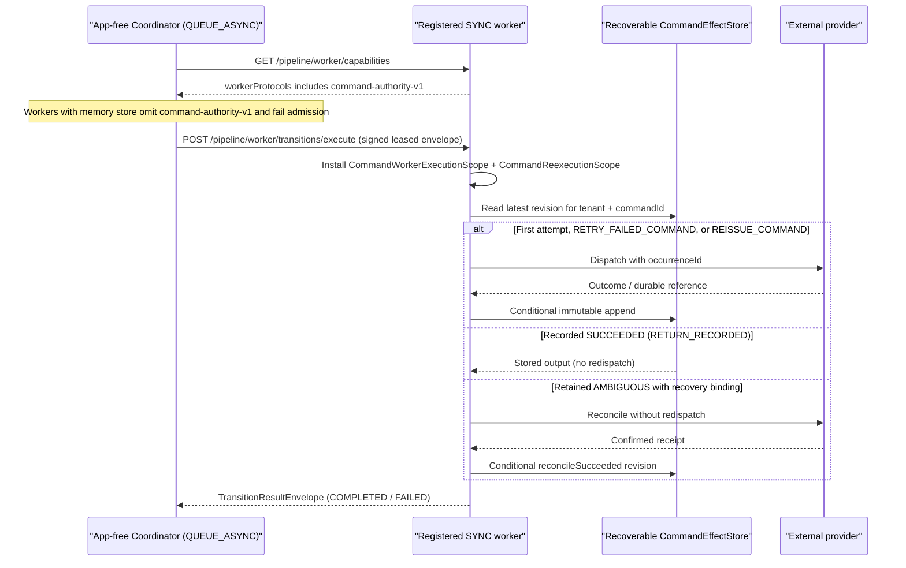
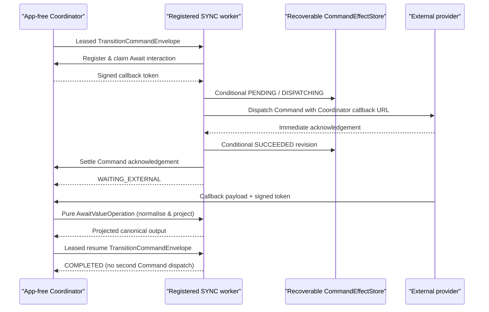
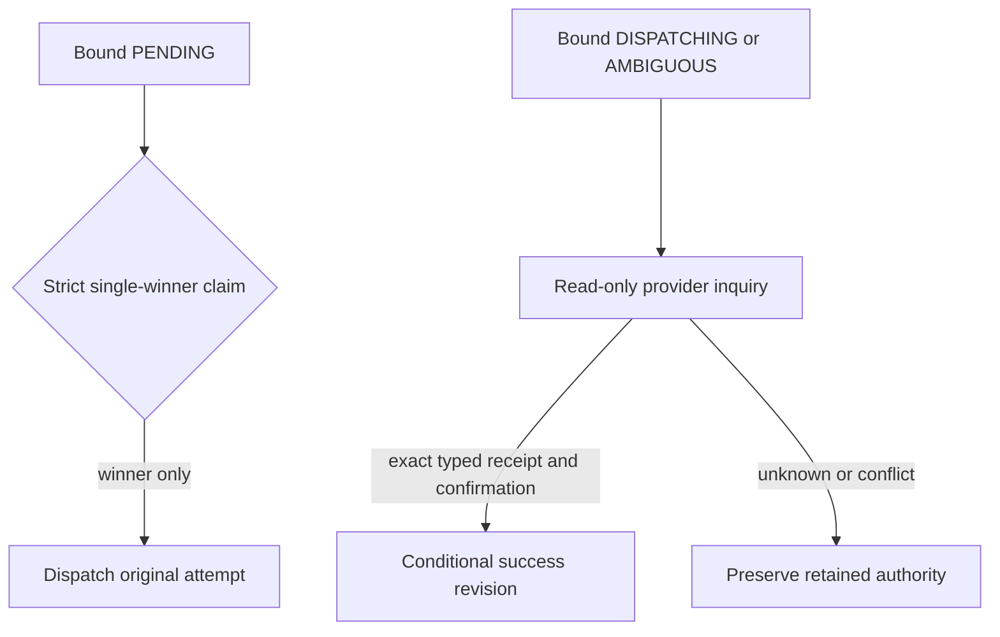

# Command Steps

Command steps record and dispatch external writes from a `QUEUE_ASYNC` pipeline, or from a registered `SYNC` transition worker executing an admitted leased segment on behalf of a shared `QUEUE_ASYNC` Coordinator. Use them when a retry or replay must not blindly call the external system again.

Start here when you need to declare a command step in `pipeline.yaml`. For connector code, see [Writing Command Connectors](/develop/extension/command-connectors). For runtime signals, see [Replay & Live Topology](/operate/observability/replay) and [Metrics](/operate/observability/metrics).

## When To Use

Use `kind: command` when the step:

1. writes to an external system,
2. has a deterministic command id,
3. needs duplicate handling on replay,
4. should record the external write result as pipeline output.

Good fits include search indexing, ticket creation, email submission, provider provisioning, or payment-provider commands with idempotency keys.

For application logic that does not need an effect record, keep using a normal `ReactiveService`, operator, or generated adapter. If the external system completes later through a callback, broker response, or human action, configure [Await Runtime Setup](/deploy/orchestrator-runtime/await). When a completed pipeline hands work to another pipeline, model that boundary with [Checkpoint Handoff](/deploy/orchestrator-runtime/checkpoint-handoff).

## YAML

V1 command steps are `ONE_TO_ONE` and require either `QUEUE_ASYNC` mode or an admitted, leased transition-worker segment backed by an explicit recoverable `CommandEffectStore`. Unscoped direct `SYNC` calls remain rejected.

```yaml
steps:
  - name: "Write Search Index Document"
    kind: "command"
    command: "opensearch-index-document"
    cardinality: "ONE_TO_ONE"
    input: "org.pipelineframework.search.common.domain.SearchIndexDocument"
    output: "org.pipelineframework.search.common.domain.SearchIndexWriteResult"
    commandIdGenerator: "org.pipelineframework.search.common.command.SearchIndexDocumentCommandIdGenerator"
    duplicatePolicy: "RETURN_RECORDED"
```

The authored step names the command and the typed input/output contract. Provider details such as endpoint, credentials, index name, timeout, and provider retry tuning belong in runtime configuration.

For a native Connector Provider, declare a named configured instance separately from the operation:

```yaml
connectors:
  search:
    provider: acme.search
    version: 1
    config:
      connection: search-primary

steps:
  - name: "Write Search Index Document"
    kind: command
    operation: write.document
    using: search
    input: SearchIndexDocument
    output: SearchIndexWriteResult
    java:
      input: org.example.SearchIndexDocument
      output: org.example.SearchIndexWriteResult
    commandIdGenerator: org.example.SearchIndexDocumentCommandIdGenerator
    config:
      index: orders
```

The `search` binding starts once and may be reused by several Command operations. Its `config` is
provider-level configuration. The step `config` is operation-level configuration. Static provider
metadata validates both scopes during compilation without constructing the provider or resolving
connection and secret references.

## Callback Completion

Version 3 operation-first Commands may select one callback declared by their
provider. The operation remains `ONE_TO_ONE` and runs either in `QUEUE_ASYNC`
mode or on a registered `SYNC` transition worker configured with both remote
Await authority and an explicit recoverable `CommandEffectStore`:

```yaml
version: 3
connectors:
  jobs:
    provider: example.jobs
    version: 1
steps:
  - name: Start job
    kind: command
    operation: start
    using: jobs
    cardinality: ONE_TO_ONE
    input: StartJobRequest
    output: JobResult
    java:
      input: com.example.StartJobRequest
      output: com.example.JobResult
    commandIdGenerator: com.example.JobCommandIdGenerator
    duplicatePolicy: RETURN_RECORDED
    await:
      operationOutput:
        type: JobAccepted
        java: com.example.JobAccepted
      timeout: PT10M
      correlation:
        strategy: signedResumeToken
      callback:
        name: job.completed
        endpointResolver: com.example.JobCallbackEndpointResolver
        authenticator: com.example.JobCallbackAuthenticator
      completion:
        type: JobCallback
        projector: com.example.JobCompletionProjector
```

The projector implements
`AwaitCompletionProjector<StartJobRequest, JobCallback, JobResult>`. Its trusted
context is the original Command input. `JobAccepted` belongs to the effect record
and never becomes the pipeline's final output.

The application provides the public endpoint resolver and asynchronous callback
authenticator. Callback URIs require HTTPS; `pipeline.callback.allow-http=true`
explicitly permits HTTP for local tests. The URI and signed token are passed only
through the native `CommandInvocation.callbackContext()` and must not be logged or
copied into configuration or effect evidence. The Quarkus runtime provides the
[release-pinned HTTP callback ingress](/develop/connectors/openapi-import#command-completion-callbacks).
It authenticates the raw request before mapping and ordinary Await admission; the
provider manifest, HTTP pins, and compiled representation bindings must agree.

The durable interaction exists before provider dispatch. Early callbacks are
acknowledged without advancing the execution until the effect outcome is recorded.
Success and ambiguity wait for the callback; known retryable non-acceptance retains
the same interaction and deadline for deliberate Command retry. A callback followed
by a definite rejection fails closed. Timeout and cancellation retain their normal
Await semantics. See [deferred completion](/architecture/await-boundaries#command-callback-completion).

The [OpenAPI callback proof](https://github.com/The-Pipeline-Framework/pipelineframework-examples/tree/main/openapi-capability-proof/jobs)
demonstrates early completion, ambiguity, deliberate retry, and a packaged restart. After a retried
Command completes, continuation past that step no longer carries its consumed retry authority.

## Required Runtime Pieces

For operation-first native provider commands, implement `CommandOperation<I, C, O>` as described in
[Writing Command Connectors](/develop/extension/command-connectors). The older
`CommandConnector<I, O>` entry below applies only to the retained legacy command path.

| Piece | Purpose |
| --- | --- |
| `CommandIdGenerator<I>` | Builds the deterministic command id from the input. |
| `CommandConnector<I, O>` | Legacy compatibility adapter that calls the external system. |
| `CommandEffectStore` | Records pending, dispatching, success, retryable failure, and DLQ state. |

The generated command step calls these pieces. Application code does not call the effect store directly.

## Effect Store Deployment

The built-in effect-store provider is selected at build time:

```properties
# Tests, development, and local examples. This is the default.
pipeline.command.effect-store.provider=memory

# Restart-safe production storage.
pipeline.command.effect-store.provider=dynamo
pipeline.command.effect-store.dynamo.table=tpf_command_effect
```

Changing the provider requires rebuilding the application. Use `custom` to disable both built-in
beans and supply exactly one CDI `CommandEffectStore` implementation. Multiple stores remain a
configuration error because Command v1 has one effect authority rather than per-step store routing.

The Dynamo provider uses the standard Quarkus DynamoDB client settings for its region, endpoint,
and credentials. TPF does not create the table. Provision one table with this primary key:

| Attribute | Dynamo type | Key role |
| --- | --- | --- |
| `command_key` | String | Partition key |
| `revision` | Number | Sort key |

Grant the runtime `dynamodb:Query` and `dynamodb:PutItem` for that table. Reads are strongly
consistent. Initial admission and every state transition are conditional immutable writes; the
store never uses `UpdateItem` or a mutable current-state pointer.

Each revision carries the complete effect authority, declared and runtime input/output types,
native outcome snapshot, and attempt history. A new runtime instance therefore preserves
`RETURN_RECORDED`, in-flight barriers, retry claims, ambiguous success, and user-action-required
state without provider redispatch. The encoded revision is limited to 300 KiB so key and metadata
overhead remain below DynamoDB's item limit. Carry large content as `PayloadReference`; an
oversized revision fails as a store failure before it is written.

Replay decoding is strict. Unknown snapshot schema versions, unavailable or incompatible runtime
types, corrupt JSON, and unknown stored protobuf fields fail as store corruption instead of being
discarded or reconstructed as generic values.

### Recovery record rollout

The recovery-aware Command codec writes schema version 3 and reads versions 1, 2 and 3. Older
records remain readable but do not acquire an original recovery binding by inference. Older runtime
readers cannot read version 3: coordinate all readers before enabling a writer that emits it, including
when planning a rollback. Retaining the same table does not make mixed-version readers compatible.

## Registered Transition Workers

In a separated Coordinator and worker deployment, the shared `QUEUE_ASYNC` Coordinator owns execution leases, release pinning, Await admission, retries, and re-drive without loading application DTOs, Connector providers, or generated steps. The standalone registered transition worker runs with `pipeline.orchestrator.mode=SYNC` and `pipeline.orchestrator.worker.rest.server-enabled=true` so it does not start a second Coordinator or hold Coordinator signing keys.

To execute `kind: command` steps in that topology safely, TPF enforces four linked gates from packaging through execution:

1. **Verified leased worker scope**: `PipelineExecutionService` installs an immutable `CommandWorkerExecutionScope` (tenant, execution, pipeline, contract/release version, claimed execution version, transition key, leased segment step bounds, worker transport, artifact id, and digest) only for signed remote worker transitions. Unscoped direct `SYNC` calls remain rejected.
2. **Explicit recoverable effect store**: in `SYNC` mode, `CommandStepSupport` requires a single explicit recoverable `CommandEffectStore` supporting recovery, native outcome snapshots, `RETRY`, and `REISSUE` (such as `DynamoCommandEffectStore`). Both `InMemoryCommandEffectStore` and `pipeline.command.effect-store.provider=memory` are rejected.
3. **Capability advertisement and admission check**: `RestTransitionWorkerResource` advertises `command-authority-v1` only when a remote worker server is enabled and backed by a recoverable `CommandEffectStore`. `RegisteredRestWorkerTargets` checks the pinned Release contract for any `kind: command` step (root or nested) and rejects workers lacking `command-authority-v1` before admission or dispatch.
4. **Release packaging gate**: for `aws-durable-java21-rest-worker-v1` Releases containing `kind: command` steps, `AwsDurableHostedProfile` requires the `aws:dynamodb:command-effects` binding on both deployment and entry, causing Release production to verify `META-INF/tpf/runtime-capabilities.properties` (`recoverySupported=true`). For pinned workers, `tpf.aws.durable.command-effect-table` maps directly to `pipeline.command.effect-store.*`.



When a Command step also declares `await.callback`, the registered `SYNC` worker coordinates Await registration, dispatch claim, and acknowledgement settlement with the app-free Coordinator over `RestAwaitLifecycleProtocol` while keeping external effect authority in its recoverable `CommandEffectStore`. `CommandDeferredCompletionSupport` preserves `CommandReexecutionScope` across those asynchronous calls, and the Coordinator delegates callback projection to the worker's pure `AwaitValueOperationExecutor` before resuming the execution without re-dispatching the settled Command:



See [ADR-0093](/decisions/0093-registered-sync-worker-command-authority) for the architectural ownership boundary.

## Duplicate Policy

`RETURN_RECORDED` returns the stored output when the same command id has already succeeded. This is the usual replay-safe setting.

`FAIL` rejects a duplicate successful command. Use it only when a duplicate is a business error and the caller should not receive the earlier result.

## Failure Behavior

| Result | Runtime behavior |
| --- | --- |
| Connector succeeds | Output is recorded and returned. |
| Same command id already succeeded with `RETURN_RECORDED` | Stored output is returned; the connector is not called again. |
| Connector throws a retryable failure | The current attempt is marked `FAILED_RETRYABLE`. Ordinary admission does not redispatch it. |
| Control plane deliberately retries a failed Command execution | The store atomically appends one attempt under the same command id and dispatches through the ordinary provider path. |
| Control plane deliberately reissues an exact successful Command | The store atomically appends one occurrence with a new provider idempotency key and dispatches only that target. |
| Connector throws a non-retryable failure | Effect is marked terminal/DLQ. |

The external system still needs an idempotency key or deterministic external id. TPF can avoid repeat dispatch after success is recorded, but it cannot make a third-party system exactly-once.

Command-step configuration is immutable application configuration passed to the connector. It does not configure framework-enforced per-command concurrency. Connectors own blocking offload and any provider-specific concurrency limit.

Completed commands with `RETURN_RECORDED` replay their stored output without recalling the connector.
Queue-Async does not automatically retry failed effects. Deliberate retry is admitted only for
`FAILED_RETRYABLE`; terminal, ambiguous, in-flight, and user-action barriers are preserved.
The configured execution store must preserve deliberate retry intent, and the configured
`CommandEffectStore` must advertise retry-attempt history support. Older implementations fail this
operation rather than silently emulating it or discarding attempt identity.

## Provider-reconciled recovery

Recovery is an opt-in native provider and effect-store capability, not a queue-async retry policy.
The runtime retains the original non-secret request/configuration/destination binding before a
recoverable reservation. On resumed invocation it validates that exact binding and the declared
types again. Provider implementation requirements are described in
[Writing Command Connectors](/develop/extension/command-connectors#provider-reconciled-native-recovery).

| Retained state | Permitted recovery action |
| --- | --- |
| Bound `PENDING` | Atomically claim the original attempt; only the single winner may dispatch. |
| Bound `DISPATCHING` or `AMBIGUOUS` | Read-only provider inquiry; settle only authoritative exact-binding typed success. |
| Unknown, absent or conflicting provider result | Leave effect history unchanged and report the unresolved barrier or conflict. |
| Old unbound record, legacy connector, unsupported custom store or callback invocation | Preserve the existing fail-closed behaviour. |



Absence, elapsed time, leases and TTL never authorise redispatch from `DISPATCHING` or `AMBIGUOUS`.
Even a claim acknowledged before a process stops, but before the provider call begins, leaves an
uncertain `DISPATCHING` cut. Without authoritative success evidence it stays unresolved.

Success settlement conditionally appends one immutable revision for the exact current binding,
attempt and uncertain state. Concurrent reconcilers and a late original acknowledgement cannot
overwrite the winner. An exactly matching typed success can converge read-only; a different output,
receipt, confirmation, attempt or terminal outcome is a conflict. A late failure cannot replace
settled success. This does not clear unrelated DLQ or user-confirmation barriers, reset effect history,
or create retry/reissue authority.

There is no automatic recovery scheduler or universal provider-recovery guarantee. Hosting must
drive resumed invocations, and providers remain responsible for authoritative receipt lookup and
stable destination identity. Preserve the [record rollout constraints](#recovery-record-rollout).

## Deliberate reissue

An operator can intentionally request one additional occurrence of a retained successful Command
with `REISSUE_COMMAND`. This is not ordinary replay. The request must identify the observed
execution version, the exact logical Command id, and a nonblank audit reason. TPF reopens the same
`SUCCEEDED` execution from its persisted initial input and deterministically replays from the root.
Successful non-target Commands still return their recorded outputs; only the exact target may append
a new occurrence, even when its duplicate policy is `FAIL`. If the target is absent or no longer
`SUCCEEDED`, execution fails before connector dispatch.

Command history distinguishes three identities:

- `commandId` is the logical identity for the complete effect history;
- `occurrenceId` is the provider idempotency key for one intentionally requested effect;
- `attemptId` is one dispatch attempt within that occurrence.

The initial occurrence id equals the logical Command id. Retry keeps its occurrence id. Reissue
creates a deterministic new occurrence id; if that reissue fails retryably, a later
`RETRY_FAILED_COMMAND` keeps the reissue occurrence id.

## Related Docs

- [Writing Command Connectors](/develop/extension/command-connectors)
- [Queue-Async Runtime](/deploy/orchestrator-runtime/queue-async)
- [Replay & Live Topology](/operate/observability/replay)
- [Functional Core, Imperative Shell](/architecture/fcis)
