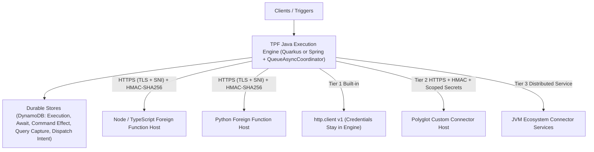

# Deploying Polyglot Applications

In production, a polyglot TPF application runs **one Java execution engine** (Quarkus — or Spring where supported) paired with remote **Node/TypeScript** and **Python** foreign function and custom Connector hosts. Your application keeps the same durable execution guarantees as a pure-Java TPF deployment without rewriting your business steps.



## 1. Transport security and trust boundaries

Production deployments enforce fail-closed transport and secret boundaries by default:

- **HTTPS with certificate and hostname verification is mandatory:** `pipeline.polyglot.allow-loopback-http` defaults to `false`. Plaintext `http://` URIs are rejected at startup unless you explicitly opt in for local loopback (`127.0.0.1` / `::1`) development.
- **HMAC-SHA256 request signing on every call:** Every invocation carries `X-TPF-Worker-Timestamp`, `X-TPF-Worker-Nonce`, `X-TPF-Worker-Signature`, `X-TPF-Step-Id`, and `X-TPF-Step-Index`. Unary calls sign the exact SHA-256 digest of the canonical JSON body; streaming `MANY_TO_ONE` and `MANY_TO_MANY` calls sign the `STREAMING-NDJSON-V1` sentinel while TLS protects stream integrity and confidentiality.
- **Strict secret isolation:** Pure business function hosts never receive provider credentials or durable store access. Only authenticated Tier-2 Connector hosts receive the scoped secrets declared for their bound connection via the host `ConnectionResolver` ([ADR-0021](/decisions/0021-host-owned-connector-authentication)).
- **Shared secret required:** Enabling polyglot mode without configuring `pipeline.polyglot.shared-secret` fails closed during application startup.

## 2. Quarkus production configuration

Include `META-INF/pipeline/pipeline-contract.json` emitted by `tpf generate` in your Quarkus application resources. At build time, the Quarkus extension validates the canonical v3 contract and auto-wires all `ONE_TO_ONE`, `ONE_TO_MANY`, `MANY_TO_ONE`, and `MANY_TO_MANY` foreign steps into `PipelineStepResolver` with zero user-authored Java domain classes.

```properties
# Enable polyglot step auto-wiring
pipeline.polyglot.enabled=true

# Default HTTPS foreign function host origin (or override per step below)
pipeline.polyglot.function-host-uri=https://node-functions.internal:8443

# Route specific steps to different language hosts in the same pipeline
pipeline.polyglot.step-uris.score-risk=https://python-functions.internal:8443
pipeline.polyglot.step-uris.enrich-lines=https://python-functions.internal:8443

# Shared HMAC secret (inject from your secret manager)
pipeline.polyglot.shared-secret=${TPF_POLYGLOT_SHARED_SECRET}

# Never enable plaintext loopback HTTP in production
pipeline.polyglot.allow-loopback-http=false

# Timeouts and response bounds
pipeline.polyglot.request-timeout=PT30S
pipeline.polyglot.stream-idle-timeout=PT60S
pipeline.polyglot.max-response-bytes=4194304

# Durable pre-send dispatch-intent store (required for production crash safety)
pipeline.polyglot.dispatch-intent-store=dynamo
pipeline.polyglot.dispatch-intent-table=tpf_foreign_dispatch_intent

# Optional Tier-2 custom polyglot Connector host (strictly isolated from business functions)
pipeline.polyglot.connector.host-uri=https://polyglot-connectors.internal:8443
pipeline.polyglot.connector.shared-secret=${TPF_POLYGLOT_CONNECTOR_SECRET}
pipeline.polyglot.connector.secrets.FX_API_KEY=${FX_API_KEY}
```

### Pre-send dispatch intent and `REMOTE_OUTCOME_UNKNOWN`

When `pipeline.polyglot.dispatch-intent-store=dynamo` is active under `QueueAsyncCoordinator`, the engine writes an immutable conditional reservation record to `tpf_foreign_dispatch_intent` **before** sending bytes to a foreign host:

- If a crash, timeout, or reclaimed expired lease causes the same unresolved attempt to be re-dispatched, the conditional write collides and fails closed with `REMOTE_OUTCOME_UNKNOWN` instead of silently repeating a potentially applied call ([ADR-0014](/decisions/0014-remote-transition-outcome-uncertainty)).
- Once a validated response or classified error arrives, the engine appends an immutable settlement record (`VALIDATED_SUCCEEDED`, `VALIDATED_RETRYABLE`, `VALIDATED_TERMINAL`, or `UNCERTAIN`).

## 3. Distributed `QueueAsyncCoordinator` and DynamoDB topologies

For durable long-running workflows combining foreign functions, Await boundaries, Commands, Queries, and checkpoints:

1. Deploy the Quarkus engine with [Queue-Async Runtime](/deploy/orchestrator-runtime/queue-async) backed by DynamoDB (`ExecutionStateStore`, `AwaitUnitStore`, `CommandEffectStore`, `QueryCaptureStore`, and `DynamoForeignDispatchIntentStore`).
2. Deploy each Node/TypeScript or Python foreign host as a stateless horizontal service behind internal HTTPS (mTLS or private CA trusted by the JVM truststore).
3. Keep pure business function hosts and Tier-2 custom Connector hosts in **separate processes or services** with distinct HMAC secrets and least-privilege network policies so business logic cannot reach provider credentials.
4. For heavy JVM ecosystem integrations (Hibernate/JPA, pgvector, enterprise Java SDKs), deploy them as Tier-3 JVM Connector services alongside your polyglot steps in the same pipeline topology.

## 4. Spring-hosted polyglot configuration

When running on `pipelineframework-runtime-spring`, enable `SpringPolyglotAutoConfiguration` with the matching `pipeline.polyglot.*` properties:

```properties
pipeline.polyglot.enabled=true
pipeline.polyglot.function-host-uri=https://node-functions.internal:8443
pipeline.polyglot.step-uris.score-risk=https://python-functions.internal:8443
pipeline.polyglot.shared-secret=${TPF_POLYGLOT_SHARED_SECRET}
pipeline.polyglot.allow-loopback-http=false
pipeline.polyglot.request-timeout=PT30S
pipeline.polyglot.stream-idle-timeout=PT60S
```

Unary `ONE_TO_ONE` steps auto-wire directly into `SpringPipelineRunner`, while streaming steps (`ONE_TO_MANY`, `MANY_TO_ONE`, `MANY_TO_MANY`) are exposed through `SpringPolyglotStepRegistry` alongside `SpringAwaitResumeCoordinator` and `SpringCheckpointHandoffCodec`. See [Spring Support Status](/develop/spring-support) for the broader Spring runtime scope.

## Related documentation

- [Polyglot Development Guide](/develop/polyglot/)
- [Orchestrator Runtime](/deploy/orchestrator-runtime/)
- [ADR-0092: Polyglot Java Execution Engine and Foreign Function Host](/decisions/0092-polyglot-java-execution-engine-and-foreign-function-host)
