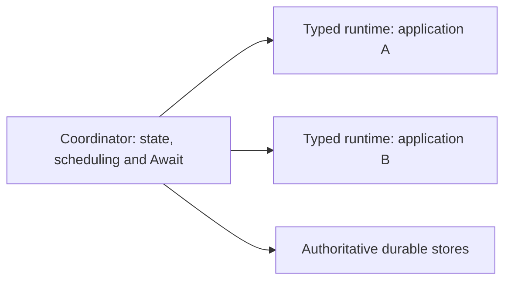

# Runtime Layouts and Build Topologies

This section is the application developer guide for shaping deployments after scaffold generation.
In the standard flow, you generate the scaffold from your pipeline model,
then choose how many deployables you actually want to run.

## Three terms you must separate

These terms sound similar, but they answer different questions:

1. Runtime layout: where TPF logically places the generated runtime pieces.
2. Build topology: what Maven and CI actually build.
3. Transport/platform: how generated pieces call each other and what kind of runtime they target.

### Runtime layout (logical)

Defined in `pipeline.runtime.yaml`.

- Decides where the generated orchestrator namespace, regular steps, and plugin side effects logically run.
- Values include `modular`, `pipeline-runtime`, and `monolith`.
- Drives generated calls and validation.

### Build topology (physical)

Defined by Maven modules and POM structure.

- Decides what artefacts are produced (how many JARs/containers).
- Decides what is actually deployable in CI and production.
- Is not rewritten automatically by runtime mapping.

### Transport mode (call mechanism)

Values include `GRPC`, `REST`, and `LOCAL`.

- Decides how generated components call steps.
- Orthogonal to layout/topology.

### Platform mode (deployment target)

Values include `COMPUTE` and `FUNCTION` (legacy aliases: `STANDARD`, `LAMBDA`).

- Decides whether generation targets standard Quarkus services or function-style entry points.
- This page provides the canonical deeper reference for choosing between `COMPUTE` and `FUNCTION`.
- Constrained by transport and step-shape compatibility (Function mode requires REST; unary and streaming shapes are supported via generated function bridges).
- Orthogonal to runtime layout/topology.

::: note
In durable self-host HA, `orchestrator-svc` is a module/artifact name, not always the whole orchestration role. The durable coordinator and transition worker roles are selected by runtime config. See [Coordinator And Worker Topology](/evolve/durable-coordinator/coordinator-worker-topology).
:::

## Independently packaged application runtimes

The class-independent Coordinator mode keeps durable orchestration in one process and compiled application behaviour in separately packaged workers. Each admitted execution retains its own Release and immutable worker binding. Activating a newer Release changes new admissions; it does not redirect an execution already waiting for completion.

This mode is opt-in through `pipeline.orchestrator.control-plane.payload-materialization=SERIALIZED` with registered remote workers. The default `TYPED` mode preserves the existing local assembly. Use a compatible compiler, contracts and runtime set: the worker must advertise the required canonical boundary facts for its exact compiled Release. Metadata reads preserve canonical envelopes without loading application classes. Conversion and request-aware completion projection run in the original typed worker; the Coordinator validates and commits their results.

A typed worker can keep `SYNC` process mode. Await is permitted there only while executing a scoped remote transition with a configured Coordinator authority endpoint; ordinary synchronous application calls do not gain durable Await semantics. The worker does not need to run a Coordinator scheduler.

Keep application JARs and generated beans out of the Coordinator package. Workers receive scoped lifecycle credentials, not general access to authoritative stores or the Coordinator's resume-token signing key. Configure immutable trusted bindings through the existing Release registry; client input must not choose arbitrary worker endpoints.

Older Releases without the required compiled boundary facts remain on their compatible typed runtime. This configuration does not migrate retained executions or enrich immutable Releases. Roll out compatible readers before writing records with dispatch pins. See [typed worker compatibility and authority](/decisions/0089-typed-worker-operations-preserve-coordinator-authority).

The generic authenticated completion API supports this separation. The connector-specific HTTP callback resource still belongs to the existing typed local assembly; it cannot be installed as a class-independent Coordinator ingress. A connector adapter must separate provider authentication and mapping from Coordinator token/state authority before using that topology.

## Who this guide is for

Application developers using the normal onboarding path:

1. Generate the scaffold from your pipeline model.
2. Adjust runtime layout and build topology for your target environment.

## Why people get confused

You can set `layout: monolith` and still not have a real monolith artefact if the
Maven topology is still modular.

- Runtime mapping changed the logical placement.
- Maven still produced modular deployables.

Both layers must be aligned to achieve your intended runtime shape.

## What runtime mapping changes automatically

- Placement rules for regular and synthetic steps.
- Validation behaviour ([`auto` = best-effort fallback placement, `strict` = fail on unmapped/mismatched placement](/evolve/runtime-mapping/schema#validation)).
- Generated client/server calls aligned to placement + transport.

## What runtime mapping does not change automatically

- Parent/module structure in Maven.
- Number of runtime artefacts produced.
- CI lanes needed to build/test a new topology.

::: note
Choosing `monolith` does not remove per-step service modules from the scaffold. `monolith-svc` acts as the runtime packaging module and aggregates service sources at build time.
:::

For Maven topology changes, use the migration playbook.

## Start here

- [POM vs Layout Matrix](/deploy/runtime-layouts/pom-layout-matrix)
- [Using Runtime Mapping](/deploy/runtime-layouts/using-runtime-mapping)
- [Maven Migration Playbook](/deploy/runtime-layouts/maven-migration)
- [CSV Payments Pipeline-Runtime Walkthrough](/deploy/runtime-layouts/csv-payments-pipeline-runtime)
- [CSV Payments Monolith Walkthrough](/deploy/runtime-layouts/csv-payments-monolith)
- [Search Lambda Verification Lane](/deploy/search-lambda)
