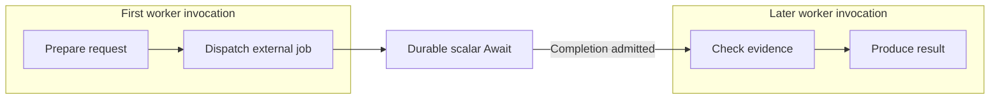

# Using Runtime Mapping

Runtime mapping is optional. If you do nothing, scaffold defaults are used.

## File and scope

- File name: `pipeline.runtime.yaml`
- Typical location in generated apps: `config/pipeline.runtime.yaml`
- Scope: whole app (resolved by annotation processing per module, applied globally)

## Minimal workflow

1. Keep the scaffold defaults working first.
2. Add runtime mapping with `validation: auto`.
3. Move to `validation: strict` after all intended mappings are explicit.

## Baseline template

```yaml
enabled: true
layout: pipeline-runtime
validation: auto

runtimes:
  orchestrator: {}
  pipeline: {}
  persistence: {}

modules:
  orchestrator-svc:
    runtime: orchestrator
  pipeline-svc:
    runtime: pipeline
  persistence-svc:
    runtime: persistence

defaults:
  module: pipeline-svc
  synthetic:
    module: persistence-svc
```

## Layout meaning

- `modular`: closest to classic one-step-per-module scaffolds.
- `pipeline-runtime`: generated orchestrator namespace isolated; service steps grouped; plugins usually grouped by aspect.
- `monolith`: generated orchestrator namespace + services + plugins in one runtime/module (requires matching Maven topology).

In durable self-host HA, the generated orchestrator module or monolith artifact can still be run in different roles. Coordinator versus transition worker is a runtime configuration choice, not a runtime-mapping layout value.

## Group work around deferred completion

A function does not need a remote call for every authored Step. Keep short, connected
work together, return when a scalar Await hands completion to durable coordination,
and resume after the external result arrives. The work between those handoffs is an
execution segment.

For example, a Pipeline can prepare a request, dispatch an external test job, then
check its evidence when the job finishes:



These are two execution segments. They can run on the same worker function in
separate invocations. Two sequential deferred completions can create three segments;
two Await declarations on alternative branches do not mean an execution crosses both.

For a single application module, this mapping explicitly keeps the authored Steps
and synthetic work together:

```yaml
# config/pipeline.runtime.yaml, relative to the application module
layout: pipeline-runtime
validation: strict
runtimes:
  application: {}
modules:
  app:
    runtime: application
defaults:
  runtime: application
  module: app
  synthetic:
    module: app
```

The compiler must receive the matching module identity (`-Apipeline.module=app`)
and module directory (`-Apipeline.moduleDir=<application-module-directory>`).
This groups compiled code; it does not create Lambda functions or select an
`execution-segment` layout. The supported layout names remain the three listed
above. Native work delivery controls suspension and resume, as described in
[Await Runtime Setup](/deploy/orchestrator-runtime/await#scalar-completion-in-function-hosts).
Physical HTTP ingress, work and recovery functions are deployment roles; their
number is independent of the number of execution segments. Hosting compiled
`LOCAL` code in a native function is also distinct from generating per-Step
`REST`/`FUNCTION` adapters.

### Account for I/O and handoff costs

Ordinary network I/O inside an active Lambda Event-function invocation contributes
to its billed duration. Reactive execution avoids blocking a thread; it does not
end that invocation. Durable suspension lets the worker return while the external
job runs, with storage, delivery and later invocation costs of their own.

Start with grouped short work and measure before splitting it further:

| Observation | Placement consideration |
| --- | --- |
| Long external job or human response | Use durable Await rather than retaining an invocation |
| Several short API calls | Compare their duration with extra cold starts and handoffs before separating them |
| Large evidence download or CPU-heavy validation | Measure memory, transfer and processing separately; a different worker may be worthwhile |
| Different credentials or scaling needs | Separate physical workers when the deployment can enforce the required boundary |

Calling another function synchronously while the caller waits does not remove the
caller's waiting time. Use traces and the selected provider's billing model rather
than treating the number of functions as a performance target. See
[AWS Lambda pricing](https://aws.amazon.com/lambda/pricing/).

## Important for plugins/synthetics

Runtime mapping applies to regular steps and synthetic side-effect steps. If plugin aspects are enabled, ensure synthetic placement is intentional (`defaults.synthetic.module` or explicit synthetic mappings), especially when switching from modular to grouped layouts.

## Transport note

Transport remains a pipeline decision (`GRPC`, `REST`, or `LOCAL`) and is orthogonal to runtime mapping. Runtime mapping chooses *where* steps run; transport chooses *how* they are called.

## FUNCTION Invocation Contract Baseline

For `pipeline.platform=FUNCTION` (serverless/function runtime target; see [Configuration](/develop/configuration/)), runtime mapping and function transport contract metadata work together:

- runtime mapping still decides placement (`orchestrator`, step modules, plugin/synthetic modules)
- function invocation metadata in `FunctionTransportContext` expresses invocation intent. `FunctionTransportContext` is the per-invocation metadata object (invocation id, caller/stage, attributes, routing intent) passed through the function transport path:
  - `tpf.function.invocation.mode=LOCAL|REMOTE`
  - optional target metadata: runtime/module/handler

Concrete example:

```yaml
# Runtime mapping placement (annotation-processor input)
enabled: true
layout: pipeline-runtime
validation: auto

modules:
  orchestrator-svc:
    runtime: orchestrator
  index-document-svc:
    runtime: pipeline
```

Example invocation attributes (carried by `FunctionTransportContext`, not parsed by `pipeline.runtime.yaml` loader):

```java
// LOCAL: default generated wiring
Map<String, String> localAttrs = Map.of(
    "tpf.function.invocation.mode", "LOCAL");

// REMOTE: adapter-routed invocation metadata
Map<String, String> remoteAttrs = Map.of(
    "tpf.function.invocation.mode", "REMOTE",
    "tpf.function.target.runtime", "pipeline",
    "tpf.function.target.module", "index-document-svc",
    "tpf.function.target.handler", "ProcessIndexDocumentFunctionHandler");
```

The runtime reads these values via `FunctionTransportContext` accessors (`invocationMode()`, `targetRuntime()`, `targetModule()`, `targetHandler()`), while the runtime-mapping loader ignores them.
The default behaviour is local (`LOCAL`) generated wiring, while stable contract fields are preserved for cross-runtime remote adapters.

## Dispatch Contract Parity Across Transports

Runtime mapping placement decisions should not change dispatch semantics.
For the same logical step call, transport lanes (REST/gRPC/LOCAL) and platform mode (`pipeline.platform=FUNCTION`) should preserve:

- immutable correlation id
- stable idempotency key semantics for duplicate deliveries
- monotonic retry-attempt propagation
- absolute deadline semantics (`epoch-ms`)
- consistent classification of terminal errors as retryable or non-retryable

This is a runtime invariant for topology changes (modular, pipeline-runtime, monolith), not a transport-specific optimization.
