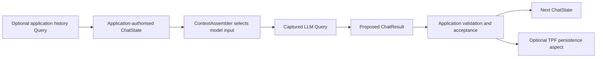

# ChatAgent Block

ChatAgent packages a conversational Pipeline from an explicit `ChatState` to a proposed `ChatResult`. The basic Block makes **one LLM Query**. It needs no database, history Query, tool catalogue or Agent runtime. The application supplies the LLM binding and decides which messages and replies it accepts.



## Start with one inference

Add `org.pipelineframework.blocks:chat-agent` as a dependency. Its `chat-agent-core` dependency supplies the portable state and pure services. Bind the Block's one Query requirement to an application-configured LLM Connector, then invoke the Block from an ordinary typed step:

```yaml
connectors:
  model:
    provider: llm.query
    version: 1
    config: { model: my-model, connection: my-model-connection }

blockBindings:
  org.pipelineframework.chat/chat-agent:
    llm.reply: { using: model }

steps:
  - name: Reply to owner
    pipeline: chat-agent
    cardinality: ONE_TO_ONE
    input: ChatState
    output: ChatResult
    java:
      input: org.pipelineframework.blocks.chat.ChatState
      output: org.pipelineframework.blocks.chat.ChatResult
```

The application constructs `ChatState.start(authorisedScope, messageId, text)` or supplies a validated state carried from a previous step. `ConversationScope` must come from an authenticated host or trusted application state. If a client returns `ChatState`, validate its owner, tenant, conversation, message identity, integrity and eligible evidence before using it. The type alone is not proof of authority.

`ChatResult` has exactly one disposition. `REPLY` contains a proposed natural reply and proposed next state; the application validates and accepts both before making them durable or using `next(...)` for another message. `HANDOFF` reserves an inert `ChatProposal` for a later composition that validates a pinned operation contract before emission and leaves handling to the application. The current Blocks produce replies; they never dispatch Commands or grant business authority. Native Query or provider failures fail the execution.

`ChatState` permits at most 64 evidence entries, 16 KiB of UTF-8 text per entry and 256 KiB of carried state. Appending evidence or a proposed reply evicts oldest entries deterministically and increments `omittedEntries`. A new state with an oversized current message or invalid shape is rejected. Large immutable content should stay in an owned `PayloadReference` with a bounded excerpt; a reference is not automatic permission to disclose its bytes to the model. These limits apply independently of `ChatWindow` and `ContextAssembler`, which select the smaller model-visible context. If the current message cannot fit, inference fails before calling the provider.

## Add one typed Query tool

Choose `org.pipelineframework.blocks:chat-agent-query` when the model may need one application-approved read before answering. This variant uses the same `ChatState` and `ChatResult` contract. Bind two LLM Query requirements and a finite catalogue of typed, one-to-one Query operations:

```yaml
blockBindings:
  org.pipelineframework.chat/chat-agent-query:
    llm.decide: { using: model }
    llm.synthesize: { using: model }
    tools:
      court_guide:
        using: application
        operation: court.guide
        operationVersion: 1
        input: CourtGuideRequest
        config: { label: public-court-guide }

steps:
  - name: Reply with optional court guide
    pipeline: chat-agent-query
    cardinality: ONE_TO_ONE
    input: ChatState
    output: ChatResult
    java:
      input: org.pipelineframework.blocks.chat.ChatState
      output: org.pipelineframework.blocks.chat.ChatResult
```

The first LLM Query either completes directly, using one inference in total, or proposes one alias from the compiled catalogue. TPF validates the typed arguments and dispatches exactly one native Query. The captured observation becomes bounded carried evidence; a second LLM Query then writes the natural answer. The tool path does not recurse or execute Commands. A failed provider call remains a native failure; an oversized observation must be shortened by the application Query or represented by a suitable `PayloadReference`, rather than being reported as a successful handoff.

The application owns the tool's provider binding, operation version, input type, host authorisation and what the Query may disclose. The compiler rejects missing bindings, unsupported operation versions, non-Query operations, non-one-to-one Query operations and type mismatches. Tool availability is a release-pinned allowlist, not runtime discovery. Both variants share the `chat-agent-core` library and its pure `chat-context` preparation Block, so an application may install either variant or both without duplicating canonical types.

## Add durable continuity when needed

For a new execution, the application may read previously **accepted** turns through a scoped Query and construct `ChatState` from that captured observation. It may persist accepted owner and agent turns through TPF's persistence aspect. The Block does not choose a table, provider, retention policy or erase behaviour. A computation already carrying authorised state does not need a history read. PadelPot demonstrates both optional hydration at its new chat root and native persistence of accepted turns, while its existing negotiation and Await path remains application-owned.

The model sees selected text as evidence. It may miss a correction, misstate certainty or follow malicious instructions embedded in history or tool results. Preserve typed policy checks and human approval for commitments. More powerful tool, MCP, recursive research, browser and code compositions can build on the same typed Query/Command/Await boundaries; they are not part of this bounded Block.

See [Conversation context](/develop/connectors/conversation-context), [LLM Query](/develop/extension/llm-query), and [ADR-0076](/decisions/0076-chat-agent-carries-bounded-conversation-state) for the underlying contracts and ownership.
