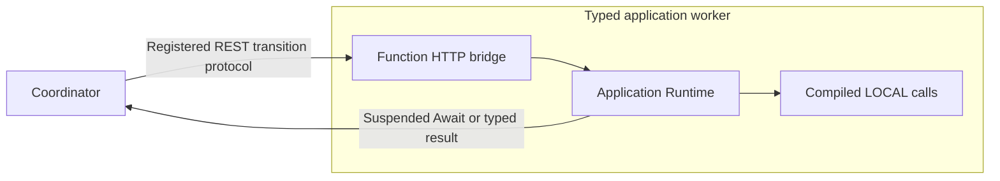

# Transport and Platform Settings

Transport controls how generated components call each other. Platform controls whether generated entry points run as a service/runtime shape or through function-style handlers.

## Current Terms

| Term | Meaning |
| --- | --- |
| `GRPC` | generated gRPC server/client adapters |
| `REST` | generated REST resource/client adapters |
| `LOCAL` | generated in-process clients without a remote hop |
| `COMPUTE` | service/resource runtime path |
| `FUNCTION` | function-handler runtime path |

Transport and platform are related, but they are not the same dimension. For generated HTTP function entry points, select `pipeline.platform=FUNCTION` with REST-oriented generated handlers. These settings describe generated application adapters. A separately packaged registered transition worker also has a host and a transport boundary; that boundary does not require a remote adapter between every authored Step.

## Place an execution segment, then select its adapters

Start with the work that should remain together until suspension or completion: an
[execution segment](/deploy/runtime-layouts/using-runtime-mapping#group-work-around-deferred-completion).
Use the existing runtime mapping to group its code, then select the required
external adapters and deployment package. There is no `execution-segment` layout.

In this topology, `LOCAL` describes calls inside the compiled application runtime;
`COMPUTE` selects its generated service/resource shape. The independently packaged
worker exposes the registered REST protocol through a Lambda HTTP bridge. This is
a supported alternative to generated per-Step `REST`/`FUNCTION` adapters, not a
claim that the worker runs on the developer's machine. Its immutable Release
must identify the actual executable package and supported entry point.

Choose `REST`/`FUNCTION` when the generated function-handler adapters are the
intended callable boundary. Changing the YAML labels alone does not turn an
archive into an independently registered worker, nor does grouping Steps promise
that the current dispatcher fuses their transitions into one invocation. Qualify
the chosen package, canonical payloads, Await projector and resumed execution.
See [runtime mapping](/deploy/runtime-layouts/using-runtime-mapping) and
[registered REST targets](/deploy/orchestrator-runtime/queue-async#release-aware-rest-targets).

## Full Reference

- [Pipeline YAML](/develop/configuration/all-settings#pipeline-yaml)
- [REST Path Overrides](/develop/configuration/all-settings#rest-path-overrides-build-time)
- [REST Client Endpoints](/develop/configuration/all-settings#rest-client-endpoints)
- [Function Transport Context Attributes](/develop/configuration/all-settings#function-transport-context-attributes-function-handlersadapters)
- [Lambda-Focused Configuration](/develop/configuration/lambda-focused)
