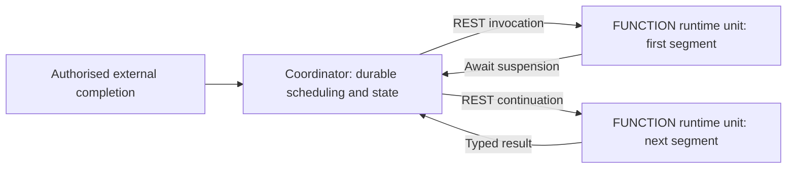

# Transport and Platform Settings

Transport controls how generated components call each other. Platform controls whether generated entry points run as a service/runtime shape or through function-style handlers.

## Current Terms

| Term | Meaning |
| --- | --- |
| `GRPC` | generated gRPC server/client adapters |
| `REST` | generated REST resource/client adapters |
| `LOCAL` | generated in-process clients without a remote hop |
| `COMPUTE` | service/resource runtime path |
| `FUNCTION` | function-handler runtime path |

Transport and platform are separate choices. When using generated REST
function handlers, select `REST` transport and `FUNCTION` platform.
Durable background execution uses
`pipeline.orchestrator.mode=QUEUE_ASYNC`; this runtime setting is separate from
the generated transport and platform settings.

## Place an execution segment, then select its adapters

Start with the work that should remain together until suspension or completion: an
[execution segment](/deploy/runtime-layouts/using-runtime-mapping#group-work-around-deferred-completion).
Use the existing runtime mapping to group its code, then make its external
invocation boundary explicit. There is no `execution-segment` layout.

For generated function handlers, align configuration, generated adapters,
worker package and immutable Release with `REST`/`FUNCTION` and `QUEUE_ASYNC`.

The registered REST transition-worker profile is a separate supported adapter
boundary. Its `aws-durable-java21-rest-worker-v1` Release selects a Lambda HTTP
bridge around one whole compiled pipeline with canonical types and local
transition execution. The inner contract can truthfully declare
`LOCAL`/`COMPUTE`: those settings describe generated calls inside the worker,
while the registered transition protocol is REST and its host is Lambda.
`AwsDurableHostedProfile.requireRestWorkerRelease` validates that package;
the Release producer invokes the same check. Do not retag an inner contract
to resemble physical placement, or infer profile support from an HTTP bridge
alone. This profile does not establish independently placed segment archives.

Qualification needs an admitted execution through the Coordinator, including
Command execution, deferred completion, continuation and recovery. Commands need
the admitted execution context and the configured durable effect authority.
Selecting `QUEUE_ASYNC` does not give the typed worker ownership of scheduling
or justify starting another Coordinator inside it. A package boot test or a
successful individual transition proves only that tested boundary.

Grouping code does not promise one invocation per segment or a separate function
resource for each segment. Check the actual generated boundaries, dispatcher and
Release entry points. See [runtime mapping](/deploy/runtime-layouts/using-runtime-mapping)
and [registered REST targets](/deploy/orchestrator-runtime/queue-async#release-aware-rest-targets).

## Full Reference

- [Pipeline YAML](/develop/configuration/all-settings#pipeline-yaml)
- [REST Path Overrides](/develop/configuration/all-settings#rest-path-overrides-build-time)
- [REST Client Endpoints](/develop/configuration/all-settings#rest-client-endpoints)
- [Function Transport Context Attributes](/develop/configuration/all-settings#function-transport-context-attributes-function-handlersadapters)
- [Lambda-Focused Configuration](/develop/configuration/lambda-focused)
