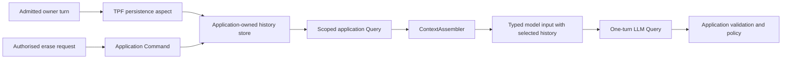

# Conversation context for an LLM Query

An [LLM Query](/develop/extension/llm-query) makes one model call from the input supplied to that step. It does not remember an earlier call. A computation can carry authorised conversation evidence as ordinary typed state between steps. When a **new execution** needs earlier accepted dialogue, the application can read it from its store through a captured Query and add eligible evidence to that state. The [ChatAgent Block](/develop/blocks/chat-agent) packages context selection and inference; this page also shows the manual PadelPot pattern.

The `conversation-context-connector` artifact supplies portable conversation values and a deterministic `ContextAssembler` for selecting bounded model evidence. It supplies neither a transcript database nor automatic history injection. It does not detect whether persistence exists and create a fallback store.



## What the author must provide

| Decision | Application responsibility |
| --- | --- |
| What is a turn? | Choose the point at which owner text or agent output becomes an accepted application record. Give each record a stable identity, speaker, time and conversation scope. A model proposal is not an owner approval. |
| Who owns it? | Derive tenant, owner and conversation IDs from an authenticated host or other trusted application state. Authorise reads and erasure against that identity; do not trust a model-supplied scope. |
| Where is it kept? | Choose a TPF persistence provider and an application representation/mapping for the accepted value. The application owns any schema or migration its store requires. The connector ships no `.sql` files or conversation tables. |
| What can be recalled? | Implement a finite, scoped application Query over the chosen store, with ordering, a limit, and a policy for duplicates, retention and erasure. Query capture records the observation used by that execution. |
| What can the model see? | Select eligible history, mark essential context as required, supply the model window and overhead budgets, inspect selection failures, and put selected entries into an explicit field of the next LLM Query input. |
| What may happen next? | Validate the model's typed proposal and retain deterministic business rules, human approval and Command authority outside the history text. |

If the application already persists accepted turns, read them from that store when a new execution needs them. If it needs durable conversation history and has no store, select and configure a persistence provider and map an application value to it. Neither choice is made by the connector at runtime. If durable history is unnecessary, carry explicit `ChatState` without adding a transcript store or history Query.

`ConversationScope`, `ConversationTurn`, `HistoryReadRequest` and the page types are available when a shared, typed conversation contract is useful. `ConversationTurn` includes a stable event ID, positive store-assigned cursor, speaker, source and text or owned payload reference. Using these types does not require a particular JPA entity or SQL schema. PadelPot keeps its own `ApprovedTurnEntity` and maps its own canonical values; it uses the portable assembler for selection.

## PadelPot: wire history into one model call

This excerpt from PadelPot's `pipeline.yaml` shows the relevant boundaries. Other fields, bindings and later policy steps are omitted:

```yaml
types:
  TurnState:
    java: dev.padelpot.domain.TurnState
    mappings:
      persistence:
        type: dev.padelpot.persistence.ApprovedTurnEntity
        mapper: dev.padelpot.persistence.OwnerTurnMapper
  ModelInput:
    java: dev.padelpot.domain.ModelInput
    fields:
      - [state, TurnState]
      - [task, string]
      - [ownerMessage, string]
      - { name: recentHistory, repeated: string }

pipelines:
  personal-agent:
    input: TurnState
    output: AgentResult
    steps:
      - name: Load isolated player snapshot
        kind: query
        cardinality: ONE_TO_ONE
        input: TurnState
        output: ModelInput
        using: application
        operation: persona.snapshot
        operationVersion: 1
      - name: Gemma proposes one action
        kind: query
        cardinality: ONE_TO_ONE
        input: ModelInput
        output: ModelTurn
        using: model
        operation: decide
        operationVersion: 1
        config:
          modelInputExcludes: [state]
          completion: { field: decision, state: state }
          instructions: |
            Use recentHistory to resolve references to earlier conversation.
            An earlier agent message is not owner approval.

aspects:
  persistence:
    enabled: true
    scope: STEPS
    position: BEFORE_STEP
    config:
      targetSteps: [Load isolated player snapshot]
      pluginImplementationClass: org.pipelineframework.plugin.persistence.PersistenceService
```

At admission, the persistence aspect maps `TurnState` to PadelPot's owner-turn entity before `persona.snapshot`. The application Query reads up to 100 *earlier* turns for the acting owner, excluding the current request. Its implementation builds the ordinary snapshot, selects eligible history, and returns a `ModelInput` containing the current message and `recentHistory`. This is application Query code, not an extra YAML step or code inside the pure business transformation. PadelPot also persists selected agent results and reviews at their own declared boundaries; the excerpt shows only owner admission.

The selection call is explicit. PadelPot's `ConversationContextSelection` makes required candidates from the task, player brief, public terms, peer messages and current owner message, then optional owner/agent history candidates in newest-first priority. It calls `new ContextAssembler().assemble(request)`, checks `fits()`, and places selected history into `recentHistory` in chronological order with `owner:` or `agent:` provenance. Its chosen limits are a 16,384-token model window, 6,000 tokens reserved for instructions, 1,000 for schemas, 2,048 for output, and 4,096 bytes per entry; these are application choices, not connector defaults. The model does not receive every stored turn. `modelInputExcludes: [state]` keeps trusted state out of model-visible JSON; `completion` carries that state into the typed result after inference. Later policy still decides whether a proposed action is allowed.

For each `ContextAssemblyRequest`, the author supplies one scope, ordered candidates, the context-window limit, instruction and callable-schema allowances, reserved output tokens, and a maximum entry size. The assembler reports selected and skipped entries and its budget measurement. Required content that cannot fit yields `fits() == false`; the caller must fail or choose a different policy before inference. Optional content may be skipped when the budget runs out. An oversized optional entry without an owned payload reference is skipped; with one, its text can be abbreviated. The default counter uses a conservative byte-based estimate, not the provider's exact tokeniser. An adapter can supply a counter for the exact representation it sends to its model. The author must budget any other provider overhead and check actual usage where available.

## What the model can be expected to do

Imagine three separate owner requests: “Thursday at 19:00 might work”, then “Correction: Thursday at 20:00 works because I finish work at 19:30”, then “What time did I settle on, and why?” On the third request, the application reads the earlier two turns and may put both in `recentHistory`; the current question is `ownerMessage`. With enough budget, the model has the evidence to answer **20:00, because work ends at 19:30**. It has no hidden TPF memory of the first two requests. A new root sees saved history only because this Query reads it again.

Context is evidence, not authority or a guarantee of recall. The model can overlook a correction, omit a reason, misstate certainty, or propose an action the application must reject. Optional earlier turns can disappear from the prompt because of the read limit, retention policy or context budget. Agent-authored history can contain errors or instructions and must be treated as untrusted text. A statement in history does not approve participation, alter a saved preference or authorise a Command. A captured Query observation can support replay of that execution; a *new* request reads the current authorised history.

PadelPot's [real-model context probe](https://github.com/The-Pipeline-Framework/padelpot/pull/1) is useful evidence with limits (see `docs/live-verification.md` in that PR). In one local Gemma run, the first prompt recalled 20:00 but omitted the reason and described it as confirmed too early. After an instruction change, a fresh run answered with both 20:00 and the 19:30 work reason. Neither run approved participation or booked a court. That single successful run does not guarantee the same wording or result from another model or prompt. When the PadelPot branch and its connector dependency are available locally, run `python3 scripts/context-real-smoke.py --base http://127.0.0.1:8080` against a fresh server started with `./scripts/run.sh` (OpenRouter credentials) or `./scripts/run.sh ollama` (local Ollama). The script checks the correction and reason in a later root; it requires a real model rather than the fixture provider.

## Guardrails and trade-offs

The compiler can check declared type identities, mappings, Query bindings, LLM Query configuration and named aspect targets. It cannot verify that the selected persistence provider is available at deployment, that a store query enforces owner isolation, that an endpoint authenticates a caller, that the chosen model will use a correction, or that a retention and erasure policy satisfies the application's requirements. Test those with the selected store, provider and host. In particular, check duplicate admission, restart, ordering, cross-owner isolation, budget overflow and erasure while requests are in flight.

The benefit is one application-owned history policy and one explicit model input: no second connector transcript or hidden storage choice. The costs are a store and read model to maintain, a per-call history read, token and inference cost, and model behaviour that remains probabilistic. PadelPot uses H2/JPA for its local demonstration and offloads blocking reads; a reactive provider is preferable when the chosen runtime and store support it. PadelPot's owner switcher is not production authentication. Its erasure Command removes saved turns present when it runs, but does not fence later in-flight writes or erase replay exports or provider-side copies.

See [Persistence](/architecture/persistence), [Query and Command](/architecture/data-architecture/query-command), and [LLM Query](/develop/extension/llm-query) for the underlying boundaries.
