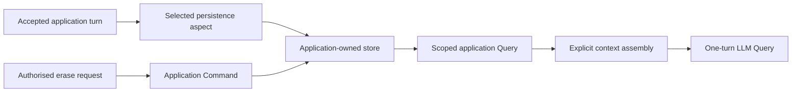

# Conversation context values

The `conversation-context-connector` artifact contributes portable v3 types for scoped conversation turns, finite history pages and explicit context assembly. It contains no transcript database or hosted session. An application decides which turns are approved, how long they are kept, who may read or erase them, and which evidence is shown to a model.



`ConversationScope` carries tenant, owner and conversation identifiers supplied by the application or authorised host. `ConversationTurn` carries a stable event ID, store-assigned cursor, timestamp, speaker, source and bounded text or an owned payload reference. History requests and pages make the scope, limit and cursor explicit. These values describe a contract; they do not select a storage backend or grant access.

The application declares a typed persistence mapping at the step where an accepted business value exists. Its Query reads only a finite authorised page from the application store. TPF captures the Query observation for replay. An explicit erase request uses an application-authorised Command with a stable effect identity. The persistence aspect, Query capture and Command effect store remain separate authorities even if they share one database.

## Pass selected history to one model turn

This shortened excerpt follows PadelPot's `pipeline.yaml`. It shows the relevant type mapping and step boundaries; the remaining type fields, bindings and policy steps are omitted:

```yaml
types:
  TurnState:
    java: dev.padelpot.domain.TurnState
    mappings:
      persistence:
        type: dev.padelpot.persistence.ApprovedTurnEntity
        mapper: dev.padelpot.persistence.OwnerTurnMapper
  ModelInput:
    java: dev.padelpot.domain.ModelInput
    fields:
      - [state, TurnState]
      - [task, string]
      - [ownerMessage, string]
      - { name: recentHistory, repeated: string }

pipelines:
  personal-agent:
    input: TurnState
    output: AgentResult
    steps:
      - name: Load isolated player snapshot
        kind: query
        cardinality: ONE_TO_ONE
        input: TurnState
        output: ModelInput
        using: application
        operation: persona.snapshot
        operationVersion: 1
      - name: Gemma proposes one action
        kind: query
        cardinality: ONE_TO_ONE
        input: ModelInput
        output: ModelTurn
        using: model
        operation: decide
        operationVersion: 1
        config:
          modelInputExcludes: [state]
          completion: { field: decision, state: state }
          instructions: |
            Use recentHistory to resolve references to earlier conversation.
            An earlier agent message is not owner approval.

aspects:
  persistence:
    enabled: true
    scope: STEPS
    position: BEFORE_STEP
    config:
      targetSteps: [Load isolated player snapshot]
      pluginImplementationClass: org.pipelineframework.plugin.persistence.PersistenceService
```

The persistence aspect stores the accepted `TurnState` through its application mapper before the named Query. PadelPot's `persona.snapshot` implementation reads at most 100 earlier turns for the acting owner, calls `ContextAssembler` with an explicit budget, and fills `recentHistory` in chronological order. The LLM Query receives that selected list alongside the current owner message. `modelInputExcludes` keeps the trusted `state` out of model-visible JSON, while `completion` carries it into the typed result after the model responds. The later policy Command still decides what may be acted on. `ContextAssembler` runs in application code; it is not an implicit YAML step or connector-owned transcript store.

`ContextAssembler` is a pure function over application-selected `ContextCandidate` values. The caller provides scope, priority order, context-window size, instruction and tool-schema overhead, reserved output budget and a maximum entry size. The result reports selected and skipped entries with the budget used. A provider tokenizer can supply exact counts; the default reports a conservative byte-based estimate. Required content that cannot fit fails assembly rather than silently dropping an instruction or approval anchor. Oversized optional content needs an owned payload reference to be abbreviated. The application passes the selected result explicitly into its one-turn LLM Query; nothing is injected automatically.

The compiler can validate the contributed v3 type identities, typed step bindings, persistence representation mapping and named aspect targets. It cannot prove that a provider will be configured at deployment, that an endpoint checks the caller's identity, or that an application's retention rule is suitable. Exercise those policies with the chosen store and host. A blocking store must run off the event loop; a reactive provider is preferable where the selected database and runtime support it.

See [Persistence](/architecture/persistence), [Query and Command](/architecture/data-architecture/query-command), and [LLM Query](/develop/extension/llm-query) for the underlying boundaries.
