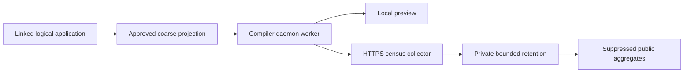

# Generated Artifacts

## Generated Classes in Detail

## Role-Specific Output Directories

Generated sources are written into role-specific directories under `target/generated-sources/pipeline`, one per deployment role. Packaging relies on these directories instead of class-name patterns.

Build configuration notes:
- Pass `-Apipeline.generatedSourcesDir=target/generated-sources/pipeline` to the compiler during `compile` only, to avoid warnings during `testCompile`.
- Register the role directories as sources for IDEs via `build-helper-maven-plugin`.
- If tests reference generated classes (e.g., REST resources), register the same directories as test sources in `generate-test-sources`.

For v3 records reachable from a REST or FUNCTION boundary, the compiler also emits one DTO under `<basePackage>.dto` and deterministic typed mappers under `<basePackage>.transport.generated`. These artifacts are generated for both application-authored and contributed protocol records. Connector libraries remain transport-neutral and do not ship application REST DTOs.

## Generated Pipeline Metadata

The build also emits runtime metadata under `META-INF/pipeline/`:

- `order.json`: resolved runtime execution order
- `telemetry.json`: item-boundary and parent-step telemetry metadata
- `replay-topology.json`: replay and live-topology metadata used by execution-event playback and trace-aware topology surfaces
- `connector-bindings.json`: schema 3 sanitized connector bindings and operations used by both local
  and imported steps. Referenced release-time capability imports include only source, operation,
  wire-contract, pin, and accepted representation fingerprints; connection and secret values are
  never emitted
- `pipeline-contract.json`: deterministic schema 3 release contract. Imported Blocks include package
  provenance, source and linked definition fingerprints, and resolved capability metadata. The
  resolution records binding/provider/operation versions, application-selected Command authority,
  and a sanitized connector-configuration digest. Imported callable catalogues additionally record
  source step, alias, canonical contracts, trusted source/target mappings, and the resolved native
  Query or Command target. Raw configuration, credentials, prompts containing application data, and
  runtime context values are never emitted.
- `connector-operation-provenance.json`: source-owned schema 1 provenance for imported Connector
  operations. The compiler projects only referenced operations into `capabilityImports`; the full
  source contract is never copied into runtime metadata.
- `http-operations.json`: schema 2 immutable private wire pins for imported `http.client` operations,
  including selected callback schemas, injection targets, security compatibility, and acknowledgement status.
- `http-operation-bindings.json`: compiler-generated direct or mapper-class bindings for each
  referenced HTTP request, response, and callback representation. Runtime-supplied callback URI paths
  are excluded from authorable input mappings.

A native Command with `await.callback` remains one semantic node in execution order, branching,
and replay topology. Its branching input is the original Command request; its replay node carries
the Command role and deferred-completion overlay. No callback URL or credential enters these resources.

If you package a grouped runtime such as monolith or pipeline-runtime, keep these resources aligned with the runtime artifact that will execute the pipeline.

### gRPC Adapter Generation

The gRPC adapter acts as a server-side endpoint that:

1. Receives gRPC requests
2. Uses the inbound mapper to convert gRPC objects to domain objects
3. Calls the actual service implementation
4. Uses the outbound mapper to convert domain objects to gRPC responses

```java
// Generated class structure (simplified)
public class ServiceNameGrpcService extends ServiceNameGrpc.ServiceNameImplBase {

    @Inject
    PaymentRecordInboundMapper inboundMapper;

    @Inject
    PaymentStatusOutboundMapper outboundMapper;

    @Inject
    ServiceName service;  // Your actual service implementation

    @Override
    public Uni<PaymentGrpcOut> remoteProcess(PaymentGrpcIn request) {
        // Delegates to an inline GrpcReactiveServiceAdapter based on the streaming shape
        return /* adapter */.remoteProcess(request);
    }
}
```

### gRPC Step Class Generation

The step class acts as a client-side component that:

1. Connects to the gRPC service
2. Implements the pipeline step interface
3. Handles the conversion between domain objects and gRPC calls

```java
// Generated class structure
@ApplicationScoped
public class ServiceNameGrpcClientStep implements StepOneToOne<DomainIn, DomainOut> {

    @Inject
    @GrpcClient("service-name")
    StubClass grpcClient;

    public Uni<DomainOut> applyOneToOne(DomainIn input) {
        // Convert domain to gRPC
        GRpcIn grpcInput = convertDomainToGrpc(input);

        // Call remote service
        return grpcClient.remoteProcess(grpcInput);
    }
}
```

### Orchestrator Application Structure

The orchestrator application coordinates pipeline execution by using the PipelineExecutionService to connect all generated steps:

```java
// Orchestrator application that coordinates execution
@CommandLine.Command(...)
public class OrchestratorApplication implements QuarkusApplication, Callable<Integer> {

    @Inject
    PipelineExecutionService pipelineExecutionService;

    public Integer call() {
        // Create input stream from input parameter
        Multi<DomainInput> inputStream = createInputStream(input);

        // Execute pipeline using the injected service
        // The service discovers all registered step implementations through dependency injection
        pipelineExecutionService.executePipeline(inputStream)
            .collect().asList()
            .await().indefinitely();

        return CommandLine.ExitCode.OK;
    }
}
```

The actual pipeline execution is handled by the PipelineExecutionService which discovers all available step implementations through the StepsRegistry.

## Generated Code Verification

### Viewing Generated Sources

Generated sources can be found in the target directory:

```bash
# Generated pipeline sources location
target/generated-sources/pipeline/

# Generated classes location
target/classes/
```

### Debugging Generation Issues

Enable verbose logging to debug generation issues:

```properties
# application.properties
quarkus.log.category."org.pipelineframework.processor".level=DEBUG
```


## Build Census

TPF ecosystem telemetry observes what developers build, never what their applications
process. The compiler can produce a small census candidate after an error-free TPF
application compilation. It adds no code to generated execution paths and does not
observe startup, execution counts, payloads, latency, or failures.

**The initial implementation supports local preview only. Public reporting is disabled.**
The client and collector source implement delivery, but enabling the public service
requires the privacy and operational release approvals. When reporting is released it
will be default-on, with the opt-out below.



### Disable or inspect

Disable census with any one of:

```sh
export TPF_CENSUS_ENABLED=false
```

```text
-Dtpf.census.enabled=false
-Atpf.census.enabled=false
```

The `-D` option must reach the JVM running the compiler; the `-A` option is a javac
annotation-processor option. A disabling value in any source wins. Invalid disabling
values also disable collection without failing the build. Disabled census creates no
identity, worker, state file, or network request.

To inspect an application compilation, pass these javac processor options:

```text
-Atpf.census.mode=preview
-Atpf.census.preview=/absolute/private/path/census-preview.json
```

Alternatively use `TPF_CENSUS_MODE=preview` and `TPF_CENSUS_PREVIEW` with that
absolute output path. The parent directory must already exist. Choose a private path
outside source, generated and packaged output directories. The compiler refuses paths
in those directories, including its selected class output, and protects the original
configuration and census identity files. Preview never sends a request;
it writes an envelope containing the exact candidate event, local deduplication digest,
and eligibility explanation. If identity state is locked or unavailable, it can write
a suppression reason without inventing an event or identity. It uses retained identities, so it creates local census
state. A failed or non-application compilation produces no candidate. An opt-out also disables preview. Preview is asynchronous and may be lost if a
short-lived compiler JVM exits immediately; a missing output is not a compilation error.
Only the module generating the application orchestrator produces an application candidate.

### Collected values

Schema v1 contains random installation/application-instance IDs, UTC date, packaged
compiler/contracts versions, compiler JVM Java major, coarse size/feature counts, and
transport, platform, and runtime layout. Sizes cover reachable pipeline definitions,
authored logical steps, canonical type declarations, and reachable contributing Block
packages. Features cover nested invocations, ONE_TO_MANY, MANY_TO_ONE, Query, Command,
and Await. Await counts its owning operation independently of Query/Command.

Count bands are `0`, `1`, `2–5`, `6–10`, `11–25`, `26–50`, `51–100`, `101+`, and
`unknown`. Unavailable information remains unknown. Component versions come from
packaged TPF metadata; unrecognized values become `unknown` and development versions
use `-dev`. No names, code, packages/classes, Maven coordinates, URLs, schemas,
payloads, credentials, infrastructure identifiers, or fingerprints enter the event.
`telemetry.json` and `pipeline-contract.json` are never uploaded.

Repeated invocations count a definition's internal steps once. Generated adapters,
aspect steps, and deployment copies do not increase logical counts. Dependencies found
on the classpath alone do not count as adoption. Persistence, caching, compensation,
providers, connector catalogue tokens, and runtime-selected modes are outside v1.

The [v1 protocol schema](https://github.com/The-Pipeline-Framework/pipelineframework-census/blob/a4b1d0bac3443d6c79e5bb4de87576d77248afbe/protocol/v1.schema.json)
lives in the independently owned [census collector repository](https://github.com/The-Pipeline-Framework/pipelineframework-census); the compiler includes the same schema at
`META-INF/tpf/census-v1.schema.json`. Its strict fields are a privacy contract.

### Retained identity and delivery

The state directory is independent of Maven, authentication, and release descriptors:

| Host | Default directory |
| --- | --- |
| Linux | `$XDG_STATE_HOME/tpf/census`, otherwise `~/.local/state/tpf/census` |
| macOS | `~/Library/Application Support/TPF/census` |
| Windows | `%LOCALAPPDATA%\TPF\census` |

Use `TPF_CENSUS_STATE_DIR` for managed retained storage. Known CI/container hosts
must also set `TPF_CENSUS_STATE_PERSISTENT=true`; do so only with a retained mount
or cache. Writable disposable storage is insufficient. Not every disposable environment
can be detected automatically.

One application instance means one original configuration path in one installation.
Its locally HMAC-keyed path never leaves the machine. Configuration/version changes keep
the same random identity. Moving a configuration, another checkout, or state loss can
create a new instance. Similar projects on different developer installations remain
separate reporting instances. These statistics do not measure globally unique projects.

Reporting sends a first observation, changed values at most once daily, or unchanged
values on the first build in a new UTC ISO week. Attempts are recorded before sending;
only `204` acknowledges acceptance. There is no offline backlog, retry, shutdown flush,
or heartbeat. Networking runs on a bounded daemon worker with a 500 ms connect timeout
and 1 second request deadline. Failure or locked/corrupt state skips census and cannot
change compilation success. JVM exit can drop queued observations.

Persistent random IDs are pseudonymous, not guaranteed anonymous. The proposed service
retains private rows for 90 days, with separately disclosed [D1 recovery-history retention](https://developers.cloudflare.com/d1/reference/time-travel/);
public statistics contain no IDs. The network edge necessarily sees IP addresses for
transient abuse control; those addresses are excluded from census storage. Provider
security processing must be disclosed before public reporting starts.

Inspect `state.json` locally to find your installation ID for the documented privacy
request process. Do not publish that file or preview output. Resetting local state creates
new counting identities and does not erase previously received observations. Runtime
observability is described separately under [Operate](/operate/).
