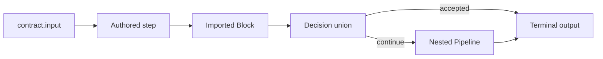

# Compose the Pipeline

A Pipeline contract connects typed steps in order. Omitted inputs can inherit one concrete predecessor
output; explicit inputs are assertions, not coercions. Unions, branches, and ambiguous predecessors
stay explicit.

## Linear contracts

Declare `contract.input` and `contract.output` as the application's end-to-end assertion. Each step
names its output; a later step may inherit it only when the predecessor has one concrete result.
Cardinality remains an execution-shape choice such as `ONE_TO_ONE` or `ONE_TO_MANY`—it is unrelated
to an Expansion package.

With an explicit version 3 output contract, separate branches can each produce a valid result and
complete at the definition boundary. An identity merge service is unnecessary. TPF validates every
reachable branch end and adapts concrete or union results to the declared return contract after the
definition's remaining steps finish. An explicit terminal merge remains useful when an operation
must choose or transform the final result.

Give each concrete canonical input type one authored consumer within a definition. For a union
input, count only the concrete variants selected by `accepts`; disjoint selections can share the
same union declaration. Query, Command, and Await-decorated operations follow the same authoring
rule. A later phase requiring different authority or behaviour needs a meaningful canonical type
or a separate nested definition. Avoid identity services or wrappers added solely to distinguish
positions. Generated plugin observers do not count as authored consumers.

This rule applies independently to every nested definition. Shared observer implementations still
have a separate occurrence in each definition's execution order. See
[ADR-0081](/decisions/0081-one-authored-consumer-per-concrete-input) for the routing decision.

## Reuse a definition

Root `pipelines` contains local compile-time definitions. A `pipeline:` step can call one of those or
a Block supplied by an installed dependency. The compiler links either form into the release contract;
it does not create a second runtime execution.

Applications bind the Query and Command capabilities required by an imported Block. The Block can
name the requirement, but it cannot own endpoints, credentials, tenant choices, or Command authority.
See the [Blocks Guide](/develop/blocks/) for the complete packaging and binding journey.

## Use recursion deliberately

For a local unary definition, use `recur: [Type]` to select continuing concrete outcomes after its
authored steps finish. Those types must satisfy the definition input; the remaining outcomes must
satisfy its output. TPF lowers the declaration through its existing bounded nested-invocation path.
Runtime depth is bounded by `pipeline.max-recursive-depth`.

An explicitly authored recursive call is also an authored consumer. The routing invariant does not
exempt it. Definition-level recurrence supplies the continuing boundary without adding another
authored consumer of the initial type. See [ADR-0083](/decisions/0083-definition-owned-bounded-recurrence).

See the [complete reference](./reference#pipeline-contracts) for syntax, capability manifests,
`blockBindings`, current restrictions, and bounded recursion.

Continue with [Declare Boundaries](./boundaries).
