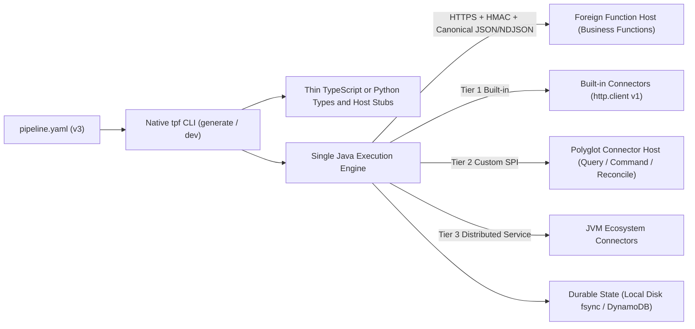

# Polyglot Development (Node/TypeScript & Python)

Build TPF applications in **Node/TypeScript** or **Python** without re-implementing TPF's execution shell and without installing a JDK, Maven, or Docker for local development.

TPF executes every polyglot pipeline on **one Java execution engine** paired with **thin foreign function hosts** and a **standalone native `tpf` CLI**. Your TypeScript or Python code implements pure typed business functions and, when needed, provider-specific custom Connector adapters. TPF owns graph sequencing, streaming backpressure, deterministic split/merge lineage, retries, telemetry, durable Await suspension and resume, Command reconciliation, and Query capture/replay.



## How the boundary works

Every polyglot application starts from the same canonical v3 `pipeline.yaml` contract:

- **Canonical types are the authority:** Types declared under `types:` compile into `META-INF/pipeline/pipeline-contract.json` and thin language bindings (`types.ts` / `host.ts` for TypeScript, `types.py` / `host.py` for Python).
- **Exact numeric precision across languages:** `int64` and `decimal` values never pass through IEEE-754 floating-point conversions. TypeScript maps `int64` to `bigint` and `decimal` to exact strings serialised via `JSON.rawJSON` (Node 22+); Python maps `int64` to `int` and `decimal` to `decimal.Decimal`.
- **All four cardinalities are supported:** `ONE_TO_ONE`, `ONE_TO_MANY`, `MANY_TO_ONE`, and full-duplex `MANY_TO_MANY` streams execute over authenticated HTTP/1.1 using canonical JSON and newline-delimited JSON (NDJSON) with explicit completion sentinels.
- **Strict secret isolation:** Pure business functions never receive provider credentials, resolved connections, or durable stores. Credentials belong to the host engine (Tier 1) or are delivered selectively to authenticated custom Connector hosts (Tier 2).

## Example canonical `pipeline.yaml`

```yaml
version: 3
appName: "Invoice Pipeline"
basePackage: "com.example.invoices"
transport: "LOCAL"
platform: "COMPUTE"

types:
  Invoice:
    fields:
      - name: invoiceId
        type: string
      - name: sequenceNumber
        type: int64
      - name: amount
        type: decimal
  LineItem:
    fields:
      - name: sku
        type: string
      - name: lineTotal
        type: decimal
  InvoiceSummary:
    fields:
      - name: invoiceId
        type: string
      - name: grandTotal
        type: decimal

steps:
  - name: "Validate Invoice"
    cardinality: "ONE_TO_ONE"
    input: "Invoice"
    output: "Invoice"
  - name: "Expand Lines"
    cardinality: "ONE_TO_MANY"
    input: "Invoice"
    output: "LineItem"
  - name: "Enrich Lines"
    cardinality: "MANY_TO_MANY"
    input: "LineItem"
    output: "LineItem"
  - name: "Summarise Invoice"
    cardinality: "MANY_TO_ONE"
    input: "LineItem"
    output: "InvoiceSummary"
```

## Reading order

1. [Node and TypeScript](./typescript) — generate stubs, author unary/streaming handlers and Tier-2 custom Connectors, and run with Node 22+.
2. [Python](./python) — generate dataclasses and host stubs, author unary/streaming handlers and Tier-2 custom Connectors, and preserve `Decimal` precision.
3. [Local Development and Testing without a JVM](./testing-and-local-dev) — use `tpf generate` and `tpf dev`, unit-test handlers natively, and verify crash recovery across `SIGKILL`.
4. [Deploying Polyglot Applications](/deploy/polyglot) — run production Quarkus or Spring execution engines alongside remote TLS + HMAC foreign hosts and DynamoDB stores.

For the architectural rationale and ownership invariants behind this design, see [ADR-0092](/decisions/0092-polyglot-java-execution-engine-and-foreign-function-host).
