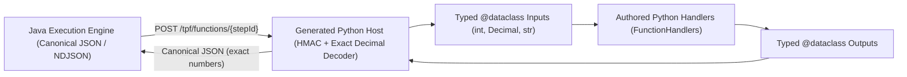

# Python

Write TPF business steps and Tier-2 custom Connector adapters in **Python 3.11+** using only the Python standard library. The native `tpf` CLI generates typed `@dataclass` definitions and a threaded HTTP/1.1 host directly from your canonical v3 `pipeline.yaml`.



## 1. Generate Python types and host bindings

Run `tpf generate` against your `pipeline.yaml`:

```sh
tpf generate --pipeline pipeline.yaml --lang python --out ./generated
```

`tpf generate` produces a self-contained Python package (named from your pipeline's `appName` in snake_case, such as `invoice_pipeline`) containing:

- `invoice_pipeline/types.py` — frozen `@dataclass` models for all canonical records and union variants, `FunctionContext`, `QueryConnectorContext`, `CommandDispatchContext`, `CommandReconcileContext`, and portable error classes (`TpfBusinessRejectionError`, `TpfTransientError`).
- `invoice_pipeline/host.py` — `start_app_host(...)` implementing HMAC-SHA256 verification (with timezone-aware ISO-8601 timestamp skew validation), exact `Decimal` parsing (`parse_float=Decimal`), NDJSON streaming for `ONE_TO_MANY`, `MANY_TO_ONE`, and full-duplex `MANY_TO_MANY`, and loopback Connector listener authentication.
- `META-INF/pipeline/pipeline-contract.json` — the compiled canonical v3 contract.

## 2. Canonical type mapping in Python

| Canonical v3 type | Python type | Precision guarantee |
| --- | --- | --- |
| `string`, `uuid`, `timestamp`, `date`, `duration` | `str` | Exact UTF-8 / ISO-8601 string |
| `bool` | `bool` | Native `bool` |
| `int32`, `int64` | `int` | Arbitrary-precision Python integer (exact `int64 > 2^53`) |
| `decimal` | `decimal.Decimal` | Parsed directly from raw JSON token with `parse_float=Decimal` |
| `float32`, `float64` | `float` | IEEE-754 floating point |
| `list<T>` | `list[T]` | Ordered list |
| `map<string, V>` | `dict[str, V]` | String-keyed dictionary |
| `union` | Tagged variant `@dataclass` | Explicit variant class per discriminator |

## 3. Implement business functions

Author a handler class whose snake_case methods match the step names in `pipeline.yaml`. Streaming steps accept and yield standard Python `Iterator` values so full-duplex `MANY_TO_MANY` steps emit outputs incrementally as inputs arrive.

```python
from decimal import Decimal
import os
from typing import Iterator

from invoice_pipeline import host, types as t


class Handlers:
    # ONE_TO_ONE
    def validate_invoice(self, invoice: t.Invoice, ctx: t.FunctionContext) -> t.Invoice:
        if invoice.amount < Decimal("0"):
            raise t.TpfBusinessRejectionError("NEGATIVE_AMOUNT", "Invoice amount must be positive")
        return t.Invoice(
            invoiceId=invoice.invoiceId,
            sequenceNumber=invoice.sequenceNumber + 1,
            amount=invoice.amount,
        )

    # ONE_TO_MANY
    def expand_lines(self, invoice: t.Invoice, ctx: t.FunctionContext) -> Iterator[t.LineItem]:
        yield t.LineItem(sku=f"{invoice.invoiceId}-A", lineTotal=invoice.amount)

    # MANY_TO_MANY (full-duplex incremental generator)
    def enrich_lines(
        self, lines: Iterator[t.LineItem], ctx: t.FunctionContext
    ) -> Iterator[t.LineItem]:
        for line in lines:
            yield t.LineItem(sku=line.sku.upper(), lineTotal=line.lineTotal)

    # MANY_TO_ONE
    def summarise_invoice(
        self, lines: Iterator[t.LineItem], ctx: t.FunctionContext
    ) -> t.InvoiceSummary:
        total = Decimal("0")
        count = 0
        for line in lines:
            total += line.lineTotal
            count += 1
        if count == 0:
            raise t.TpfTransientError("EMPTY_BATCH", "Upstream produced no line items")
        return t.InvoiceSummary(invoiceId=f"batch-{count}", grandTotal=total)


if __name__ == "__main__":
    running = host.start_app_host(
        Handlers(),
        host="127.0.0.1",
        port=int(os.environ.get("PORT", "0")),
        shared_secret=os.environ["TPF_SHARED_SECRET"],
    )
    print(f"READY {running.base_url}", flush=True)
```

### Portable failure classification

- Raise `t.TpfBusinessRejectionError(code, message)` for deterministic domain rejections (`BUSINESS_REJECTION`, non-retryable).
- Raise `t.TpfTransientError(code, message)` for retryable transient errors (`TRANSIENT`).
- Unhandled Python exceptions are reported as `UNCLASSIFIED` (non-retryable by default) while keeping the host process healthy.

## 4. Author a Tier-2 custom Connector (optional)

For external providers that require a Python SDK (for example, data science or proprietary API clients), pass a `connectors` object to `host.start_app_host(Handlers(), Connectors(), ...)`:

```python
class Connectors:
    def query_lookup_rate(self, request: t.RateRequest, ctx: t.QueryConnectorContext) -> dict:
        api_key = ctx.secrets["FX_API_KEY"]
        # Call external Python SDK using api_key...
        return {
            "outcome": "FOUND",
            "payload": t.RateQuote(currency=request.currency, rate=Decimal("1.08450000")),
        }

    def dispatch_submit_ledger(
        self, request: t.LedgerRequest, ctx: t.CommandDispatchContext
    ) -> dict:
        # Use ctx.dispatch_identity.provider_idempotency_key for idempotent submission
        return {
            "outcome": "CONFIRMED_SUCCEEDED",
            "payload": t.LedgerReceipt(entryId="led-100"),
            "providerReference": "ext-ref-100",
        }
```

The Java execution engine persists the `CommandEffectStore` and `QueryCaptureStore` records, enforces `RETURN_RECORDED` replay, and invokes `reconcile_<operation>` when an outcome is `AMBIGUOUS`.

## 5. Run and unit-test without a JVM

Unit-test your handlers directly with `pytest` or `unittest`:

```sh
python3 -m unittest discover -s tests
```

Then run the full pipeline end-to-end with `tpf dev` (see [Local Development and Testing without a JVM](./testing-and-local-dev)).
