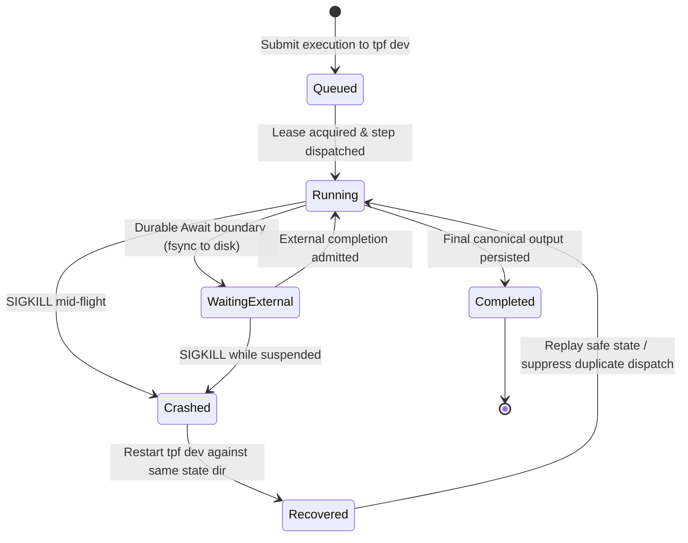

# Local Development and Testing without a JVM

The standalone native `tpf` CLI embeds TPF's standard Java execution engine inside an ahead-of-time compiled binary. You can generate stubs, run multi-language pipelines locally, exercise durable Await boundaries and Connectors, and verify crash recovery across `SIGKILL` without installing a JDK, Maven, or Docker.



## 1. Two-step local workflow

### Generate contracts and stubs offline

```sh
tpf generate --pipeline pipeline.yaml --lang typescript --out ./generated
```

Or for Python:

```sh
tpf generate --pipeline pipeline.yaml --lang python --out ./generated
```

`tpf generate` validates your canonical v3 schema, emits `META-INF/pipeline/pipeline-contract.json` and `polyglot-manifest.json`, and writes only the thin typed interfaces and host helper for your chosen language.

### Start the local execution engine (`tpf dev`)

Start your TypeScript or Python host(s) with a shared HMAC secret, then launch `tpf dev` pointing at `pipeline.yaml`, your durable state directory, and foreign host URL(s):

```sh
export TPF_DEV_SECRET="local-dev-secret"

tpf dev \
  --pipeline pipeline.yaml \
  --data-dir .tpf/dev-state \
  --function-host http://127.0.0.1:4100 \
  --connector-host http://127.0.0.1:4101 \
  --connector-secret FX_API_KEY=dev-fx-token \
  --secret "$TPF_DEV_SECRET"
```

Pass `--port <port>` to bind a fixed loopback HTTP port (or omit it to use an ephemeral port) and `--max-retries <n>` to control transient retry attempts. In production Quarkus and Spring deployments, you can also route individual steps to separate language hosts using `pipeline.polyglot.step-uris.<step-id>`.

## 2. Crash-safe local durability

`tpf dev` persists all durable control-plane state under `--data-dir` using atomic file replacement and `FileChannel.force(true)`:

- **Execution state:** tracks step index, attempts, leases, and terminal outputs.
- **Await units and interactions:** preserves `WAITING_EXTERNAL` suspensions and completion idempotency keys across restarts.
- **Command effects:** records pre-send `CommandRecoveryBinding` and `CommandEffectRecord` entries so re-runs apply `RETURN_RECORDED` replay or `AMBIGUOUS` reconciliation instead of duplicating external side effects.
- **Query captures:** persists external Query observations for deterministic replay.
- **Pre-send foreign dispatch intents:** suppresses automatic blind resends after an uncertain crash or timeout.

If you kill `tpf dev` with `SIGKILL` mid-execution or while an execution is waiting at an Await boundary, restarting `tpf dev` against the same `--data-dir` resumes from the exact last durable boundary.

## 3. Loopback security for local Tier-2 Connectors

Remote deployments always require HTTPS with certificate and hostname validation. On local loopback (`127.0.0.1` / `::1`) during `tpf dev`, plaintext HTTP is permitted only when explicitly opted in:

- **Pure business functions** receive HMAC-signed requests and never receive external credentials.
- **Tier-2 custom Connector hosts** on plaintext loopback HTTP are authenticated by `tpf dev` before any scoped secret is sent. `tpf dev` sends a fresh signed challenge to `POST /tpf/connector/auth/challenge` and verifies the listener's constant-time HMAC-SHA256 proof (`tpf-connector-listener-auth-v1\n<challenge>`). If the listener fails the challenge, times out, or returns an oversized or invalid response, `tpf dev` fails closed and sends zero secrets.

## 4. Testing strategy

Use three fast test layers matching your native toolchain:

1. **Pure unit tests (TypeScript `node --test` / Python `pytest` or `unittest`):** call your handler functions directly with plain in-memory inputs. Verify domain logic, exact `bigint`/`Decimal` arithmetic, and `TpfBusinessRejectionError` / `TpfTransientError` cases in milliseconds.
2. **Host boundary tests:** start `startAppHost(...)` on an ephemeral loopback port (`port: 0`), verify HMAC rejection (`401`) on unsigned requests, and exercise NDJSON streaming / full-duplex interleaving.
3. **End-to-end engine tests with `tpf dev`:** run the real `tpf` binary against your live Node/Python hosts, submit an execution, optionally inject a `SIGKILL` across an Await or Command boundary, restart `tpf dev`, and assert final canonical output and effect counts.
