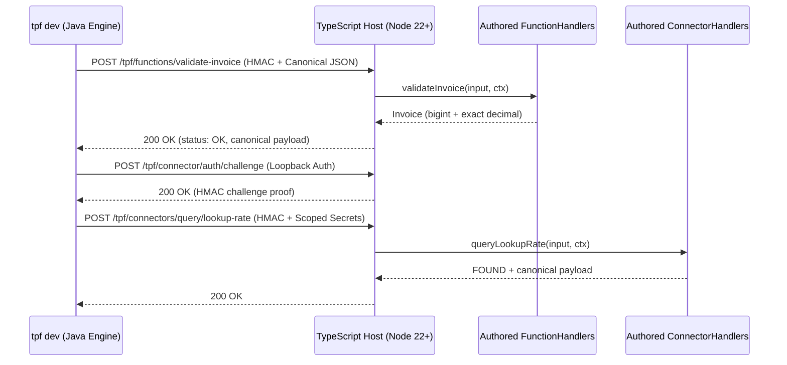

# Node and TypeScript

Write TPF business steps and Tier-2 custom Connector adapters in TypeScript using **Node 22.18+** (when built-in TypeScript type stripping became enabled by default; earlier Node 22.x releases require `--experimental-strip-types`) with zero runtime dependencies. The native `tpf` CLI generates strongly typed interfaces and an HTTP/1.1 host module directly from your canonical v3 `pipeline.yaml`.



## 1. Generate TypeScript types and host bindings

Run `tpf generate` against your `pipeline.yaml`:

```sh
tpf generate --pipeline pipeline.yaml --lang typescript --out ./generated
```

`tpf generate` runs offline and produces:

- `generated/types.ts` — immutable TypeScript interfaces for every canonical type, union variant, `FunctionContext`, `QueryConnectorContext`, `CommandDispatchContext`, `CommandReconcileContext`, and portable failure classes (`TpfBusinessRejectionError`, `TpfTransientError`).
- `generated/host.ts` — `FunctionHandlers`, `ConnectorHandlers`, and `startAppHost(...)` wiring HMAC-SHA256 verification, exact `int64` (`bigint`) and `decimal` (`JSON.rawJSON`) codecs, NDJSON streaming with backpressure, and loopback Connector listener authentication.
- `generated/META-INF/pipeline/pipeline-contract.json` — the compiled canonical v3 contract consumed by `tpf dev` and production runtimes.

## 2. Canonical type mapping in TypeScript

| Canonical v3 type | TypeScript type | Precision guarantee |
| --- | --- | --- |
| `string`, `uuid`, `timestamp`, `date`, `duration` | `string` | Exact UTF-8 / ISO-8601 string |
| `bool` | `boolean` | Native boolean |
| `int32` | `number` | Exact signed 32-bit integer |
| `int64` | `bigint` | Exact 64-bit integer (`> 2^53` preserved via `JSON.rawJSON`) |
| `decimal` | `string` | Exact arbitrary-precision decimal string (no float64 rounding) |
| `float32`, `float64` | `number` | IEEE-754 floating point |
| `list<T>` | `readonly T[]` | Ordered array |
| `map<string, V>` | `Readonly<Record<string, V>>` | String-keyed map |
| `union` | Discriminated union (`{ kind: '...' }`) | Exhaustive type narrowing |

## 3. Implement business functions

Author plain async functions and async generators matching the generated `FunctionHandlers` contract. Keep business steps pure — they never handle HTTP transport, retries, or secrets.

```ts
import {
  type FunctionHandlers,
  TpfBusinessRejectionError,
  TpfTransientError,
  startAppHost,
} from './generated/host.ts';

export const handlers: FunctionHandlers = {
  // ONE_TO_ONE
  async validateInvoice(invoice, ctx) {
    if (invoice.amount.startsWith('-')) {
      throw new TpfBusinessRejectionError('NEGATIVE_AMOUNT', 'Invoice amount must be positive');
    }
    return { ...invoice, sequenceNumber: invoice.sequenceNumber + 1n };
  },

  // ONE_TO_MANY
  async *expandLines(invoice, _ctx) {
    yield { sku: `${invoice.invoiceId}-A`, lineTotal: invoice.amount };
  },

  // MANY_TO_MANY (true full-duplex: yields outputs as inputs arrive)
  async *enrichLines(lines, _ctx) {
    for await (const line of lines) {
      yield { sku: line.sku.toUpperCase(), lineTotal: line.lineTotal };
    }
  },

  // MANY_TO_ONE
  async summariseInvoice(lines, _ctx) {
    let count = 0;
    let lastTotal = '0.00';
    for await (const line of lines) {
      count += 1;
      lastTotal = line.lineTotal;
    }
    if (count === 0) {
      throw new TpfTransientError('EMPTY_BATCH', 'Upstream produced no line items');
    }
    return { invoiceId: `batch-${count}`, grandTotal: lastTotal };
  },
};

const running = await startAppHost(handlers, {
  host: '127.0.0.1',
  port: Number(process.env.PORT ?? 0),
  sharedSecret: process.env.TPF_SHARED_SECRET!,
});
console.log(`READY ${running.baseUrl}`);
```

### Portable failure classification

Throw one of the generated error classes so the Java engine applies the correct retry and failure policy:

- **`TpfBusinessRejectionError(code, message)`** — non-retryable domain rejection (`BUSINESS_REJECTION`).
- **`TpfTransientError(code, message)`** — retryable transient failure (`TRANSIENT`) governed by the engine's retry policy.
- Any other thrown `Error` is classified as `UNCLASSIFIED` and treated as non-retryable by default.

## 4. Author a Tier-2 custom Connector (optional)

When your pipeline needs a proprietary Node SDK that is not covered by built-in Tier-1 Connectors (such as `http.client` v1), implement `ConnectorHandlers` and pass it as the second argument to `startAppHost(handlers, connectors, options)`.

- **Query operations** return `{ outcome: 'FOUND', payload }`, `{ outcome: 'NOT_FOUND' }`, `{ outcome: 'RETRYABLE_ERROR', code, message }`, or `{ outcome: 'TERMINAL_ERROR', code, message }`.
- **Command operations** implement `dispatch<Op>(input, ctx)` and optionally `reconcile<Op>(ctx)` using `ctx.dispatchIdentity.providerIdempotencyKey`.
- Java continues to own `CommandEffectStore`, `QueryCaptureStore`, `RETURN_RECORDED` replay, and automatic `AMBIGUOUS` reconciliation. Scoped secrets arrive in `ctx.secrets` only after the host authenticates the Connector listener.

```ts
export const connectors: ConnectorHandlers = {
  async queryLookupRate(request, ctx) {
    const apiKey = ctx.secrets['FX_API_KEY'];
    // Call proprietary SDK with apiKey...
    return { outcome: 'FOUND', payload: { currency: request.currency, rate: '1.08450000' } };
  },
};
```

## 5. Run and unit-test without a JVM

Test business functions directly using Node 22.18+'s built-in test runner (pass `--experimental-strip-types` on Node 22.6–22.17):

```sh
node --test src/handlers.test.ts
```

Then run the complete pipeline with durable state, streaming, Await, and Connector composition using `tpf dev` (see [Local Development and Testing without a JVM](./testing-and-local-dev)).
