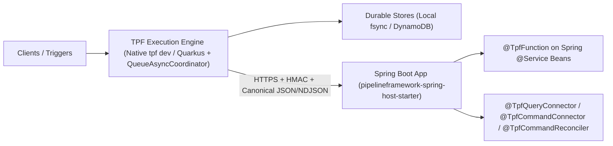

# Spring Boot Integration

Spring Boot applications integrate with The Pipeline Framework through the **ADR-0092 Foreign Function & Connector Host** model ([ADR-0094](/decisions/0094-non-quarkus-jvm-frameworks-use-foreign-function-host)).

Instead of re-hosting TPF's durable execution engine inside Spring, TPF runs **one canonical execution engine** (the standalone native `tpf` CLI in local development, or Quarkus + `QueueAsyncCoordinator` in production) and invokes your ordinary Spring Boot `@Service` beans over authenticated HTTP/1.1 using `org.pipelineframework:pipelineframework-spring-host-starter`.



## Why this architecture

- **Full durable parity immediately:** Spring Boot applications inherit `ONE_TO_ONE`, `ONE_TO_MANY`, `MANY_TO_ONE`, and full-duplex `MANY_TO_MANY` streaming, durable Await suspension and resume, Command effect idempotency and reconciliation, Query capture and replay, pre-send dispatch intents, and crash recovery.
- **Zero Quarkus, Vert.x, or Mutiny dependencies:** `pipelineframework-spring-host-starter` depends only on Spring Boot WebFlux, Jackson, and `pipelineframework-runtime-core` (`TransitionWorkerSignature`).
- **Idiomatic Spring Boot code:** Keep your existing `@SpringBootApplication`, Spring Data repositories, Spring Security configuration, and `@Service` beans (`sync`, `Mono`, `Flux`, `CompletionStage`, `Stream`, `Iterable`).
- **Seamless composition:** Compose Spring Boot steps alongside Quarkus, Node/TypeScript, and Python steps in the same `pipeline.yaml`.

## Dependency

Add `pipelineframework-spring-host-starter` to your Spring Boot WebFlux application:

```xml
<dependency>
    <groupId>org.pipelineframework</groupId>
    <artifactId>pipelineframework-spring-host-starter</artifactId>
</dependency>
```

## Configuration

Configure the shared HMAC-SHA256 secret (or pass `TPF_FUNCTION_HOST_SECRET` in the environment):

```properties
tpf.host.shared-secret=${TPF_FUNCTION_HOST_SECRET}
tpf.host.max-clock-skew=PT5M
tpf.host.max-request-bytes=4194304
tpf.host.max-frame-bytes=4194304
```

The starter auto-configures the following ADR-0092 endpoints on your Spring WebFlux server:

- `GET /tpf/health` — readiness probe
- `POST /tpf/functions/{stepId}` — `ONE_TO_ONE` unary JSON
- `POST /tpf/functions/{stepId}/stream` — `ONE_TO_MANY` NDJSON streaming
- `POST /tpf/functions/{stepId}/reduce` — `MANY_TO_ONE` chunked NDJSON reducer
- `POST /tpf/functions/{stepId}/duplex` — `MANY_TO_MANY` full-duplex interleaved NDJSON
- `POST /tpf/connector/auth/challenge` — mutual HMAC loopback authentication for `tpf dev`
- `POST /tpf/connector/query/{operation}` — Tier-2 Query Connector
- `POST /tpf/connector/command/{operation}/dispatch` — Tier-2 Command Connector dispatch
- `POST /tpf/connector/command/{operation}/reconcile` — Tier-2 Command Connector reconciliation

## Authoring business functions

Annotate methods on ordinary Spring `@Service` or `@Component` beans with `@TpfFunction`. Synchronous methods (`Out`, `Stream<Out>`, `Iterable<Out>`, `Out(Stream<In>)`) are automatically offloaded to Reactor's bounded elastic scheduler; reactive methods (`Mono`, `Flux`, `CompletionStage`) run natively on the WebFlux event loop.

```java
@Service
public class PaymentFunctions {

    @TpfFunction(stepId = "price-payment")
    public PaymentReceipt pricePayment(PaymentInput input, TpfFunctionContext ctx) {
        if (input.amount().compareTo(BigDecimal.ZERO) < 0) {
            throw new TpfBusinessRejectionException("NEGATIVE_AMOUNT", "Amount must be non-negative");
        }
        return new PaymentReceipt(input.id(), input.amount(), ctx.versionTag().orElse("v1"));
    }

    @TpfFunction(stepId = "split-payment")
    public Flux<LineItem> splitPayment(PaymentInput input) {
        return Flux.just(new LineItem(input.id(), 1, input.amount()));
    }

    @TpfFunction(stepId = "sum-lines", outputTypeId = "BatchSummary")
    public Mono<BatchSummary> sumLines(Flux<LineItem> lines) {
        return lines.reduce(
            new BatchSummary(0, BigDecimal.ZERO),
            (acc, item) -> new BatchSummary(acc.count() + 1, acc.sum().add(item.portion())));
    }

    @TpfFunction(stepId = "transform-duplex", outputTypeId = "LineItem")
    public Flux<LineItem> transformDuplex(Flux<LineItem> incoming) {
        return incoming.map(item -> new LineItem(item.id(), item.index(), item.portion()));
    }
}
```

### Precision, failures, and secret isolation

- **Exact numeric fidelity:** The starter's JSON codec preserves full arbitrary-precision `BigDecimal` values (including trailing zeroes) and odd 64-bit `long` values above $2^{53}$.
- **Portable failures:** Throw `TpfBusinessRejectionException` for non-retryable rejections (`BUSINESS_REJECTION`) or `TpfTransientException` for retryable failures (`TRANSIENT`). Unhandled exceptions map to `UNCLASSIFIED`.
- **Strict secret isolation:** `TpfFunctionContext` carries only non-secret step metadata (`stepId`, `stepIndex`, `versionTag`). Provider credentials are never delivered to `@TpfFunction` methods.

## Authoring Tier-2 custom Connectors

Expose provider-specific Query, Command, and Reconciliation operations using `@TpfQueryConnector`, `@TpfCommandConnector`, and `@TpfCommandReconciler`. TPF's execution engine retains authority over `CommandEffectStore`, `QueryCaptureStore`, `providerIdempotencyKey`, and host credential resolution (`ConnectionResolver`), delivering scoped secrets solely through `TpfConnectorContext`, `TpfCommandContext`, and `TpfReconcileContext`.

```java
@Service
public class BillingConnectors {

    @TpfQueryConnector(operation = "lookup-account")
    public TpfQueryResult<AccountState> lookupAccount(AccountLookup input, TpfConnectorContext ctx) {
        String apiKey = ctx.secret("apiKey").orElse("");
        if (apiKey.isBlank()) {
            return TpfQueryResult.authRequired("missing-api-key");
        }
        return TpfQueryResult.found(new AccountState(input.accountId(), "enterprise"));
    }

    @TpfCommandConnector(operation = "charge-account")
    public Mono<TpfCommandResult<ChargeReceipt>> chargeAccount(ChargeRequest input, TpfCommandContext ctx) {
        return Mono.just(TpfCommandResult.succeeded(
            new ChargeReceipt("chg-" + input.accountId(), ctx.providerIdempotencyKey()),
            "rcpt-" + ctx.commandId()));
    }

    @TpfCommandReconciler(operation = "charge-account")
    public TpfReconcileResult<ChargeReceipt> reconcileCharge(TpfReconcileContext ctx) {
        return TpfReconcileResult.confirmedSucceeded(
            new ChargeReceipt("chg-reconciled", ctx.providerIdempotencyKey()),
            "rcpt-reconciled-" + ctx.commandId());
    }
}
```

> [!NOTE]
> Deploy pure `@TpfFunction` hosts and Tier-2 custom Connector hosts in separate processes or services with distinct HMAC secrets in production so business logic remains strictly isolated from provider credentials.

## Retirement of legacy Spring host-parity adapters

The earlier `pipelineframework-runtime-spring` adapter and `rendererProfile=spring` compiler renderers are superseded by [ADR-0094](/decisions/0094-non-quarkus-jvm-frameworks-use-foreign-function-host) and are being retired in favour of `pipelineframework-spring-host-starter`.

## Related documentation

- [ADR-0094: Non-Quarkus JVM Frameworks Use Foreign Function Host](/decisions/0094-non-quarkus-jvm-frameworks-use-foreign-function-host)
- [ADR-0092: Polyglot Java Execution Engine and Foreign Function Host](/decisions/0092-polyglot-java-execution-engine-and-foreign-function-host)
- [Polyglot Development Guide](/develop/polyglot/)
- [Deploying Polyglot Applications](/deploy/polyglot)
