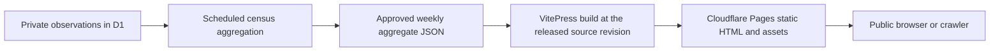

# Publishing ecosystem usage

## Architecture audit

The public site uses VitePress static output on Cloudflare Pages, with clean URLs and the existing light/dark documentation theme. The site has no dashboard charting dependency. [Docs deployment](/evolve/publishing#docs-deployment) pins the public domain to the exact release commit on the `release-docs` branch. `main` and PRs serve staging and previews.

The home page's Latest Releases and Featured Articles widgets fetch `/api/releases` and `/api/devto-feed` after mounting. The release widget has a direct GitHub fallback. The corresponding Pages Functions clamp request parameters, cache upstream fetches for 300 seconds, and send 300-second browser/600-second shared success TTLs with 120 seconds of stale-while-revalidate. Errors use shorter TTLs. An audit of the live homepage and both endpoint responses found Cloudflare serving all three; the sampled responses showed `CF-Cache-Status: DYNAMIC`. The homepage revalidated, releases returned the shorter error TTL on that probe, and the dev.to endpoint returned the success TTL. These headers do not prove a zone cache rule or a cache hit. There is no zone ruleset, billing configuration or Pages project configuration in this checkout to verify account-specific overrides.

The census v1 schema has compiler/contracts versions, Java major, four structure bands, six feature bands, transport, platform and runtime layout. D1 stores daily observations and distinct period membership. Its scheduled Worker prunes data and can materialise fixed monthly marginals, but has no public read/export endpoint. Ingestion and statistics are gated off and the checked-in D1 binding is a placeholder. There is no approved live weekly dataset. Neither the compiler nor runtime needs to change.

## Decision and ownership

The census owns eligibility, weekly deduplication, suppression and the independently versioned public schema. The site owns strict validation, static rendering and publication. Public traffic never calls the census, D1, GitHub or dev.to for this dashboard. The existing two Pages Functions keep their routes; all dashboard paths are outside the Functions route allowlist. Browser navigation loads ordinary static VitePress assets; the charts use CSS/SVG and the HTML already contains the numbers and tables.

A weekly approved export is small enough for the existing Pages project. No R2, public Worker, deploy-time database binding, per-view fetch or visitor analytics is needed. Prefer a reviewed export and rebuild to introducing a new privileged cross-repository automation before the pilot. Keep the exact release source policy. An independent weekly refresh rebuilds that same commit with updated aggregate input; it does not advance `release-docs`. This data-only refresh requires operator approval and a configured Pages build hook before activation.

Use Pages' existing revalidation for HTML. Content-addressed JSON and Vite assets may be cached as immutable; the current HTML is the pointer, so clients do not need a separate manifest request. A failed export or validation must leave the last good Pages deployment in place. See [Pages cache behaviour](https://developers.cloudflare.com/pages/configuration/serving-pages/#caching-and-performance) and [Pages Functions pricing](https://developers.cloudflare.com/pages/functions/pricing/). Ordinary static Pages asset requests are not billed as Functions under the standard model; verify account terms, route coverage and any other services before launch. Builds, deployment quotas and scheduled D1 work still apply. Public traffic increases static requests and bytes only.

## Publication runbook

1. Complete the existing compiler/collector privacy, ownership and pilot gates. Confirm the collector operator and site operator. Keep ingestion and aggregate publication disabled until approved. Apply the weekly table migration to the dedicated census database, and select the first fully covered UTC Monday with `PUBLIC_WEEKLY_FIRST_MONDAY`.
2. After Tuesday's scheduled job, have the census operator run the checked-in `scripts/select-public-usage.sql` against D1 and give its Wrangler JSON result to `scripts/export-public-usage.js`. See the collector's `docs/privacy-runbook.md` for the exact commands. The query touches only materialised public weekly rows. The exporter refuses an absent latest week; earlier gaps are allowed. A materialised insufficient-contributor week is valid data and exposes no totals. Keep existing monthly rows internal when operating the weekly dashboard; publishing overlapping granularities needs a separate disclosure review.
3. Review the JSON against the public schema and confirm that it comes from approved observations, not fixtures. Compare its latest complete week and generation date with the last deployed data; do not replace a newer release with an older export. Publish only the reviewed `usage.snapshot.json` at the root of the protected `usage-public` branch of `The-Pipeline-Framework/pipelineframework-census`. The branch is public: do not place raw input, credentials, or synthetic data there. Confirm GitHub's raw URL returns the approved bytes before proceeding.
4. Once the public release includes this route, the site operator enables `TPF_USAGE_SNAPSHOT=approved` in the existing Pages build configuration and verifies the build runs the normal docs `npm run build` script. The consumer additionally requires Cloudflare's `CF_PAGES_BRANCH=release-docs`, so staging and PR builds show the empty state and do not contact GitHub. Configure a [branch-specific deploy hook](https://developers.cloudflare.com/pages/configuration/deploy-hooks/) for `release-docs`. Trigger it once for the approved weekly export. Keep its URL secret, and coordinate with release promotion so the deployment records the intended released source SHA. Do not move the source branch or install a scheduled push. A normal release build consumes the same approved input.
5. Verify the deployment contains `ecosystem/usage.html`, `_routes.json` and the hash-addressed JSON. Inspect `Cache-Control`, `ETag` and content type at the custom domain for both the page and download. Repeat with varied query strings and user agents; check that Pages Functions/Workers metrics show no invocation for either path, including any account-level Worker routes or cache overrides. Confirm the existing release and article API routes still behave as before.

This is one operator-reviewed handoff per week, with one bounded GitHub fetch during an enabled site build. An automatic scheduled handoff is possible later, but would need protected publication credentials and explicit approval and withdrawal controls. Never give the site D1 access or let the browser discover snapshots on GitHub.

## Failure and withdrawal

An outage does not affect an already deployed page. A failed export, an unpublished latest week,
a failed fetch or malformed input stops the refresh; the last successful deployment stays in
place. Its UTC period and generation timestamp are always visible. The browser can mark it
stale once the next week closes, using its clock alone. If an approved input is temporarily
unavailable during a regular docs release build, restore the last approved export and rebuild;
do not bypass validation or substitute fixtures.

For a withdrawal, stop publication and review the affected weeks with the privacy owner.
Do not publish revised counts for the same week without assessing differencing against the
already public release. To remove statistics from the active site, disable the input flag
and rebuild the same release source, then verify the empty page and purge the affected edge
paths where applicable. Protect against restoring withdrawn weekly rows in the collector.
An immutable asset or previously public Git revision may survive in client caches or copies;
publication is not reversible. For recovery on the preview branch alias, prefer restoring
a reviewed export and rebuilding over assuming [Pages rollback](https://developers.cloudflare.com/pages/configuration/rollbacks/) applies to preview deployments.

## Local verification and production gate

- From the site root, run `npm --prefix docs test` and `npm --prefix docs run build`.
- With Playwright Chromium installed, run `node docs/scripts/verify-usage-render.js`. The synthetic
  site exists only in a temporary local directory. The production build contains an empty state,
  never test counts. The browser proof exercises stale and missing data, suppression, mobile and
  keyboard use, and static responses to varied crawler requests.
- From the census root, run `npm test` and `WRANGLER_SEND_METRICS=false npm run check`. Check that
  the site schema copy and `protocol/public-usage-v1.schema.json` match byte for byte.
- Before opening the dashboard publicly, verify real data provenance, deployment ownership,
  Cloudflare billing/route overrides and a real approved export on a preview deployment.
  No public deployment, production traffic test or account setting change is part of local validation.
