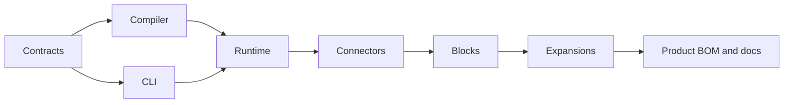

# Framework Release Process

This page captures the framework artifact release flow.

## Prepare Locally

Run Maven release preparation without pushing:

```bash
./mvnw release:prepare \
  -DpushChanges=false \
  -DreleaseVersion=26.5.2 \
  -DdevelopmentVersion=26.6.1-SNAPSHOT \
  -Dtag=v26.5.2 \
  -Darguments="-DskipTests"
```

## Validate Before Pushing

Run the release gate appropriate to the slice. At minimum:

- version drift checks,
- framework verification,
- CSV topology checks,
- docs build.

After publishing the snapshot, verify the downstream consumer repositories against it: examples (including
`ai-sdk`), reference implementations, CSV Kafka Payments, and RAG Turnkey.

## Publish

After validation:

1. push the prepared release and next-development commits,
2. push the immutable release tag,
3. let GitHub Actions publish signed artifacts to Maven Central,
4. verify the artifacts on Sonatype Central,
5. create or verify the GitHub release,
6. verify that the workflow promoted the release commit to `release-docs` and that
   `https://pipelineframework.org` serves that deployment.

For detailed Central plugin, GPG, and troubleshooting notes, see [Publishing Reference](/evolve/publishing-reference).

## 26.10.1 release record

Release `26.10.1` freezes the compatible component coordinates at `26.10.1`.
The following development line is `26.11.1-SNAPSHOT`.
Publish each producer only after its released dependencies are available:



Local preparation at coordinator commit `337a31a8ff6ccd0234bca0b979176325aa0ddcfe`
passed 14 Java cross-artifact tests, 130 orchestration tests, 36 documentation
tests, the production documentation build and availability checks for all 56
BOM-managed coordinates. Those checks used the published `26.10.1-SNAPSHOT`
line; they do not replace verification of the final immutable releases.

The frozen release-source candidate set subsequently passed all six product
shards and exact-SHA status reporting in
[coordinated run 40941421051](https://github.com/The-Pipeline-Framework/pipelineframework/actions/runs/40941421051).
Only the reference shard was retried, after a base-image download ended early;
the five successful shards were retained.

CLI Central publication required a metadata-only recovery: six child POMs
needed explicit project display names. [CLI PR 14](https://github.com/The-Pipeline-Framework/pipelineframework-cli/pull/14)
added the guard and a trusted recovery entry point.
[The successful recovery](https://github.com/The-Pipeline-Framework/pipelineframework-cli/actions/runs/40951274591)
checked out the original `v26.10.1` tag and logged only those POM display-name
additions. It did not move the tag or alter Java sources, coordinates,
dependencies or the reactor. Native distributions and the container were
published from that same original tag.

The maintainer explicitly authorised this release without waiting for the
following failures from the [29 October full train](https://github.com/The-Pipeline-Framework/pipelineframework/actions/runs/40836241920):

- CSV HA scale: [CSV PR 28](https://github.com/The-Pipeline-Framework/csv-kafka-payments/pull/28)
  merged; a successful full-train scale retest was not established during preparation.
- AWS Search test deployment: direct Lambda ZIP upload exceeded its upload
  limit. [Coordinator PR 1047](https://github.com/The-Pipeline-Framework/pipelineframework/pull/1047)
  subsequently merged deployment-permission and package-preflight changes;
  a successful cloud retest is not established by the local release checks.
  The original failure does not establish a runtime defect.

This is a release-specific exception, not a green full-train attestation or a
permanent reduction in the full-train policy. The ordinary compatibility,
application and HA shards in that train passed.
