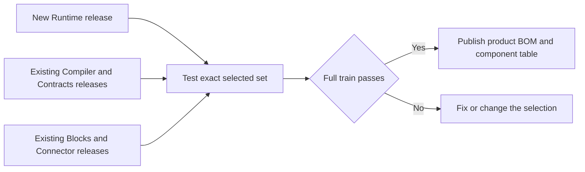
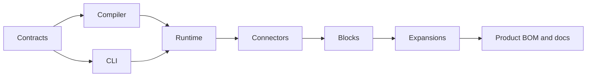

# Framework Release Process

This page captures the framework artifact release flow.

## Select component versions

A product release publishes a tested BOM selection, not a new version of every repository.
Runtime `26.12.3` may work with Compiler `26.12.1`, Contracts `26.11.2` and Blocks `26.10.1`.
These are illustrative versions. Consumers normally choose one product BOM version; Maven plugins
still need explicit plugin versions because an imported BOM cannot manage them.



Create `releases/<product-version>.json`, following
`system-tests/schemas/product-release.schema.json`. Start from the previous release manifest;
set `previousVersion` to that product version and identify each component as `new` or `reuse`.
Record stable Maven versions and full source SHAs for every component, plus exact source SHAs
for all four test-owning repositories. Repository ownership is checked against `system-tests/components.yml`.
`releases/26.10.1.json` bootstraps the historical component selection; its harness pins are the main revisions
recorded during this automation change, not a claim of a historical full-train attestation.

Inspect implementation, API, dependency POM, generated resource and publication changes before choosing
`new`. A dependency update may require a new consumer artifact, but a newer compatible dependency alone
does not automatically require republishing every downstream component. The BOM's mediation and tests
decide whether reuse works. A reused component must preserve its previous version and source SHA.

Print the publication plan:

```sh
python3 system-tests/scripts/product-release.py plan --manifest releases/<product-version>.json
```

Only the `publishComponents` list needs preparation, tags and component publication. The list is in
dependency order; reused components are absent. A runtime-only change normally needs two Central
operations: Runtime and the coordinator's parent/BOM bundle. The product version need not match
either Runtime's version or the other components' versions.
The planner checks Central availability: components already independently published are listed under
`alreadyPublishedComponents` and need no second publication. Partial availability blocks preparation
until the original deployment or repository propagation has been reconciled.

## Prepare only new components

Before a coordinated change merges, use the existing immutable candidate compatibility-set gate.
Then, for each planned new component, freeze its dependencies to the selected stable releases:

```sh
python3 system-tests/scripts/product-release.py freeze \
  --manifest releases/<product-version>.json --component runtime --pom /absolute/runtime-checkout/pom.xml
```

This edits only that named POM's dependency-version properties, preserves comments and rejects missing
or duplicate declarations. It refuses a reused component. It does not change reactor versions, create
commits, or publish anything. Use the owning repository's release preparation and validation to set
its own new version, retain the canonical reactor, commit the prepared source, and record the final
release commit SHA in the selection manifest. Publish only the new components, in planned dependency
order. Never move a published tag or overwrite an existing coordinate.

Unchanged components need no release or version-bump PR. In particular, do not advance Blocks simply
because Runtime advances. Keep the active snapshot development policy on `main` after preparation;
stable selection must not leave development depending on obsolete stable versions.

## Test the exact stable selection

After new component coordinates are available, commit the selection manifest to coordinator `main`.
In Actions, run **TPF System Tests — Full Train** from `main` with `release_manifest` set to
`releases/<product-version>.json`. Leaving that input empty retains the nightly current-main train.

Selected-release mode verifies source SHAs against component release tags, fetches the selected stable
POMs/JARs from Central, records their SHA-256 hashes, hydrates the isolated Maven repository once and
runs the existing complete suite policy. Source harnesses, annotation processors, tool dependencies
and the temporary test BOM receive the independent selected versions through existing override mappings.
Cloud build jobs receive the same credential-free exact inputs. No candidate publication, source reactor,
extra Maven profile or floating snapshot is substituted for these stable coordinates.

The run records `release-selection.json`, containing the selection and hashes of the BOM dependency model,
component configuration and coverage policy. Selected-release runs never promote the mutable development
baseline. Missing artifacts or an incompatible set must fail; resolve the cause or select another version.
Do not fabricate success, silently drop a suite, or reuse the 26.10.1 release-specific exceptions below.

## Publish the tested BOM

After that full train succeeds:

1. Set `validationRunId` in the manifest to the successful run ID. The run ID is a pointer to evidence,
   not part of the tested selection identity, so adding it does not invalidate the evidence.
2. Freeze the coordinator dependency properties with `freeze --component coordination --pom /absolute/coordinator-checkout/pom.xml`.
3. Prepare the coordinator's product release version and docs, then validate the framework and docs.
   Include `-Dmaven.repo.local="$PWD/.m2/repository"` in every Maven invocation.
4. Push the prepared commits and immutable product tag through the normal maintainer process.
5. The tag publisher rejects a root-POM/manifest mismatch, missing or unsuccessful evidence, or a train that
   tested a different selection, BOM model or coverage policy. It also resolves every BOM-managed coordinate
   through the existing publication verifier before deploying the parent/BOM bundle.
6. Verify Central availability, the GitHub release's new/reused component table and public docs promotion.

Changes to component selection, harness SHAs, BOM dependencies, component mappings or coverage policy after
validation require another selected-release train. Evidence artifacts must still be retained and downloadable;
expired evidence blocks publication. Retry only the failing layer when the tested inputs are unchanged.
Rollback means selecting a previously tested product BOM, never rewriting a published component.

This flow does not implement the separate combined-Central-bundle proposal in issue #1051. Individual new
components retain their owning publishers. It removes unnecessary component publications first.

For detailed Central plugin, GPG, and troubleshooting notes, see [Publishing Reference](/evolve/publishing-reference).

## 26.10.1 release record

Release `26.10.1` freezes the compatible component coordinates at `26.10.1`.
The following development line is `26.11.1-SNAPSHOT`.
Publish each producer only after its released dependencies are available:



Local preparation at coordinator commit `337a31a8ff6ccd0234bca0b979176325aa0ddcfe`
passed 14 Java cross-artifact tests, 130 orchestration tests, 36 documentation
tests, the production documentation build and availability checks for all 56
BOM-managed coordinates. Those checks used the published `26.10.1-SNAPSHOT`
line; they do not replace verification of the final immutable releases.

The frozen release-source candidate set subsequently passed all six product
shards and exact-SHA status reporting in
[coordinated run 40941421051](https://github.com/The-Pipeline-Framework/pipelineframework/actions/runs/40941421051).
Only the reference shard was retried, after a base-image download ended early;
the five successful shards were retained.

CLI Central publication required a metadata-only recovery: six child POMs
needed explicit project display names. [CLI PR 14](https://github.com/The-Pipeline-Framework/pipelineframework-cli/pull/14)
added the guard and a trusted recovery entry point.
[The successful recovery](https://github.com/The-Pipeline-Framework/pipelineframework-cli/actions/runs/40951274591)
checked out the original `v26.10.1` tag and logged only those POM display-name
additions. It did not move the tag or alter Java sources, coordinates,
dependencies or the reactor. Native distributions and the container were
published from that same original tag.

The maintainer explicitly authorised this release without waiting for the
following failures from the [29 October full train](https://github.com/The-Pipeline-Framework/pipelineframework/actions/runs/40836241920):

- CSV HA scale: [CSV PR 28](https://github.com/The-Pipeline-Framework/csv-kafka-payments/pull/28)
  merged; a successful full-train scale retest was not established during preparation.
- AWS Search test deployment: direct Lambda ZIP upload exceeded its upload
  limit. [Coordinator PR 1047](https://github.com/The-Pipeline-Framework/pipelineframework/pull/1047)
  subsequently merged deployment-permission and package-preflight changes;
  a successful cloud retest is not established by the local release checks.
  The original failure does not establish a runtime defect.

This is a release-specific exception, not a green full-train attestation or a
permanent reduction in the full-train policy. The ordinary compatibility,
application and HA shards in that train passed.
