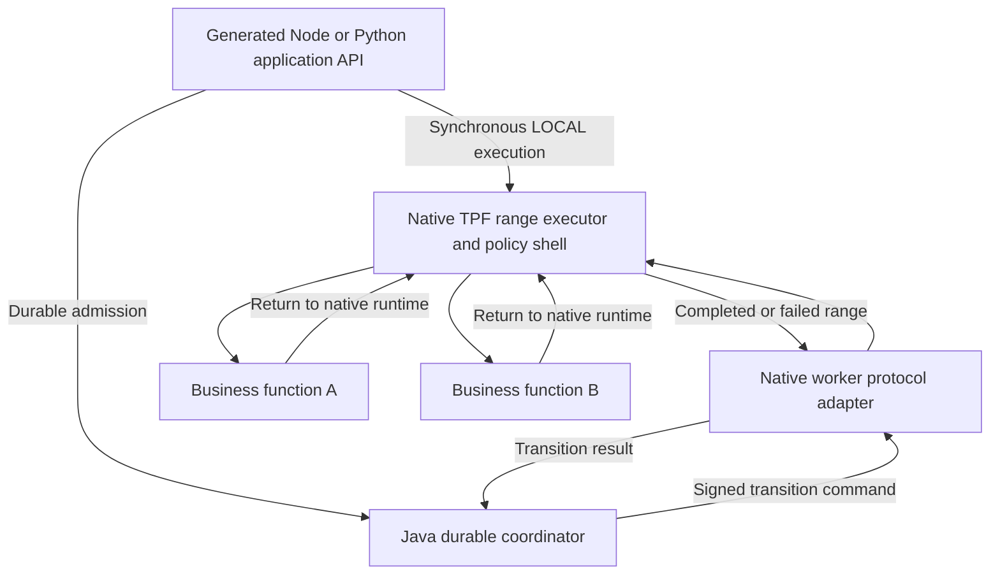

# Polyglot TPF applications: native LOCAL and distributed execution

Evidence assessed 30 October 2026; native-runtime requirement and roadmap revised 31 October 2026. **Future/backlog exploration, outside Cloud MVP; implementation remains unscheduled.**

## Current conclusion: equivalent LOCAL workflows require native runtimes

The earlier adapter-only proposal below keeps the entire execution shell in Quarkus and calls foreign business functions remotely. That can provide business-function interoperability, but it does not give a Node or Python author an equivalent in-process LOCAL pipeline. Generated gRPC stubs, registration adapters and an application facade cannot supply the missing execution semantics.

Native LOCAL equivalence is a requirement: ship a language-specific TPF execution runtime alongside the generated application API and business functions. A returns to that runtime; the runtime applies the supported invocation policies and invokes B. In durable mode, the native worker returns a transition result to the Java coordinator at the transition boundary, rather than calling the JVM after every business function.

This requirement supersedes the earlier restriction to a single execution implementation. TPF retains one compiler-owned semantic authority and the Java durable coordinator, while language-specific runtimes implement a bounded shared execution profile. This is a larger investment than adapters. The requirement is settled; the initial profile, protocol compatibility and package ownership still require design decisions. All new implementation remains unscheduled, outside current Cloud priorities.

The approved roadmap below replaces the earlier adapter-only MVP and its Spring dispositions. Existing Java functionality remains intact. [Draft ADR-0080](/decisions/0080-native-runtimes-consume-compiler-owned-execution-contracts) records the proposed runtime boundary without claiming delivered native support or freezing the detailed protocol. It preserves [compiler-owned semantics](/decisions/0002-compiler-owned-v3-type-model) and [shared worker contracts](/decisions/0050-remote-worker-protocols-are-shared-runtime-contracts).

## Native execution and coordinator boundary

The compiler remains Java-hosted during the build; the proposed pure synchronous native monolith needs no JVM during execution. Durable execution still needs the Java coordinator, locally or remotely. A native function packaged for Lambda could execute a local chain only if its package includes the native TPF executor; bundling handlers alone does not establish this capability. No native Lambda deployment evidence was found or produced in this investigation.

The existing command carries execution/release identity, attempt and a range (`currentStepIndex`, `stopBeforeStepIndex`). Its result distinguishes completion, failure and external suspension. This is reusable framing, not an implementation of the range executor. A lost response can cause a transition to execute again; business-function invocation is not exactly once. [TransitionCommandEnvelope, fields](https://github.com/The-Pipeline-Framework/pipelineframework-contracts/blob/66f10452aec78ac79645292fa4df6cf8479a204c/runtime-protocol/src/main/java/org/pipelineframework/orchestrator/TransitionCommandEnvelope.java#L30-L52); [TransitionWireResult, outcome invariants](https://github.com/The-Pipeline-Framework/pipelineframework-contracts/blob/66f10452aec78ac79645292fa4df6cf8479a204c/runtime-protocol/src/main/java/org/pipelineframework/orchestrator/TransitionWireResult.java#L17-L77).

### Minimum language-specific runtime

| Component | Proposed minimum responsibility |
|---|---|
| Generated application API | Typed direct invocation; separately, durable admission/status/result bindings |
| Compiled bindings | Ordered operations, logical step identities, native handler registry, canonical types, execution policy requirements and placement bindings |
| Native range executor | Execute the compiler-defined pipeline/range; sequence results; normalise synchronous throws and asynchronous failures |
| Invocation policy shell | Supported retry/backoff, rejection, context, cancellation, deadline propagation and semantic telemetry; one policy owner at each boundary |
| LOCAL adapter | Invoke a handler in the same native process through the policy shell |
| Remote step bindings | Generated client/server mappings preserving canonical values, context and failure classification |
| Coordinator worker adapter | Validate authentication and pinned identity, decode inputs, execute the range and return structured results |

Porting the chaining loop is insufficient. `PipelineRunnerCore` leaves invocation/lifecycle responsibilities to the host. `StepOneToOne` implements retry/backoff and rejection, and deliberately bypasses generic retry/recovery for `TransportBoundaryInvocation`. Native distribution must preserve that distinction instead of multiplying retries at caller, server and coordinator. There is no universal per-handler timeout in this inspected unary implementation; preserve actual deadline/transport-budget contracts rather than inventing parity with one. [PipelineRunnerCore, host responsibilities and sequencing](https://github.com/The-Pipeline-Framework/pipelineframework-contracts/blob/66f10452aec78ac79645292fa4df6cf8479a204c/runtime-core/src/main/java/org/pipelineframework/runtime/core/PipelineRunnerCore.java#L24-L111); [StepOneToOne.apply](https://github.com/The-Pipeline-Framework/pipelineframework-runtime/blob/b58f9ff4f3e904e49dcbe2ce420c209d36efe97a/runtime/src/main/java/org/pipelineframework/step/StepOneToOne.java#L55-L118); [unary policy tests](https://github.com/The-Pipeline-Framework/pipelineframework-runtime/blob/b58f9ff4f3e904e49dcbe2ce420c209d36efe97a/runtime/src/test/java/org/pipelineframework/pipeline/step/StepOneToOneTest.java#L140-L180).

Node and Python can share compiler-owned contracts and conformance vectors, but need their own async execution, task-local context, cancellation and explicit blocking-work integration. A Promise/coroutine chain is not streaming/backpressure support. Spring/Micronaut are closer because Java contracts and implementations can be reused; that does not prove complete host parity or make their runners disposable.

### Equivalent workflows and placement gaps

| Proposed workflow | Execution owner | JVM during execution |
|---|---|---|
| Native synchronous monolith | Native runtime, all business calls LOCAL | Not for the bounded pure profile |
| Native distributed pipeline | Native executors and generated remote bindings; co-located calls stay LOCAL | Not inherently |
| Durable native worker | Java coordinator plus native range executor | Required for coordinator |
| Native execution using Quarkus capabilities | Native executor plus explicitly bound Quarkus endpoints | Required for those capabilities |

These are target workflows, not current delivered support. LOCAL continues to mean same-process invocation. A worker reached over REST on localhost is a remote worker, even if its own business-function chain is LOCAL. Worker invocation protocol, pipeline transport and deployment platform remain distinct.

Placement-aware lowering is new compiler work. Current target resolution uses the compilation transport and role-specific rules; runtime mapping assigns modules but does not automatically select LOCAL for every co-located edge. Native targets need generated local and remote bindings from one validated semantic graph, not per-language YAML interpreters. Existing contract metadata includes logical identity, cardinality and canonical types, but also JVM class names and is not a complete native executable plan with resolved policies. [PipelineTargetResolutionPhase](https://github.com/The-Pipeline-Framework/pipelineframework-compiler/blob/26deba06fbee5296c235d7957b4b47fb32708838/src/main/java/org/pipelineframework/processor/phase/PipelineTargetResolutionPhase.java#L174-L238); [PipelineContractMetadataGenerator, step descriptors](https://github.com/The-Pipeline-Framework/pipelineframework-compiler/blob/26deba06fbee5296c235d7957b4b47fb32708838/src/main/java/org/pipelineframework/processor/util/PipelineContractMetadataGenerator.java#L350-L375).

Separately, registered REST transition-worker targeting currently requires the coordinator's generated contract and a single whole-bundle `application-archive`; it explicitly rejects distributed placement. Ordinary remote step calls and a coordinator calling one remote whole-pipeline worker are different workflows. Native release packaging and range placement need qualification rather than assuming this gate already admits them. [RegisteredRestWorkerTargets.validateCompiledContract/wholeBundle](https://github.com/The-Pipeline-Framework/pipelineframework-runtime/blob/b58f9ff4f3e904e49dcbe2ce420c209d36efe97a/runtime/src/main/java/org/pipelineframework/orchestrator/RegisteredRestWorkerTargets.java#L153-L199).

### Coordinator protocol reuse and remaining coupling

A native REST worker can in principle implement the existing signed command/result seam and protocol-v1 capability advertisement. The signature contract already has a deterministic HMAC vector. This is wire feasibility, not an existing Node/Python implementation or deployment proof. [TransitionWorkerProtocolContractTest](https://github.com/The-Pipeline-Framework/pipelineframework-contracts/blob/66f10452aec78ac79645292fa4df6cf8479a204c/runtime-protocol/src/test/java/org/pipelineframework/orchestrator/TransitionWorkerProtocolContractTest.java#L16-L34).

| Gap | Consequence and required decision |
|---|---|
| Java-tagged payloads | Domain payload IDs are Java class names; Java decode performs allowlisted class loading. A proof could use compiler-generated compatibility mappings, but canonical type identity/presence/numeric precision need a sustainable cross-language contract. Outer protobuf framing does not solve inner payload semantics. |
| Java failure classification | Unknown foreign exception names do not communicate nonretryability. Define portable categories or explicit compatibility mappings; do not infer retry safety from a Node/Python exception name. |
| Semantic capability qualification | Worker capability fields advertise protocol/encoding and pinned identity, not support for every execution feature. Reject unsupported contracts before admission or design explicit feature negotiation. |
| Release/tooling integration | Capability matching is necessary but insufficient: generated contract, archive, digests and lifecycle registration must agree. Existing Java packaging is not evidence of native bundle publication. |

Evidence: [JsonTransitionPayloadCodec.encode/decode](https://github.com/The-Pipeline-Framework/pipelineframework-runtime/blob/b58f9ff4f3e904e49dcbe2ce420c209d36efe97a/runtime/src/main/java/org/pipelineframework/orchestrator/JsonTransitionPayloadCodec.java#L61-L138); [TransitionFailureRuntimeAdapter](https://github.com/The-Pipeline-Framework/pipelineframework-runtime/blob/b58f9ff4f3e904e49dcbe2ce420c209d36efe97a/runtime/src/main/java/org/pipelineframework/orchestrator/TransitionFailureRuntimeAdapter.java#L41-L70); [PipelineWorkerCapability](https://github.com/The-Pipeline-Framework/pipelineframework-contracts/blob/66f10452aec78ac79645292fa4df6cf8479a204c/runtime-protocol/src/main/java/org/pipelineframework/orchestrator/worker/PipelineWorkerCapability.java#L20-L31); [registered admission checks](https://github.com/The-Pipeline-Framework/pipelineframework-runtime/blob/b58f9ff4f3e904e49dcbe2ce420c209d36efe97a/runtime/src/main/java/org/pipelineframework/orchestrator/RegisteredRestWorkerTargets.java#L184-L199).

### Bounded first increment and acceptance

The smallest credible profile is finite linear unary pure transformations, supported canonical types, serial execution and explicitly qualified policies. Reject unsupported streaming, branching, Await, checkpoints, Query/Command, object boundaries, cache and plugin declarations at compile time. Equivalence means the same supported profile across Java, Node and Python, not full TPF feature parity.

Keeping Connectors and plugins in Quarkus does not automatically make their semantics available to a native runner. Existing generated step endpoints offer a concrete interoperability path, but Query capture, Command authority, cache policy and plugin acknowledgement cannot all become generic RPC calls. A later boundary needs authenticated context, effect identity, release compatibility and outcome semantics. For this proof, reject such configured capabilities rather than silently omitting them. [RestClientStepRenderer, invocation and side-effect handling](https://github.com/The-Pipeline-Framework/pipelineframework-compiler/blob/26deba06fbee5296c235d7957b4b47fb32708838/src/main/java/org/pipelineframework/processor/renderer/RestClientStepRenderer.java#L170-L268).

Qualification would proceed through the same A → B → C fixture as a native LOCAL monolith, split over two native processes, and a whole-pipeline native worker under the Java coordinator; Python repeats the same contract fixtures. Compiler/build tooling must accept DSL and native functions without handwritten application Java, even if internal compilation still uses a generated Java build host. That build-host independence is a prerequisite, not existing proof from phase-engine unit tests.

Acceptance compares canonical outputs, stable step/item identities, failure classification, retry counts, context isolation and semantic observations. Inject transient/nonretryable failure, cancellation and late response; B must not run after a terminal failure in A. Test the boundary distinction that prevents duplicate retries. The durable configuration additionally needs duplicate delivery, lost response, worker death/recovery and release mismatch fixtures; do not equate synchronous success with durable qualification. Unsupported-feature diagnostics and native type checking/import checks are part of acceptance. No implementation or conformance run was performed in this investigation.

Indicative engineering estimate, not measured delivery data: **12–20 engineer-weeks** for the bounded Node path including shared compiler/protocol work, placement and conformance; **4–8 additional engineer-weeks** for Python. These ranges exclude full feature parity, portable Connector/plugin integration, production hosting and Lambda qualification. Re-estimate after executable contract and placement decisions. They are not delivery commitments or scheduled work.

The remaining decisions concern which unary policies/types form the first profile, how payload/failure compatibility evolves, and how release packaging and worker qualification admit native targets. Operators and remote application services remain useful interoperability paths, but do not satisfy the native pipeline-monolith requirement. The first unary profile is a delivery boundary, not a permanent parity ceiling.

## Roadmap: native LOCAL equivalence is required

Author DSL v3 and business functions in the chosen language. Run the supported pipeline profile in one native process using LOCAL calls; distribute it through compiler-generated placement bindings without rewriting functions or changing semantics. Reuse the Java coordinator when durability is required. Node/Python need no JVM executor for the pure synchronous monolith; Java remains build-time compiler infrastructure.

This replaces the adapter-only Quarkus Execution MVP. One semantic authority does not require one runtime implementation: native kernels consume compiler-owned output and must pass shared conformance. The coordinator, Release authority and existing Quarkus provider implementations remain shared. No new coordinator, Provider SDK or independent YAML interpreter is planned. Unary scope is the first increment, not a permanent parity ceiling.

## Dependency gates and ownership

1. **Executable profile and conformance:** [contracts #52](https://github.com/The-Pipeline-Framework/pipelineframework-contracts/issues/52), informed by the bounded [Node probe #27](https://github.com/The-Pipeline-Framework/pipelineframework-examples/issues/27). Native LOCAL is settled; the open decisions are profile, wire compatibility and packaging.
2. **Native authoring and LOCAL execution:** [compiler #46](https://github.com/The-Pipeline-Framework/pipelineframework-compiler/issues/46) and [Node runtime #84](https://github.com/The-Pipeline-Framework/pipelineframework-runtime/issues/84). Zero handwritten application Java; no JVM executor at run time for pure synchronous execution.
3. **Placement equivalence:** [compiler #47](https://github.com/The-Pipeline-Framework/pipelineframework-compiler/issues/47). A/B co-located use LOCAL; C may move remotely without changing function bodies, identities or policy ownership.
4. **Durable native workers:** [runtime #82](https://github.com/The-Pipeline-Framework/pipelineframework-runtime/issues/82). Reuse coordinator contracts, pin releases and qualify failure/recovery. Whole-bundle worker qualification need not wait for arbitrary distributed worker admission; its current restrictions remain explicit.
5. **Required Python delivery:** [runtime #85](https://github.com/The-Pipeline-Framework/pipelineframework-runtime/issues/85) includes Python runtime and coordinated generated bindings. Reuse settled contracts and fixtures; Node success alone does not complete the epic.
6. **Common acceptance:** [examples #28](https://github.com/The-Pipeline-Framework/pipelineframework-examples/issues/28) owns shared evidence across native monolith, distributed and durable layouts. Spring execution/worker integration is [#482](https://github.com/The-Pipeline-Framework/pipelineframework/issues/482), diagnostics/conformance [#483](https://github.com/The-Pipeline-Framework/pipelineframework/issues/483). Micronaut needs explicit bindings/evidence, not inherited Spring claims.
7. **Later profiles/hosting:** the restored Spring work below is backlog capability expansion, not an initial unary dependency or a dated milestone.

Compiler owns normalisation, canonical types, executable projection and placement. Contracts owns wire/data compatibility and conformance definitions; runtime owns native kernels and Java coordinator integration; examples owns executable proofs; root system-tests qualifies released cross-artifact combinations. Runtime tracks Node/Python work initially; package/repository layout is resolved before implementation. CLI/build tooling reuses [#966](https://github.com/The-Pipeline-Framework/pipelineframework/issues/966), descriptor work [#902](https://github.com/The-Pipeline-Framework/pipelineframework/issues/902) and replay work [#456](https://github.com/The-Pipeline-Framework/pipelineframework/issues/456), without a second Release manifest.

## Spring disposition

| Issues | Approved disposition | Scope |
|---|---|---|
| [#474](https://github.com/The-Pipeline-Framework/pipelineframework/issues/474), [#475](https://github.com/The-Pipeline-Framework/pipelineframework/issues/475) | Completed; retain | Six companion PRs merged; reconcile original acceptance, preserve the Spring runner and generated server/client boundaries |
| [#476](https://github.com/The-Pipeline-Framework/pipelineframework/issues/476) | Restored, rewritten, unscheduled | Later FUNCTION qualification of packaged native execution ranges; distinguish entrypoint and durable-worker roles |
| [#477](https://github.com/The-Pipeline-Framework/pipelineframework/issues/477) | Restored, unscheduled | Later shared streaming/non-unary execution profile with Spring implementation and lineage/backpressure conformance |
| [#478](https://github.com/The-Pipeline-Framework/pipelineframework/issues/478) | Restored, narrowed, unscheduled | Compiled hook order/acknowledgement/failure and bounded Quarkus capability invocation; no plugin ecosystem port |
| [#479](https://github.com/The-Pipeline-Framework/pipelineframework/issues/479) | Remains not planned | Spring-hosted persistence providers are not required by native LOCAL execution |
| [#480](https://github.com/The-Pipeline-Framework/pipelineframework/issues/480) | Restored, rewritten, unscheduled | Worker suspension/resume under existing coordinator-owned Await authority; no Spring Await store/coordinator |
| [#481](https://github.com/The-Pipeline-Framework/pipelineframework/issues/481) | Restored, unscheduled | Typed checkpoint interoperability, retaining downstream lifecycle ownership and existing general checkpoint work |
| [#482](https://github.com/The-Pipeline-Framework/pipelineframework/issues/482), [#483](https://github.com/The-Pipeline-Framework/pipelineframework/issues/483) | Rewritten, unscheduled | Native unary Spring execution, worker participation and actual runtime diagnostics/conformance; remove function-host-only restriction |
| [Connectors #60](https://github.com/The-Pipeline-Framework/pipelineframework-connectors/issues/60) | Closed as not planned | Foreign-language Provider authoring is separate from invoking existing Quarkus capabilities |

The restored issues have no delivery milestone. Completed #474/#475 retain historical milestone association. Former milestones 9/10 are not reactivated. The [project](https://github.com/orgs/The-Pipeline-Framework/projects/3) is backlog organisation: Todo means unscheduled, never staffed or committed. Existing completed work is preserved; no code deletion follows from this revision.

## Acceptance and exclusions

- Same canonical fixture, unchanged business functions, correct values/types/identities in native LOCAL and supported distributed layouts.
- Retry/rejection/failure classification, cancellation and context isolation match the declared profile; remote boundaries do not multiply retries.
- Native workers preserve coordinator admission, leases, retry/DLQ, release pinning and durable commit authority. Test duplicate delivery, lost responses, process death and incompatible releases; do not claim exactly-once function invocation.
- Unsupported streams, branching, Await, checkpoints, connectors and plugins fail explicitly until their profile is qualified. Existing Java functionality is not narrowed to the initial native subset.
- Pure LOCAL runtime acceptance does not prove production FUNCTION hosting, full feature parity or portable providers. External I/O remains an explicit supported boundary, not a hidden effect in a pure business function.

## Risks and estimates

Java payload tags/failure classification, incomplete native executable metadata, policy duplication and registered-worker whole-bundle restrictions need explicit resolution. Native runtime maintenance and cross-language conformance are real costs. Spring can reuse Java contracts but is not automatically a fully conforming reference; Micronaut requires its own evidence.

The previous thin-host estimates are withdrawn. Provisional programme estimate: 12–20 engineer-weeks for Node plus shared compiler/protocol/placement/conformance work; 4–8 additional for Python. These overlap child estimates and must not be summed again. Engineering judgement, not measurements or a schedule; re-estimate after the probe/profile decisions. Later Spring profile expansion, provider integration and production hosting are excluded. All new implementation remains unscheduled and subordinate to current Cloud priorities.

## Superseded adapter-only proposal

The earlier Quarkus-executor/function-host proposal and retirement rationale are retained in [merged PR #1057](https://github.com/The-Pipeline-Framework/pipelineframework/pull/1057) and its [assessment snapshot](https://github.com/The-Pipeline-Framework/pipelineframework/blob/82c28874f2fdd6dc2566ec426691ae6be859a341/docs/evolve/polyglot-applications-assessment.md). They are historical, not the current implementation plan. Thin host estimates and the prohibition on native Spring/Node/Python execution no longer govern this programme. No existing code is identified for deletion.

The Spring server/client groundwork is merged: compiler [#43](https://github.com/The-Pipeline-Framework/pipelineframework-compiler/pull/43)/[#44](https://github.com/The-Pipeline-Framework/pipelineframework-compiler/pull/44), runtime [#79](https://github.com/The-Pipeline-Framework/pipelineframework-runtime/pull/79)/[#80](https://github.com/The-Pipeline-Framework/pipelineframework-runtime/pull/80), and root [#1053](https://github.com/The-Pipeline-Framework/pipelineframework/pull/1053)/[#1054](https://github.com/The-Pipeline-Framework/pipelineframework/pull/1054). Their original acceptance and recorded validation support closing #474/#475 as completed. That administrative reconciliation is not a new test run or a claim of complete native-runtime parity.

## Runtime evidence audit (30 October 2026)

Remote main was checked through GitHub: `68b9a224f55c8fe8ad1934cffcab571d6baae2a9`, 26.11.1-SNAPSHOT; release 26.10.1 freeze PR #77 and snapshot PR #78 are merged. The ordinary local runtime checkout (`8289528`) is diverged and unsuitable as current evidence. Source below was inspected in the GitNexus canonical clone matching remote main. No tests were rerun in this assessment.

### H1: qualified confirmation

TPF owns semantic admission, execution state, lease/retry/commit policy, Await admission, release pins and worker selection. The durable *role* does not run user functions; a single-process deployment can nevertheless host both roles. AWS Durable now owns mechanical checkpointing, waiting and wake-up while TPF retains semantic authority. “The coordinator owns everything” therefore needs this distinction.

[QueueAsyncCoordinator submission and work processing](https://github.com/The-Pipeline-Framework/pipelineframework-runtime/blob/68b9a224f55c8fe8ad1934cffcab571d6baae2a9/runtime/src/main/java/org/pipelineframework/QueueAsyncCoordinator.java#L177-L304) shows submission delegation and segment processing through a supplied PipelineTransitionWorker.

[AwsDurableCoordinatorHandler.handleRequest](https://github.com/The-Pipeline-Framework/pipelineframework-runtime/blob/68b9a224f55c8fe8ad1934cffcab571d6baae2a9/aws-durable-coordination/host/src/main/java/org/pipelineframework/aws/durable/AwsDurableCoordinatorHandler.java#L66-L129) checkpoints bounded action calls, observes WAITING_EXTERNAL and reads terminal results; it does not evaluate business steps. Callback IDs are hosting state, not completion authority.

### H2: deployment independence is bounded, not universal

[PipelineTransitionWorkerSelector.select](https://github.com/The-Pipeline-Framework/pipelineframework-runtime/blob/68b9a224f55c8fe8ad1934cffcab571d6baae2a9/runtime/src/main/java/org/pipelineframework/orchestrator/PipelineTransitionWorkerSelector.java#L39-L75) selects local, registered REST, configured REST, gRPC or SQS. Multiple configured remote targets are rejected; this is not arbitrary transport discovery. [TransitionWorkerExecutionMode](https://github.com/The-Pipeline-Framework/pipelineframework-runtime/blob/68b9a224f55c8fe8ad1934cffcab571d6baae2a9/runtime/src/main/java/org/pipelineframework/orchestrator/TransitionWorkerExecutionMode.java#L6-L11) supports SAME_THREAD and VIRTUAL_THREAD for subscription placement.

[AwsDurableTransitionWorkerHandler](https://github.com/The-Pipeline-Framework/pipelineframework-runtime/blob/68b9a224f55c8fe8ad1934cffcab571d6baae2a9/aws-durable-coordination/host/src/main/java/org/pipelineframework/aws/durable/AwsDurableTransitionWorkerHandler.java#L15-L25) consumes Lambda SQSEvent and delegates SqsTransitionWorkerAction. [SqsTransitionWorkerAction.handle](https://github.com/The-Pipeline-Framework/pipelineframework-runtime/blob/68b9a224f55c8fe8ad1934cffcab571d6baae2a9/runtime/src/main/java/org/pipelineframework/orchestrator/SqsTransitionWorkerAction.java#L59-L96) executes the portable transition through PipelineExecutionService. This is an actual Lambda transition integration, distinct from ordinary HTTP FUNCTION step invocation.

### H3: facade versus executor

[PipelineExecutionService public execution entrypoints](https://github.com/The-Pipeline-Framework/pipelineframework-runtime/blob/68b9a224f55c8fe8ad1934cffcab571d6baae2a9/runtime/src/main/java/org/pipelineframework/PipelineExecutionService.java#L235-L270) exposes streaming/unary synchronous execution separately from executePipelineAsync, which calls the control plane. [Transition entrypoints](https://github.com/The-Pipeline-Framework/pipelineframework-runtime/blob/68b9a224f55c8fe8ad1934cffcab571d6baae2a9/runtime/src/main/java/org/pipelineframework/PipelineExecutionService.java#L422-L433) distinguishes in-process and portable transition policies. [Direct synchronous runner](https://github.com/The-Pipeline-Framework/pipelineframework-runtime/blob/68b9a224f55c8fe8ad1934cffcab571d6baae2a9/runtime/src/main/java/org/pipelineframework/PipelineExecutionService.java#L628-L637) calls PipelineRunner directly; [Continuation execution](https://github.com/The-Pipeline-Framework/pipelineframework-runtime/blob/68b9a224f55c8fe8ad1934cffcab571d6baae2a9/runtime/src/main/java/org/pipelineframework/PipelineExecutionService.java#L883-L895) calls runFromStepUntilWithContext. Thus an application-facing TypeScript/Python client/facade can be thin, but replacing the generated execution service/runner with such a facade would lose important semantics. No mandatory coordinator hop is needed for SYNC.

### H4: application-specific JVM/native engine remains plausible

[PipelineRunner](https://github.com/The-Pipeline-Framework/pipelineframework-runtime/blob/68b9a224f55c8fe8ad1934cffcab571d6baae2a9/runtime/src/main/java/org/pipelineframework/PipelineRunner.java#L58-L97) owns execution with PipelineRunnerCore, step ordering and execution helpers; [runner continuation API](https://github.com/The-Pipeline-Framework/pipelineframework-runtime/blob/68b9a224f55c8fe8ad1934cffcab571d6baae2a9/runtime/src/main/java/org/pipelineframework/PipelineRunner.java#L118-L151) consumes concrete step instances. Keeping those Java components and generating Java boundary stubs is architecturally compatible with non-Java application logic. It does not establish a universal native engine: application-specific steps, types, generated adapters and dependency injection closure still need compiling into the worker. A no-authored-Java experience needs tooling to generate that closure.

### Execution-mode proof matrix

| Mode | Implemented boundary | Evidence level and caveat |
|---|---|---|
| LOCAL/SYNC COMPUTE | PipelineExecutionService → PipelineRunner | Source-verified direct path; no coordinator required. This audit did not rerun tests. |
| Single-process QUEUE_ASYNC | Coordinator → local PipelineTransitionWorker, same/virtual thread | Source-verified selector and execution mode; same process does not collapse semantic roles. |
| Distributed COMPUTE | REST, gRPC, SQS worker clients/services | Source verified; named RestPipelineTransitionWorkerTest, GrpcPipelineTransitionWorkerTest, SqsPipelineTransitionWorkerTest exist. Unit tests are not deployment proof. Self-host references require their own exact stack evidence. |
| FUNCTION/Lambda transition | AWS Durable host + bounded TPF actions + signed SQS worker | Merged production host and deployment package exist; historical real-AWS fault proof exists. Current exact-production-candidate conformance remains a separate open gate. |

Historical [deployed evidence](https://github.com/The-Pipeline-Framework/pipelineframework/blob/5667ffc2702cb358ee842363c8d3c0be86b66ac2/docs/evolve/durable-coordinator/aws-durable-coordination-host.md#L41-L54) reports 22 fault scenarios, ten seeded races, provider-history-loss recovery and terminal-Await passthrough on disposable AWS infrastructure. Treat this as a recorded proof report, not independently rerun evidence. The [production plan](https://github.com/The-Pipeline-Framework/pipelineframework/blob/5667ffc2702cb358ee842363c8d3c0be86b66ac2/docs/evolve/durable-coordinator/aws-durable-production-plan.md#L1145-L1212) explicitly says live production scenarios remain unexecuted and retains exact-artifact publication/conformance gates. Do not promote the historical proof into a production-readiness claim.

Current [deployment contract](https://github.com/The-Pipeline-Framework/pipelineframework/blob/5667ffc2702cb358ee842363c8d3c0be86b66ac2/docs/deploy/orchestrator-runtime/aws-durable.md#L674-L679) uses SQS as the initial supported worker boundary and distinguishes COMPUTE/FUNCTION placement. Earlier topology pages saying AWS Durable is only future work are superseded. Runtime [PR #74](https://github.com/The-Pipeline-Framework/pipelineframework-runtime/pull/74) fixes native SQS queue-only execution; [host README](https://github.com/The-Pipeline-Framework/pipelineframework-runtime/blob/68b9a224f55c8fe8ad1934cffcab571d6baae2a9/aws-durable-coordination/host/README.md#L29-L40) explains why local CDI loopback must be disabled in Lambda.

## Compiler, contracts and CLI evidence

Verified GitHub main on 2026-10-30: compiler `57be39692e7410384a70fd29b668a617a55332f6`; contracts `66f10452aec78ac79645292fa4df6cf8479a204c`; CLI `aaa1be8010e43cd77727a70623c625d3a796742b`. Fetched refs only; no repository edits. GitNexus compiler query preceded source inspection; stale index results were checked against `git show origin/main`.

## Host independence

Partially extracted, not established end to end. [PipelineCompiler.compile, lines 6–34](https://github.com/The-Pipeline-Framework/pipelineframework-compiler/blob/57be39692e7410384a70fd29b668a617a55332f6/src/main/java/org/pipelineframework/processor/PipelineCompiler.java#L6-L34) executes an immutable list of phases. Production [PipelineStepProcessor, lines 75–138](https://github.com/The-Pipeline-Framework/pipelineframework-compiler/blob/57be39692e7410384a70fd29b668a617a55332f6/src/main/java/org/pipelineframework/processor/PipelineStepProcessor.java#L75-L138) still constructs the phases, discovers Java annotations and supplies ProcessingEnvironment and Jsr269SourceInventory. [ModelExtractionPhase.createInternalStepModel, lines 528–558](https://github.com/The-Pipeline-Framework/pipelineframework-compiler/blob/57be39692e7410384a70fd29b668a617a55332f6/src/main/java/org/pipelineframework/processor/phase/ModelExtractionPhase.java#L528-L558) resolves execution classes with Elements.getTypeElement and checks Java service signatures with Types. Missing classes fail unless a cross-module synthetic model is possible. A generic phase engine does not prove complete Java-free compilation.

## Application facade

[OrchestratorRestResourceRenderer, lines 125–218](https://github.com/The-Pipeline-Framework/pipelineframework-compiler/blob/57be39692e7410384a70fd29b668a617a55332f6/src/main/java/org/pipelineframework/processor/renderer/OrchestratorRestResourceRenderer.java#L125-L218) generates direct calls to PipelineExecutionService.executePipeline/executePipelineStreaming and asynchronous admission calls to executePipelineAsync, including tenant/idempotency/context. A generated TS/Python client can use these APIs without owning pipeline execution. Trusted tenant admission must stay server-side; forwarding headers is not authorisation.

## Types, identity and serialization

[V3 protobuf renderer, lines 47–84](https://github.com/The-Pipeline-Framework/pipelineframework-compiler/blob/57be39692e7410384a70fd29b668a617a55332f6/src/main/java/org/pipelineframework/proto/PipelineTypesProtoRenderer.java#L47-L84) consumes PipelineGenerationPlan, canonical type model and compiler-owned IDL identity, sorts type names, emits records/wrappers/unions and rejects absent IDL state. Standard protobuf language tools can reuse schemas; this does not prove equivalent canonical TS/Python model validation.

[CanonicalFieldValue, lines 11–50](https://github.com/The-Pipeline-Framework/pipelineframework-contracts/blob/66f10452aec78ac79645292fa4df6cf8479a204c/runtime-core/src/main/java/org/pipelineframework/type/CanonicalFieldValue.java#L11-L50) distinguishes absent, present-null and present-value. JS null or Python None alone loses information. [PipelineJson, lines 38–76](https://github.com/The-Pipeline-Framework/pipelineframework-contracts/blob/66f10452aec78ac79645292fa4df6cf8479a204c/runtime-serialization/src/main/java/org/pipelineframework/config/pipeline/PipelineJson.java#L38-L76) centralises Jackson modules, protobuf JsonFormat, Path encoding and CanonicalFieldJsonModule. This is a Java reference implementation, not evidence of cross-language byte/hash identity. Golden vectors must cover presence/nullability, union tags, IDL reservations, decimal/int64 precision, bytes, collection ordering, Unicode and digest input. Do not infer deterministic hashing from deterministic type-name ordering.

Existing coverage files (inspected as coverage inventory, not executed): compiler `src/test/java/org/pipelineframework/processor/renderer/CanonicalRestPresenceMatrixTest.java`, `CanonicalUnionRestIntegrationTest.java`, `CanonicalOptionalPayloadReferenceTransportTest.java`; contracts `runtime-serialization/src/test/java/org/pipelineframework/config/pipeline/CanonicalFieldJsonTest.java`.

## Operators

[RemoteOperatorAdapterRenderer, lines 40–93](https://github.com/The-Pipeline-Framework/pipelineframework-compiler/blob/57be39692e7410384a70fd29b668a617a55332f6/src/main/java/org/pipelineframework/processor/renderer/RemoteOperatorAdapterRenderer.java#L40-L93) generates Java service adapters backed by ProtobufHttpRemoteOperatorClient or EnvelopeHttpRemoteOperatorClient, requiring domain types and remote target. This is an existing interoperability seam for a TS pure transform, but does not establish native LOCAL pipeline execution. It is not Query capture or Command authority; these remain Connector/runtime responsibilities.

## CLI and packaging

[ReleaseCommand, lines 5–8](https://github.com/The-Pipeline-Framework/pipelineframework-cli/blob/aaa1be8010e43cd77727a70623c625d3a796742b/tpf-cli/src/main/java/org/pipelineframework/cli/ReleaseCommand.java#L5-L8) exposes release inspection/verification. CLI AGENTS assigns build-tool-neutral release resolution/deployment adapters; runtime owns release production and compiler owns compilation. A build front door must not duplicate semantic compilation.

## Connector evidence

Read-only audit 2026-10-30. GitNexus query used first; source then verified. Connectors local da2cadb is behind remote main `cd555b5e52e067ae86f64fbaca2c69e5a2aaf040`. GitHub compare confirmed the HTTP/OpenAPI files cited below unchanged. Contracts local db96460 is behind remote main `66f10452aec78ac79645292fa4df6cf8479a204c`; current CommandOperation, CommandCapabilities and QueryOperation were read directly from GitHub. No tests executed by this assessment.

## Supported today

- `HttpConnector` implements release-pinned HTTP Query/Command operations and invokes ordinary HTTP endpoints. Nothing in that endpoint boundary requires Java; TypeScript/Python HTTP services are credible integrations through the existing adapter, not evidence that non-Java code implements the ConnectorProvider SPI. [HttpConnector declaration, discovery and lifecycle](https://github.com/The-Pipeline-Framework/pipelineframework-connectors/blob/cd555b5e52e067ae86f64fbaca2c69e5a2aaf040/framework/connectors/http/src/main/java/org/pipelineframework/connector/http/HttpConnector.java#L47-L115).
- Host owns connection resolution, selected security constraints and authorization. The connector borrows an `HttpClientConnection`, asks the host resolver with execution context, checks security capabilities, requests authorization material, and validates it against the pinned security selection. [connection/authorization](https://github.com/The-Pipeline-Framework/pipelineframework-connectors/blob/cd555b5e52e067ae86f64fbaca2c69e5a2aaf040/framework/connectors/http/src/main/java/org/pipelineframework/connector/http/HttpConnector.java#L117-L159).
- Unary Query maps canonical input to wire JSON and response back to invocation output class; connection and transport errors receive typed Query outcomes. [PinnedQueryOperation.query](https://github.com/The-Pipeline-Framework/pipelineframework-connectors/blob/cd555b5e52e067ae86f64fbaca2c69e5a2aaf040/framework/connectors/http/src/main/java/org/pipelineframework/connector/http/HttpConnector.java#L179-L233).
- Command dispatch uses supplied dispatch identity/callback context. Failures before dispatch can be retryable; post-dispatch failure and invalid response are ambiguous. It does not turn unknown effect status into permission to retry. HTTP connector advertises provider idempotency only when explicitly pinned, and reconciliation is false. [dispatch and commandCapabilities](https://github.com/The-Pipeline-Framework/pipelineframework-connectors/blob/cd555b5e52e067ae86f64fbaca2c69e5a2aaf040/framework/connectors/http/src/main/java/org/pipelineframework/connector/http/HttpConnector.java#L255-L348).
- Concrete socket-level unit tests cover host authorization, explicit provider idempotency and acknowledged confirmation, post-dispatch disconnect ambiguity, response-size limits, redirect-free borrowed clients and lifecycle. They are not distributed pipeline/recovery or production deployment proof. [HttpConnectorTest](https://github.com/The-Pipeline-Framework/pipelineframework-connectors/blob/cd555b5e52e067ae86f64fbaca2c69e5a2aaf040/framework/connectors/http/src/test/java/org/pipelineframework/connector/http/HttpConnectorTest.java#L147-L324).
- OpenAPI import creates ordinary Query/Command pins, requires explicit semantic kind instead of guessing from HTTP method, pins source closure digest, and rejects unresolved remote reference closure. [OpenApiImportEngineTest](https://github.com/The-Pipeline-Framework/pipelineframework-connectors/blob/cd555b5e52e067ae86f64fbaca2c69e5a2aaf040/framework/connector-openapi-maven-plugin/src/test/java/org/pipelineframework/connector/openapi/maven/OpenApiImportEngineTest.java#L35-L136). This is build-time importer coverage, not a TS end-to-end application.

## Hidden Java dependencies / current recovery contract

- Provider identity/version/operations/configuration/start/stop are semantic concepts wrapped in Java generic interfaces and CompletionStage. [ConnectorProvider](https://github.com/The-Pipeline-Framework/pipelineframework-contracts/blob/66f10452aec78ac79645292fa4df6cf8479a204c/runtime-core/src/main/java/org/pipelineframework/connector/ConnectorProvider.java#L10-L32).
- Runtime provider discovery uses Java ClassLoader + ServiceLoader, not npm/PyPI or process discovery. [ConnectorProviderDiscovery](https://github.com/The-Pipeline-Framework/pipelineframework-contracts/blob/66f10452aec78ac79645292fa4df6cf8479a204c/runtime-core/src/main/java/org/pipelineframework/connector/ConnectorProviderDiscovery.java#L13-L24).
- Current unary Query operation exposes `Class<O>` and CompletionStage; this is framework-neutral Java, not language-neutral ABI. [QueryOperation](https://github.com/The-Pipeline-Framework/pipelineframework-contracts/blob/66f10452aec78ac79645292fa4df6cf8479a204c/runtime-core/src/main/java/org/pipelineframework/connector/QueryOperation.java#L12-L36).
- Command recovery has now gained explicit hooks: `recoveryTarget` must derive authoritative non-secret destination/configuration identity; `reconcile` is read-only authoritative inquiry, never dispatch/retry, and defaults to unresolved. A portable adapter must preserve these distinctions. [CommandOperation](https://github.com/The-Pipeline-Framework/pipelineframework-contracts/blob/66f10452aec78ac79645292fa4df6cf8479a204c/runtime-core/src/main/java/org/pipelineframework/connector/CommandOperation.java#L22-L41). Capability declaration alone is explicitly insufficient without inquiry/target hooks and recovery-capable effect store. [CommandCapabilities](https://github.com/The-Pipeline-Framework/pipelineframework-contracts/blob/66f10452aec78ac79645292fa4df6cf8479a204c/runtime-core/src/main/java/org/pipelineframework/connector/CommandCapabilities.java#L7-L20).
- Invocation metadata includes tenant, execution/pipeline/contract/release/step identities, target, correlation, trace and deadline; do not serialize host runtime services or credentials into it. [ConnectorExecutionContext](https://github.com/The-Pipeline-Framework/pipelineframework-contracts/blob/66f10452aec78ac79645292fa4df6cf8479a204c/runtime-core/src/main/java/org/pipelineframework/connector/ConnectorExecutionContext.java#L7-L31). Host connection API requires a Java typed resolved connection. [ConnectionResolver](https://github.com/The-Pipeline-Framework/pipelineframework-contracts/blob/66f10452aec78ac79645292fa4df6cf8479a204c/runtime-core/src/main/java/org/pipelineframework/connector/ConnectionResolver.java#L5-L9).

## Connector evidence implication for the first native profile

Provider implementations remain in the Quarkus host. Native invocation of those capabilities needs separate semantic qualification; the initial pure profile rejects unsupported Connector/plugin declarations. Foreign Provider authoring is not required by native LOCAL equivalence and is outside this programme.

## Cloud evidence limits

Accessible private Cloud material was inspected but is not reproduced here. It does not establish a public, reproducible polyglot hosting qualification. No Cloud deployment was run. Public Release contracts remain the evidence authority for this proposal.

## Reference application evidence

Remote main `5787c765dd22348893ee47be711904d53a669f23` was inspected. [Checkout's handwritten JavaScript facade](https://github.com/The-Pipeline-Framework/pipelineframework-reference-implementations/blob/5787c765dd22348893ee47be711904d53a669f23/checkout/nextjs-ui/lib/tpf-client.js#L328-L347) already calls RunAsync with typed input, tenant and idempotency key. This proves a non-Java application client, not generated TypeScript or non-Java business execution.

[Search Lambda mock smoke](https://github.com/The-Pipeline-Framework/pipelineframework-reference-implementations/blob/5787c765dd22348893ee47be711904d53a669f23/search/orchestrator-svc/src/test/java/org/pipelineframework/search/orchestrator/service/LambdaMockEventServerSmokeTest.java#L26-L34) starts a mock event server. [Deployed Lambda integration coverage](https://github.com/The-Pipeline-Framework/pipelineframework-reference-implementations/blob/5787c765dd22348893ee47be711904d53a669f23/search/orchestrator-svc/src/it/java/org/pipelineframework/search/orchestrator/service/AwsLambdaModularEndToEndIT.java#L37-L109) checks HTTP execution/cardinality but skips without a deployment URL. [Topology documentation](https://github.com/The-Pipeline-Framework/pipelineframework-reference-implementations/blob/5787c765dd22348893ee47be711904d53a669f23/search/README.md#L221-L250) describes six-Lambda modular hosting; the test's five-Lambda comment is stale. Neither mock smoke nor conditional test presence establishes a current live deployment run.

## Existing decisions retained

The native LOCAL requirement changes the roadmap, not current runtime support. Detailed native execution/protocol contracts remain subject to draft ADR-0080 and contracts #52. The design retains [ADR-0042 canonical serialization](https://github.com/The-Pipeline-Framework/pipelineframework/blob/5667ffc2702cb358ee842363c8d3c0be86b66ac2/docs/decisions/0042-shared-canonical-pipeline-serialization.md), [ADR-0049 wire results versus runtime outcomes](https://github.com/The-Pipeline-Framework/pipelineframework/blob/5667ffc2702cb358ee842363c8d3c0be86b66ac2/docs/decisions/0049-transition-results-separate-wire-data-from-runtime-outcomes.md), [ADR-0050 remote protocol ownership](https://github.com/The-Pipeline-Framework/pipelineframework/blob/5667ffc2702cb358ee842363c8d3c0be86b66ac2/docs/decisions/0050-remote-worker-protocols-are-shared-runtime-contracts.md), and [ADR-0051 release identity](https://github.com/The-Pipeline-Framework/pipelineframework/blob/5667ffc2702cb358ee842363c8d3c0be86b66ac2/docs/decisions/0051-release-identity-is-shared-runtime-model.md). Decision spikes must add ADRs before freezing new language/provider contracts.
