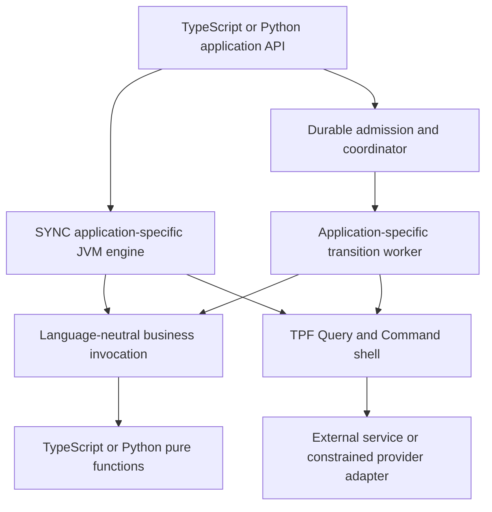

# Polyglot TPF applications: architecture assessment

Assessment date: 30 October 2026. Status: **future/backlog exploration, outside Cloud MVP; no implementation commitment**.

## Executive conclusion

The architecture is feasible without porting the executor. Much of the *runtime separation* exists; a complete non-Java *authoring product* does not. The shortest useful baseline is a TypeScript HTTP service consumed through the existing OpenAPI/HTTP Connector. It must not be advertised as a TypeScript Connector Provider SPI or as proof that the compiler no longer needs Java discovery.

Keep an application-specific Java/Quarkus engine, with generated domain types, adapters and compiled pipeline wiring. A Node.js/Python facade can call application APIs without owning execution. Pure business functions need a deliberately bounded remote invocation contract; external observations/effects must remain Queries/Commands under TPF authority. A universal native executable loading arbitrary future application classes is a different and substantially larger design.

Evidence below distinguishes merged source, authored tests, recorded deployment results and unexecuted qualification gates. Tests were inspected, not rerun for this assessment. Local checkouts were behind merged main; citations use inspected remote revisions. A source/test's presence is not evidence that its current revision passed CI or ran in production.

## Verified boundaries and proposed extension

The coordinator hop is conditional. SYNC executes directly. QUEUE_ASYNC admits durable work and dispatches bounded continuations. Generated orchestration therefore is not uniformly a replaceable facade: generated pipeline wiring and runtime execution remain Java-side. A language-specific facade should submit, retrieve status/results and complete authorised interactions through supported APIs, never drive step order or retry policy.

H1 is substantially true as a role boundary, with runtime/application metadata and payload-codec coupling still to inspect per host. Co-location does not erase that boundary. H2 is true for several implementations, but supported worker transports and deployment proof are different claims. Recent AWS Durable work supersedes older FUNCTION-only limitations; it does not imply every Lambda combination is production-qualified. H3 is mode-dependent. H4 is a credible extension of the existing compiled engine, not evidence of a universal native engine. Detailed source evidence follows below.

## Polyglot feasibility and Java coupling

Classification: **existing**, **adapter**, **small integration**, **new contract/compiler capability**, **fundamental obstacle to the proposed variant**.

| Surface | Assessment | Required work / ownership |
|---|---|---|
| Application facade | Adapter for handwritten HTTP clients; generated TS/Python API is new compiler capability | Generate typed submission/status/result/error bindings; distinguish synchronous results from execution handles; preserve authentication |
| Internal pure steps | Existing remote-service seams offer reuse; general portable authoring needs contract/compiler work | Compiler owns callable signature, cardinality and type binding; runtime owns invocation, deadlines and failure classification |
| Query | Existing HTTP/OpenAPI adapter can reach TS/Python | Preserve capture and replay in Java; a native-language provider SDK needs a separate provider boundary |
| Command | Existing HTTP adapter for supported service contracts | Preserve effect identity, confirmation, ambiguity and reconciliation; never equate an HTTP success or timeout with durable effect certainty |
| Other customer SPIs | Case-by-case new contracts | Keep stores, dispatch, secret resolution and coordinator lifecycle Java-side initially; no blanket RPC export of Java interfaces |
| Fully native TS/Python executor | Fundamental conflict with this mission's single-engine constraint | Excluded; would duplicate execution semantics and require independent conformance |
| Application-specific JVM/native worker | Reuse existing engine and generated Java | Generate all necessary glue; native build must include application-specific reachable types/adapters |
| Compiler host | New integration/capability | Hide Java/Maven scaffolding first; prove compiler entrypoint independence separately rather than assuming a neutral model implies a neutral build |
| Domain types | Shared semantic model reusable; language renderers new | Nominal identity, closed unions, constraints and field presence must survive generation |
| Serialization | Cross-language conformance is a prerequisite | Explicit absent versus null, int64 beyond JS safe integers, decimal scale, bytes, timestamps, enum/union evolution and deterministic hash vectors |
| Discovery | New portable provider contract if provider SDK selected | Pin provider/version/operations/configuration/capabilities; define lifecycle and compatibility independently of class loading |
| Connections | Existing host authority must remain | Authorise tenant/actor before invocation; do not put credentials or coordinator internals into a generic invocation envelope |
| Streams | New cross-language conformance/protocol work | Unary first; later bound buffers, ordering, cancellation, deadlines, partial failures, fan-out and reduction identity |
| Packaging | Existing release identity reusable; language artefact integration missing | Digest exact npm/Python deployment closure and engine together; package lockfiles alone are insufficient release identity |
| Hosting | Local/customer COMPUTE is smallest | Hosted isolation, process lifecycle and FUNCTION cost/limits need separate qualification; no claim of Spring parity |

No fundamental obstacle was found to a unary remote application boundary. That is an architectural judgement, not measured feasibility of every type, streaming mode or deployment target.

## Options and recommendation

| Option | Value | Limitation |
|---|---|---|
| HTTP/OpenAPI connectors only | Smallest baseline; reuse established observation/effect shell | External-service integration, not general pure-function authoring or native provider discovery |
| Existing remote Operators/services | Reuse callable transport boundary for pure business logic | Operator is a callable reuse abstraction, not a replacement for Query capture or Command authority |
| Java engine + generated language API + bounded invocation | Recommended eventual model; one executor | Requires compiler integration, canonical wire conformance, packaging and a trust boundary |
| Native-language provider process | Useful only when HTTP adapter cannot express required capability | New lifecycle/metadata/outcome protocol; defer until baseline proves need |
| Native-language executor | Independent hosting flexibility | Duplicates routing, replay and durable semantics; excluded |

First validate the existing imported-service path. Next agree canonical wire vectors and the authoring/build contract. Generate TS models/facade and a unary pure-function adapter while retaining Java compilation internally. Add a provider process only after a decision identifies an actual gap in existing HTTP capabilities. Finally qualify durable recovery and packaging, then port the same vectors and generated API pattern to Python.

## Smallest credible proof and gates

**Baseline (engineering estimate: 3–5 person-days):** DSL v3 canonical input/output, one OpenAPI-imported Query backed by a TypeScript HTTP service, compiled with existing Java machinery, local COMPUTE/SYNC execution. Verify accepted/rejected payloads, captured observation replay without a second service call, and stable pipeline/step identity. Existing framework Java adapters are allowed. Report any handwritten application Java explicitly. This baseline does not satisfy the full business-step/provider-authoring objective.

**Full unary TS slice (estimate: 6–10 person-weeks, excluding production hosting):** author only YAML, TypeScript and standard package/configuration files; generate hidden Java scaffolding, canonical TS models, an application API, one pure TS transformation and one TS-backed Query. Query is sufficient for the requested Query-or-Command proof. If 'implement a Query' requires implementing a portable Provider SPI rather than an external endpoint, gate that interpretation on the provider-boundary decision and budget an additional 3–6 person-weeks.

Acceptance:

1. A clean checkout with documented prerequisites builds the application without handwritten application Java. Keep generated Java inspectable; do not claim a Java-free toolchain.
2. The compiler rejects type/cardinality/operation mismatches before execution. Generated TS validation and Java use the same golden vectors, including missing/null, union tags and large integers.
3. The existing Java engine owns ordering and identity. TS performs only the selected function/provider operation; it cannot request arbitrary coordinator actions.
4. Local execution demonstrates correct typed output, deterministic lineage and Query capture replay without provider re-execution. Capture policies and replay fixtures are explicit.
5. A second durable COMPUTE gate kills/restarts a worker and coordinator, resumes a pinned release, and verifies retry/Await behaviour if included. Changing the active release must not change an in-flight execution's pinned code.
6. If Command is included, test duplicate invocation, ambiguous timeout after effect, confirmation, reconciliation and durable recovery; Query-only success cannot close the Command gate.
7. Exact engine and TS artefacts are digest-verified. Modified artefacts and incompatible protocol/model versions fail closed.
8. Collect execution/replay evidence across processes; account for existing replay-export limitations rather than claiming process-local traces are an execution-wide replay.

A coordinator is unnecessary for the first local proof, but required to substantiate the later durable claims. FUNCTION/Lambda is a subsequent deployment qualification, not a prerequisite. Python reuses wire vectors, descriptors, Java engine and release machinery; estimate 2–4 additional person-weeks for renderer/SDK/proof after TS stabilises. These are engineering ranges, not verified measurements or scheduling commitments. Streaming, production multi-tenancy and broad SPI support are excluded.

## Open decisions and risks

- Decide whether external HTTP services meet initial authoring value, or a true non-Java Provider SDK is required. Do not silently conflate them.
- Decide callable identity, wire version and error/cancellation semantics before implementing a generic business-function protocol; reuse existing operators where sufficient.
- Decide canonical numeric/presence representation and hashing; do not hash each language's default JSON output.
- Decide how build-host independence is exposed: generated hidden JVM project first versus a fully standalone compiler host. Preserve compiler-owned truth in either case.
- Decide provider isolation and credential placement with host-authorisation owners. A remote provider must not become an unrestricted tenant credential proxy.
- Decide release artefact closure and process placement using existing Release authority, not a second polyglot manifest.
- Native images, FUNCTION streaming/deadlines, real-cloud recovery, and execution-wide replay remain explicit qualification gates.

Human decisions are required before implementation commitment, not to finish this exploration. No Cloud priority, milestone or implementation PR is created by this assessment.

## Backlog ownership and existing work

The main repository owns this assessment and cross-repository epic. Compiler owns build and language generation; contracts owns shared model/wire semantics; runtime owns engine adapters and durable policy; connectors owns providers and HTTP adapter; CLI owns developer UX; examples owns the bounded proof; system-tests owns cross-artifact qualification. Cloud owns hosting acceptance, not compiler or execution semantics.

Reuse [build/deploy tooling #966](https://github.com/The-Pipeline-Framework/pipelineframework/issues/966), [descriptor audit #902](https://github.com/The-Pipeline-Framework/pipelineframework/issues/902), [provider ecosystem #581](https://github.com/The-Pipeline-Framework/pipelineframework/issues/581), [provider testkit #578](https://github.com/The-Pipeline-Framework/pipelineframework/issues/578) and [execution-wide replay export #456](https://github.com/The-Pipeline-Framework/pipelineframework/issues/456). [Completed Java v3 generation #506](https://github.com/The-Pipeline-Framework/pipelineframework/issues/506) explicitly leaves future language targets separate. The organisation-wide polyglot search returned no existing equivalent epic; this does not establish completeness of private roadmaps.

## Runtime evidence audit (30 October 2026)

Remote main was checked through GitHub: `68b9a224f55c8fe8ad1934cffcab571d6baae2a9`, 26.11.1-SNAPSHOT; release 26.10.1 freeze PR #77 and snapshot PR #78 are merged. The ordinary local runtime checkout (`8289528`) is diverged and unsuitable as current evidence. Source below was inspected in the GitNexus canonical clone matching remote main. No tests were rerun in this assessment.

### H1: qualified confirmation

TPF owns semantic admission, execution state, lease/retry/commit policy, Await admission, release pins and worker selection. The durable *role* does not run user functions; a single-process deployment can nevertheless host both roles. AWS Durable now owns mechanical checkpointing, waiting and wake-up while TPF retains semantic authority. “The coordinator owns everything” therefore needs this distinction.

[QueueAsyncCoordinator submission and work processing](https://github.com/The-Pipeline-Framework/pipelineframework-runtime/blob/68b9a224f55c8fe8ad1934cffcab571d6baae2a9/runtime/src/main/java/org/pipelineframework/QueueAsyncCoordinator.java#L177-L304) shows submission delegation and segment processing through a supplied PipelineTransitionWorker.

[AwsDurableCoordinatorHandler.handleRequest](https://github.com/The-Pipeline-Framework/pipelineframework-runtime/blob/68b9a224f55c8fe8ad1934cffcab571d6baae2a9/aws-durable-coordination/host/src/main/java/org/pipelineframework/aws/durable/AwsDurableCoordinatorHandler.java#L66-L129) checkpoints bounded action calls, observes WAITING_EXTERNAL and reads terminal results; it does not evaluate business steps. Callback IDs are hosting state, not completion authority.

### H2: deployment independence is bounded, not universal

[PipelineTransitionWorkerSelector.select](https://github.com/The-Pipeline-Framework/pipelineframework-runtime/blob/68b9a224f55c8fe8ad1934cffcab571d6baae2a9/runtime/src/main/java/org/pipelineframework/orchestrator/PipelineTransitionWorkerSelector.java#L39-L75) selects local, registered REST, configured REST, gRPC or SQS. Multiple configured remote targets are rejected; this is not arbitrary transport discovery. [TransitionWorkerExecutionMode](https://github.com/The-Pipeline-Framework/pipelineframework-runtime/blob/68b9a224f55c8fe8ad1934cffcab571d6baae2a9/runtime/src/main/java/org/pipelineframework/orchestrator/TransitionWorkerExecutionMode.java#L6-L11) supports SAME_THREAD and VIRTUAL_THREAD for subscription placement.

[AwsDurableTransitionWorkerHandler](https://github.com/The-Pipeline-Framework/pipelineframework-runtime/blob/68b9a224f55c8fe8ad1934cffcab571d6baae2a9/aws-durable-coordination/host/src/main/java/org/pipelineframework/aws/durable/AwsDurableTransitionWorkerHandler.java#L15-L25) consumes Lambda SQSEvent and delegates SqsTransitionWorkerAction. [SqsTransitionWorkerAction.handle](https://github.com/The-Pipeline-Framework/pipelineframework-runtime/blob/68b9a224f55c8fe8ad1934cffcab571d6baae2a9/runtime/src/main/java/org/pipelineframework/orchestrator/SqsTransitionWorkerAction.java#L59-L96) executes the portable transition through PipelineExecutionService. This is an actual Lambda transition integration, distinct from ordinary HTTP FUNCTION step invocation.

### H3: facade versus executor

[PipelineExecutionService public execution entrypoints](https://github.com/The-Pipeline-Framework/pipelineframework-runtime/blob/68b9a224f55c8fe8ad1934cffcab571d6baae2a9/runtime/src/main/java/org/pipelineframework/PipelineExecutionService.java#L235-L270) exposes streaming/unary synchronous execution separately from executePipelineAsync, which calls the control plane. [Transition entrypoints](https://github.com/The-Pipeline-Framework/pipelineframework-runtime/blob/68b9a224f55c8fe8ad1934cffcab571d6baae2a9/runtime/src/main/java/org/pipelineframework/PipelineExecutionService.java#L422-L433) distinguishes in-process and portable transition policies. [Direct synchronous runner](https://github.com/The-Pipeline-Framework/pipelineframework-runtime/blob/68b9a224f55c8fe8ad1934cffcab571d6baae2a9/runtime/src/main/java/org/pipelineframework/PipelineExecutionService.java#L628-L637) calls PipelineRunner directly; [Continuation execution](https://github.com/The-Pipeline-Framework/pipelineframework-runtime/blob/68b9a224f55c8fe8ad1934cffcab571d6baae2a9/runtime/src/main/java/org/pipelineframework/PipelineExecutionService.java#L883-L895) calls runFromStepUntilWithContext. Thus an application-facing TypeScript/Python client/facade can be thin, but replacing the generated execution service/runner with such a facade would lose important semantics. No mandatory coordinator hop is needed for SYNC.

### H4: application-specific JVM/native engine remains plausible

[PipelineRunner](https://github.com/The-Pipeline-Framework/pipelineframework-runtime/blob/68b9a224f55c8fe8ad1934cffcab571d6baae2a9/runtime/src/main/java/org/pipelineframework/PipelineRunner.java#L58-L97) owns execution with PipelineRunnerCore, step ordering and execution helpers; [runner continuation API](https://github.com/The-Pipeline-Framework/pipelineframework-runtime/blob/68b9a224f55c8fe8ad1934cffcab571d6baae2a9/runtime/src/main/java/org/pipelineframework/PipelineRunner.java#L118-L151) consumes concrete step instances. Keeping those Java components and generating Java boundary stubs is architecturally compatible with non-Java application logic. It does not establish a universal native engine: application-specific steps, types, generated adapters and dependency injection closure still need compiling into the worker. A no-authored-Java experience needs tooling to generate that closure.

### Execution-mode proof matrix

| Mode | Implemented boundary | Evidence level and caveat |
|---|---|---|
| LOCAL/SYNC COMPUTE | PipelineExecutionService → PipelineRunner | Source-verified direct path; no coordinator required. This audit did not rerun tests. |
| Single-process QUEUE_ASYNC | Coordinator → local PipelineTransitionWorker, same/virtual thread | Source-verified selector and execution mode; same process does not collapse semantic roles. |
| Distributed COMPUTE | REST, gRPC, SQS worker clients/services | Source verified; named RestPipelineTransitionWorkerTest, GrpcPipelineTransitionWorkerTest, SqsPipelineTransitionWorkerTest exist. Unit tests are not deployment proof. Self-host references require their own exact stack evidence. |
| FUNCTION/Lambda transition | AWS Durable host + bounded TPF actions + signed SQS worker | Merged production host and deployment package exist; historical real-AWS fault proof exists. Current exact-production-candidate conformance remains a separate open gate. |

Historical [deployed evidence](https://github.com/The-Pipeline-Framework/pipelineframework/blob/5667ffc2702cb358ee842363c8d3c0be86b66ac2/docs/evolve/durable-coordinator/aws-durable-coordination-host.md#L41-L54) reports 22 fault scenarios, ten seeded races, provider-history-loss recovery and terminal-Await passthrough on disposable AWS infrastructure. Treat this as a recorded proof report, not independently rerun evidence. The [production plan](https://github.com/The-Pipeline-Framework/pipelineframework/blob/5667ffc2702cb358ee842363c8d3c0be86b66ac2/docs/evolve/durable-coordinator/aws-durable-production-plan.md#L1145-L1212) explicitly says live production scenarios remain unexecuted and retains exact-artifact publication/conformance gates. Do not promote the historical proof into a production-readiness claim.

Current [deployment contract](https://github.com/The-Pipeline-Framework/pipelineframework/blob/5667ffc2702cb358ee842363c8d3c0be86b66ac2/docs/deploy/orchestrator-runtime/aws-durable.md#L674-L679) uses SQS as the initial supported worker boundary and distinguishes COMPUTE/FUNCTION placement. Earlier topology pages saying AWS Durable is only future work are superseded. Runtime [PR #74](https://github.com/The-Pipeline-Framework/pipelineframework-runtime/pull/74) fixes native SQS queue-only execution; [host README](https://github.com/The-Pipeline-Framework/pipelineframework-runtime/blob/68b9a224f55c8fe8ad1934cffcab571d6baae2a9/aws-durable-coordination/host/README.md#L29-L40) explains why local CDI loopback must be disabled in Lambda.

## Compiler, contracts and CLI evidence

Verified GitHub main on 2026-10-30: compiler `57be39692e7410384a70fd29b668a617a55332f6`; contracts `66f10452aec78ac79645292fa4df6cf8479a204c`; CLI `aaa1be8010e43cd77727a70623c625d3a796742b`. Fetched refs only; no repository edits. GitNexus compiler query preceded source inspection; stale index results were checked against `git show origin/main`.

## Host independence

Partially extracted, not established end to end. [PipelineCompiler.compile, lines 6–34](https://github.com/The-Pipeline-Framework/pipelineframework-compiler/blob/57be39692e7410384a70fd29b668a617a55332f6/src/main/java/org/pipelineframework/processor/PipelineCompiler.java#L6-L34) executes an immutable list of phases. Production [PipelineStepProcessor, lines 75–138](https://github.com/The-Pipeline-Framework/pipelineframework-compiler/blob/57be39692e7410384a70fd29b668a617a55332f6/src/main/java/org/pipelineframework/processor/PipelineStepProcessor.java#L75-L138) still constructs the phases, discovers Java annotations and supplies ProcessingEnvironment and Jsr269SourceInventory. [ModelExtractionPhase.createInternalStepModel, lines 528–558](https://github.com/The-Pipeline-Framework/pipelineframework-compiler/blob/57be39692e7410384a70fd29b668a617a55332f6/src/main/java/org/pipelineframework/processor/phase/ModelExtractionPhase.java#L528-L558) resolves execution classes with Elements.getTypeElement and checks Java service signatures with Types. Missing classes fail unless a cross-module synthetic model is possible. A generic phase engine does not prove complete Java-free compilation.

## Application facade

[OrchestratorRestResourceRenderer, lines 125–218](https://github.com/The-Pipeline-Framework/pipelineframework-compiler/blob/57be39692e7410384a70fd29b668a617a55332f6/src/main/java/org/pipelineframework/processor/renderer/OrchestratorRestResourceRenderer.java#L125-L218) generates direct calls to PipelineExecutionService.executePipeline/executePipelineStreaming and asynchronous admission calls to executePipelineAsync, including tenant/idempotency/context. A generated TS/Python client can use these APIs without owning pipeline execution. Trusted tenant admission must stay server-side; forwarding headers is not authorisation.

## Types, identity and serialization

[V3 protobuf renderer, lines 47–84](https://github.com/The-Pipeline-Framework/pipelineframework-compiler/blob/57be39692e7410384a70fd29b668a617a55332f6/src/main/java/org/pipelineframework/proto/PipelineTypesProtoRenderer.java#L47-L84) consumes PipelineGenerationPlan, canonical type model and compiler-owned IDL identity, sorts type names, emits records/wrappers/unions and rejects absent IDL state. Standard protobuf language tools can reuse schemas; this does not prove equivalent canonical TS/Python model validation.

[CanonicalFieldValue, lines 11–50](https://github.com/The-Pipeline-Framework/pipelineframework-contracts/blob/66f10452aec78ac79645292fa4df6cf8479a204c/runtime-core/src/main/java/org/pipelineframework/type/CanonicalFieldValue.java#L11-L50) distinguishes absent, present-null and present-value. JS null or Python None alone loses information. [PipelineJson, lines 38–76](https://github.com/The-Pipeline-Framework/pipelineframework-contracts/blob/66f10452aec78ac79645292fa4df6cf8479a204c/runtime-serialization/src/main/java/org/pipelineframework/config/pipeline/PipelineJson.java#L38-L76) centralises Jackson modules, protobuf JsonFormat, Path encoding and CanonicalFieldJsonModule. This is a Java reference implementation, not evidence of cross-language byte/hash identity. Golden vectors must cover presence/nullability, union tags, IDL reservations, decimal/int64 precision, bytes, collection ordering, Unicode and digest input. Do not infer deterministic hashing from deterministic type-name ordering.

Existing coverage files (inspected as coverage inventory, not executed): compiler `src/test/java/org/pipelineframework/processor/renderer/CanonicalRestPresenceMatrixTest.java`, `CanonicalUnionRestIntegrationTest.java`, `CanonicalOptionalPayloadReferenceTransportTest.java`; contracts `runtime-serialization/src/test/java/org/pipelineframework/config/pipeline/CanonicalFieldJsonTest.java`.

## Operators

[RemoteOperatorAdapterRenderer, lines 40–93](https://github.com/The-Pipeline-Framework/pipelineframework-compiler/blob/57be39692e7410384a70fd29b668a617a55332f6/src/main/java/org/pipelineframework/processor/renderer/RemoteOperatorAdapterRenderer.java#L40-L93) generates Java service adapters backed by ProtobufHttpRemoteOperatorClient or EnvelopeHttpRemoteOperatorClient, requiring domain types and remote target. This is an existing seam to test for a TS pure transform before inventing a protocol. It is not Query capture or Command authority; these remain Connector/runtime responsibilities.

## CLI and packaging

[ReleaseCommand, lines 5–8](https://github.com/The-Pipeline-Framework/pipelineframework-cli/blob/aaa1be8010e43cd77727a70623c625d3a796742b/tpf-cli/src/main/java/org/pipelineframework/cli/ReleaseCommand.java#L5-L8) exposes release inspection/verification. CLI AGENTS assigns build-tool-neutral release resolution/deployment adapters; runtime owns release production and compiler owns compilation. A build front door must not duplicate semantic compilation.

## Proof recommendation and engineering estimates

1. Baseline: an existing JVM pipeline invokes a tiny TS HTTP service via imported OpenAPI Query, proving typing and replay without another provider call. Estimate 3–5 engineer-days with a compiling importer example. This proves foreign-language external services, not native polyglot authoring.
2. Unary LOCAL transport/COMPUTE proof: v3 DSL, TS pure transform through existing remote-operator protocol, TS Query behind existing connector machinery; generated Java bootstrap/build files allowed but zero handwritten application Java. Keep Java executor/models/adapters/capture. Estimate 2–4 engineer-weeks after mapping and operator shapes are confirmed. No coordinator required initially.
3. Add pinned distributed QUEUE_ASYNC release, interruption/replay and ambiguity tests. Lambda is not a prerequisite.
4. Python reuses schema, conformance vectors and packaging contract after TS acceptance.

Estimates are engineering judgement, not measured delivery data. Native execution would remain application-specific generated/linked Java plus runtime integration. No evidence inspected establishes a universal native TPF engine accepting arbitrary application classes dynamically. No-Java authoring can generate Java internally; it need not remove Java compilation.

## Connector evidence

Read-only audit 2026-10-30. GitNexus query used first; source then verified. Connectors local da2cadb is behind remote main `cd555b5e52e067ae86f64fbaca2c69e5a2aaf040`. GitHub compare confirmed the HTTP/OpenAPI files cited below unchanged. Contracts local db96460 is behind remote main `66f10452aec78ac79645292fa4df6cf8479a204c`; current CommandOperation, CommandCapabilities and QueryOperation were read directly from GitHub. No tests executed by this assessment.

## Supported today

- `HttpConnector` implements release-pinned HTTP Query/Command operations and invokes ordinary HTTP endpoints. Nothing in that endpoint boundary requires Java; TypeScript/Python HTTP services are credible integrations through the existing adapter, not evidence that non-Java code implements the ConnectorProvider SPI. [HttpConnector declaration, discovery and lifecycle](https://github.com/The-Pipeline-Framework/pipelineframework-connectors/blob/cd555b5e52e067ae86f64fbaca2c69e5a2aaf040/framework/connectors/http/src/main/java/org/pipelineframework/connector/http/HttpConnector.java#L47-L115).
- Host owns connection resolution, selected security constraints and authorization. The connector borrows an `HttpClientConnection`, asks the host resolver with execution context, checks security capabilities, requests authorization material, and validates it against the pinned security selection. [connection/authorization](https://github.com/The-Pipeline-Framework/pipelineframework-connectors/blob/cd555b5e52e067ae86f64fbaca2c69e5a2aaf040/framework/connectors/http/src/main/java/org/pipelineframework/connector/http/HttpConnector.java#L117-L159).
- Unary Query maps canonical input to wire JSON and response back to invocation output class; connection and transport errors receive typed Query outcomes. [PinnedQueryOperation.query](https://github.com/The-Pipeline-Framework/pipelineframework-connectors/blob/cd555b5e52e067ae86f64fbaca2c69e5a2aaf040/framework/connectors/http/src/main/java/org/pipelineframework/connector/http/HttpConnector.java#L179-L233).
- Command dispatch uses supplied dispatch identity/callback context. Failures before dispatch can be retryable; post-dispatch failure and invalid response are ambiguous. It does not turn unknown effect status into permission to retry. HTTP connector advertises provider idempotency only when explicitly pinned, and reconciliation is false. [dispatch and commandCapabilities](https://github.com/The-Pipeline-Framework/pipelineframework-connectors/blob/cd555b5e52e067ae86f64fbaca2c69e5a2aaf040/framework/connectors/http/src/main/java/org/pipelineframework/connector/http/HttpConnector.java#L255-L348).
- Concrete socket-level unit tests cover host authorization, explicit provider idempotency and acknowledged confirmation, post-dispatch disconnect ambiguity, response-size limits, redirect-free borrowed clients and lifecycle. They are not distributed pipeline/recovery or production deployment proof. [HttpConnectorTest](https://github.com/The-Pipeline-Framework/pipelineframework-connectors/blob/cd555b5e52e067ae86f64fbaca2c69e5a2aaf040/framework/connectors/http/src/test/java/org/pipelineframework/connector/http/HttpConnectorTest.java#L147-L324).
- OpenAPI import creates ordinary Query/Command pins, requires explicit semantic kind instead of guessing from HTTP method, pins source closure digest, and rejects unresolved remote reference closure. [OpenApiImportEngineTest](https://github.com/The-Pipeline-Framework/pipelineframework-connectors/blob/cd555b5e52e067ae86f64fbaca2c69e5a2aaf040/framework/connector-openapi-maven-plugin/src/test/java/org/pipelineframework/connector/openapi/maven/OpenApiImportEngineTest.java#L35-L136). This is build-time importer coverage, not a TS end-to-end application.

## Hidden Java dependencies / current recovery contract

- Provider identity/version/operations/configuration/start/stop are semantic concepts wrapped in Java generic interfaces and CompletionStage. [ConnectorProvider](https://github.com/The-Pipeline-Framework/pipelineframework-contracts/blob/66f10452aec78ac79645292fa4df6cf8479a204c/runtime-core/src/main/java/org/pipelineframework/connector/ConnectorProvider.java#L10-L32).
- Runtime provider discovery uses Java ClassLoader + ServiceLoader, not npm/PyPI or process discovery. [ConnectorProviderDiscovery](https://github.com/The-Pipeline-Framework/pipelineframework-contracts/blob/66f10452aec78ac79645292fa4df6cf8479a204c/runtime-core/src/main/java/org/pipelineframework/connector/ConnectorProviderDiscovery.java#L13-L24).
- Current unary Query operation exposes `Class<O>` and CompletionStage; this is framework-neutral Java, not language-neutral ABI. [QueryOperation](https://github.com/The-Pipeline-Framework/pipelineframework-contracts/blob/66f10452aec78ac79645292fa4df6cf8479a204c/runtime-core/src/main/java/org/pipelineframework/connector/QueryOperation.java#L12-L36).
- Command recovery has now gained explicit hooks: `recoveryTarget` must derive authoritative non-secret destination/configuration identity; `reconcile` is read-only authoritative inquiry, never dispatch/retry, and defaults to unresolved. A portable adapter must preserve these distinctions. [CommandOperation](https://github.com/The-Pipeline-Framework/pipelineframework-contracts/blob/66f10452aec78ac79645292fa4df6cf8479a204c/runtime-core/src/main/java/org/pipelineframework/connector/CommandOperation.java#L22-L41). Capability declaration alone is explicitly insufficient without inquiry/target hooks and recovery-capable effect store. [CommandCapabilities](https://github.com/The-Pipeline-Framework/pipelineframework-contracts/blob/66f10452aec78ac79645292fa4df6cf8479a204c/runtime-core/src/main/java/org/pipelineframework/connector/CommandCapabilities.java#L7-L20).
- Invocation metadata includes tenant, execution/pipeline/contract/release/step identities, target, correlation, trace and deadline; do not serialize host runtime services or credentials into it. [ConnectorExecutionContext](https://github.com/The-Pipeline-Framework/pipelineframework-contracts/blob/66f10452aec78ac79645292fa4df6cf8479a204c/runtime-core/src/main/java/org/pipelineframework/connector/ConnectorExecutionContext.java#L7-L31). Host connection API requires a Java typed resolved connection. [ConnectionResolver](https://github.com/The-Pipeline-Framework/pipelineframework-contracts/blob/66f10452aec78ac79645292fa4df6cf8479a204c/runtime-core/src/main/java/org/pipelineframework/connector/ConnectionResolver.java#L5-L9).

## Recommended proof and issues

Baseline first: one explicit unary Query backed by a TypeScript HTTP service imported via OpenAPI, Java-generated host/runtime, deterministic mapping. Verify same canonical result and Query replay without second HTTP call. Reuse this for Python by changing only service implementation. Estimated 3–5 engineer-days assuming existing generated host setup, not a verified measurement. This demonstrates cross-language external observation through existing Connector, not no-Java authoring or internal business-step language neutrality. Add a Command only as a second gate: stable identity, explicit idempotency, acknowledged success, dropped response => ambiguous, recovery never blindly repeats.

Do not model pure internal business transformation as Query just to reuse HTTP. Its semantic meaning differs. Separate internal business-step transport decision from external observation/effect provider protocol.

A new portable Provider invocation boundary is genuinely new work: versioned invocation/outcome schemas, host-authenticated tenant context, connection capability restrictions, cancellation/deadlines, lifecycle and discovery, type-ID resolution, metadata validation and operation-specific outcome mapping. Start unary; do not claim streaming parity from a unary HTTP response-size bound. Command extension must add recovery target/inquiry semantics and fault-injection tests, not just dispatch.

Suggested cohesive issues: (1) baseline OpenAPI TS external service proof (examples owner; 3–5d); (2) decision spike for portable invocation/authority and canonical wire conformance (contracts + runtime + compiler; 1–2w); (3) provider bridge plus Query/Command conformance (connectors integration, runtime guarantee owner, contracts protocol owner; 3–6w after spike); keep full hosting and Python parity gated by first real application slice.

## Cloud evidence limits

Accessible private Cloud material was inspected but is not reproduced here. It does not establish a public, reproducible polyglot hosting qualification. No Cloud deployment was run. Public Release contracts remain the evidence authority for this proposal.

## Reference application evidence

Remote main `5787c765dd22348893ee47be711904d53a669f23` was inspected. [Checkout's handwritten JavaScript facade](https://github.com/The-Pipeline-Framework/pipelineframework-reference-implementations/blob/5787c765dd22348893ee47be711904d53a669f23/checkout/nextjs-ui/lib/tpf-client.js#L328-L347) already calls RunAsync with typed input, tenant and idempotency key. This proves a non-Java application client, not generated TypeScript or non-Java business execution.

[Search Lambda mock smoke](https://github.com/The-Pipeline-Framework/pipelineframework-reference-implementations/blob/5787c765dd22348893ee47be711904d53a669f23/search/orchestrator-svc/src/test/java/org/pipelineframework/search/orchestrator/service/LambdaMockEventServerSmokeTest.java#L26-L34) starts a mock event server. [Deployed Lambda integration coverage](https://github.com/The-Pipeline-Framework/pipelineframework-reference-implementations/blob/5787c765dd22348893ee47be711904d53a669f23/search/orchestrator-svc/src/it/java/org/pipelineframework/search/orchestrator/service/AwsLambdaModularEndToEndIT.java#L37-L109) checks HTTP execution/cardinality but skips without a deployment URL. [Topology documentation](https://github.com/The-Pipeline-Framework/pipelineframework-reference-implementations/blob/5787c765dd22348893ee47be711904d53a669f23/search/README.md#L221-L250) describes six-Lambda modular hosting; the test's five-Lambda comment is stale. Neither mock smoke nor conditional test presence establishes a current live deployment run.

## Existing decisions retained

This assessment proposes no accepted semantic change. It retains [ADR-0042 canonical serialization](https://github.com/The-Pipeline-Framework/pipelineframework/blob/5667ffc2702cb358ee842363c8d3c0be86b66ac2/docs/decisions/0042-shared-canonical-pipeline-serialization.md), [ADR-0049 wire results versus runtime outcomes](https://github.com/The-Pipeline-Framework/pipelineframework/blob/5667ffc2702cb358ee842363c8d3c0be86b66ac2/docs/decisions/0049-transition-results-separate-wire-data-from-runtime-outcomes.md), [ADR-0050 remote protocol ownership](https://github.com/The-Pipeline-Framework/pipelineframework/blob/5667ffc2702cb358ee842363c8d3c0be86b66ac2/docs/decisions/0050-remote-worker-protocols-are-shared-runtime-contracts.md), and [ADR-0051 release identity](https://github.com/The-Pipeline-Framework/pipelineframework/blob/5667ffc2702cb358ee842363c8d3c0be86b66ac2/docs/decisions/0051-release-identity-is-shared-runtime-model.md). Decision spikes must add ADRs before freezing new language/provider contracts.

## Created backlog

[Epic and published assessment mirror](https://github.com/The-Pipeline-Framework/pipelineframework/issues/1055).

- [ ] [[Polyglot][Proof] Establish a TypeScript OpenAPI Query baseline](https://github.com/The-Pipeline-Framework/pipelineframework-examples/issues/27)
- [ ] [[Polyglot][Decision] Pin canonical wire conformance and application invocation boundaries](https://github.com/The-Pipeline-Framework/pipelineframework-contracts/issues/52)
- [ ] [[Polyglot] Generate a unary TypeScript application boundary without handwritten Java](https://github.com/The-Pipeline-Framework/pipelineframework-compiler/issues/46)
- [ ] [[Polyglot][Decision] Determine and prove the minimum portable Provider bridge](https://github.com/The-Pipeline-Framework/pipelineframework-connectors/issues/60)
- [ ] [[Polyglot] Qualify immutable release packaging and durable TypeScript execution](https://github.com/The-Pipeline-Framework/pipelineframework-runtime/issues/82)
- [ ] [[Polyglot] Complete the no-authored-Java TypeScript proof and gate Python parity](https://github.com/The-Pipeline-Framework/pipelineframework-examples/issues/28)
