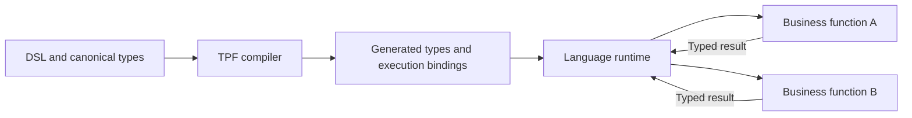
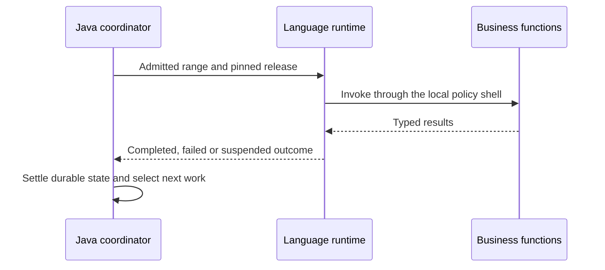

# Polyglot TPF applications

TPF is exploring how developers could author pipelines and business functions in
TypeScript and Python while retaining compiler-owned semantics and Java-owned durable
coordination. This is a proposed architecture, not supported Node.js or Python product
functionality. Existing Java applications remain supported through their current runtimes.

The intended experience includes streaming, Connectors and durable Await. A small unary
pipeline helps investigate the boundaries, but does not define the product's MVP.
Implementation status, experiments, source audits and estimates live in the
[polyglot epic](https://github.com/The-Pipeline-Framework/pipelineframework/issues/1055).

## What a language runtime would own

A business function returns a value to TPF. Before invoking the next function, TPF applies
the pipeline's execution rules: validate the result, handle failure or rejection, honour
cancellation, preserve context and perform any configured framework operations.

Supporting another language therefore involves more than generating client stubs. For a
pipeline to execute entirely within a Node or Python process, that process needs a TPF
runtime capable of carrying out the supported rules. The compiler supplies the pipeline's
meaning; the language runtime executes it.

The proposed division of responsibility is:

| Component | Responsibility |
|---|---|
| Compiler | Validate DSL, canonical types, logical identity, composition, placement and execution requirements |
| Generated application API | Expose typed invocation and, where supported, durable admission and result access |
| Language runtime | Invoke functions and apply the declared execution policies in its process |
| Java coordinator | Own durable admission, execution state, leases, transition retries, recovery and release pinning |
| Capability host | Own authorised external access, Connector guarantees and hosted plugin behaviour |

These boundaries are described in [ADR-0080](../decisions/0080-native-runtimes-consume-compiler-owned-execution-contracts.md).
They do not give each language a separate interpretation of the DSL.

## LOCAL means one process

For A → B → C placed together in a Node application, LOCAL means that all three functions
and their TPF execution runtime run in that Node process. A's result returns to the native
runtime before B is invoked. No inter-step network call or Java executor is required for
that pure LOCAL path.

A service on `localhost` is still a separate process. Calling it may be useful, but does
not provide the same execution arrangement as an in-process LOCAL pipeline. Similarly,
putting several handlers into one Lambda package does not provide pipeline execution by
itself: the package also needs the runtime that applies the pipeline's rules.

In a distributed layout, generated bindings would connect different placements while
co-located functions continue to use LOCAL calls. Business functions should retain their
types and behaviour when placement changes. LOCAL, REST and gRPC are pipeline transports;
COMPUTE and FUNCTION describe platform choices. QUEUE_ASYNC describes an execution mode.

## The developer workflow

The target Node/Python workflow requires no local JVM, including regeneration after a DSL
change. The Java compiler can remain the semantic authority behind a remote build service
or another suitable tool boundary. That generation mechanism is still a design choice;
a remote build does not imply offline regeneration.

| Activity | Intended arrangement |
|---|---|
| Author and regenerate | Native language tools and compiler-authoritative generation, without handwritten application Java or a local JVM |
| Run, test and debug a pure LOCAL pipeline | Business functions and TPF runtime in one native process; no coordinator or Cloud account required |
| Exercise real QUEUE_ASYNC | A remote durable coordinator and deployed development workers; the workstation submits work and retrieves results |

A coordinator connection to a laptop worker is an optional debugging arrangement. It is
not a prerequisite for either pure LOCAL development or testing deployed durable workers.
TPF Cloud is a possible host for shared services, rather than a requirement for the
language architecture.

## Durable execution and Await

A native runtime would execute an admitted range of pipeline operations and return an
outcome to the Java coordinator. It would not take over the coordinator's stores, lease
ownership or recovery decisions. Synchronous execution does not inherently need this
coordinator hop.

A worker's response and the coordinator's durable settlement are separate events. A lost
response can lead to another execution attempt; the architecture does not promise
exactly-once business-function invocation.

Durable Await must survive the application process disappearing. The continuation needs
to be represented by persisted canonical data, correlation and pinned code identity, so
that a fresh compatible worker can resume it. A live JavaScript Promise, Python coroutine
or interpreter handle cannot serve as that durable continuation. Language-level
`async`/`await` and TPF Await solve different problems.

## Connectors and plugins

Keeping existing Connectors and plugins in Quarkus avoids requiring a second provider
ecosystem. It does not make their semantics available to another runtime automatically.
A remote capability boundary must preserve what the operation means, as well as its input
and output types.

A Query needs authorised access, stable capture identity and replay without repeating the
provider call. A Command additionally needs effect authority, idempotency, confirmation
and a way to handle ambiguous outcomes. Plugin hooks need defined ordering,
acknowledgement and failure handling. These responsibilities cannot be replaced by a
generic function call or hidden inside application business logic.

The proposed native runtime would receive only the context and logical capability
references it needs. Provider credentials, resolved clients and coordinator-store access
stay with their owning host. Invoking a capability and implementing a Connector Provider
are separate extension surfaces; a public native Provider SPI has not been selected.

## A shared contract prevents semantic drift

A language runtime needs an explicit description of the types, cardinalities and policies
it supports. The compiler and runtime must reject unsupported requirements rather than
silently omit them. Adding a capability means extending a shared contract and checking
every language that claims to support it.

Compatibility includes more than a successful return value. It covers field presence,
nullability, numeric precision, identity, retry ownership, rejection, cancellation, context,
stream ordering and backpressure. Empty completion and failure must remain distinguishable.
Canonical identities must not depend on Java class names or a language's incidental JSON
formatting.

The unresolved policy mappings and their qualification belong to
[contracts #52](https://github.com/The-Pipeline-Framework/pipelineframework-contracts/issues/52).
[ADR-0088](../decisions/0088-polyglot-contract-qualification-precedes-runtime-selection.md)
explains why those contracts precede production runtime selection.

## Alternatives and trade-offs

| Approach | Benefit | Trade-off |
|---|---|---|
| Native Node/Python runtimes | Same-process LOCAL execution and native developer tools | TPF must maintain equivalent execution behaviour across languages |
| Java execution with remote business services or Operators | Reuses Java execution and existing language-neutral service boundaries | The whole foreign-language pipeline does not execute in one native process |
| A TPF daemon or service | Centralises durable and hosted capability responsibilities | Needs explicit remote contracts; a local Java requirement would change the intended SDLC |
| Embedded languages through Detroit | Could retain Java execution while hosting foreign business functions in the same process | Requires engine integration and a different packaging, dependency and debugging arrangement |

Spring and Micronaut are Java frameworks, so they can reuse Java contracts and execution
code. Framework integration still has to preserve lifecycle behaviour. Their runners and
adapters are useful existing work; polyglot exploration does not make them disposable or
establish full framework parity.

### Detroit and the developer experience

Detroit is an investigated alternative, not a selected TPF runtime. An embedded engine
could keep the Java policy shell around JavaScript or Python business functions. This
could reduce duplicated execution code, while introducing language bridges, canonical
conversions and engine-specific packaging.

Embedding JavaScript does not by itself establish Node.js ecosystem compatibility. The
same distinction applies between embedding Python and supporting an ordinary Python
project's dependencies and tooling. A required local JVM would need an explicit revision
to the intended developer workflow.

Three questions determine whether this alternative fits TPF:

1. **Streaming:** can asynchronous functions, producers and consumers preserve demand,
   ordering, cancellation, cleanup, bounded memory and failure signals?
2. **Await recovery:** can a fresh interpreter resume from durable TPF data after the
   worker has stopped, including duplicate completions and lost acknowledgements?
3. **Developer experience:** can a real project regenerate types, use representative
   dependencies, test, debug and reload code without handwritten application Java?

The [epic's investigation record](https://github.com/The-Pipeline-Framework/pipelineframework/issues/1055)
contains the engine-specific findings and limitations. No alternative is selected by a
successful unary experiment, and production implementation remains unscheduled.

## Investigation records

The [epic](https://github.com/The-Pipeline-Framework/pipelineframework/issues/1055)
owns source audits, experiment results, estimates and progress history.
The [contract decision issue](https://github.com/The-Pipeline-Framework/pipelineframework-contracts/issues/52)
owns unresolved compatibility choices. Older investigation-section links lead here.

<!-- Compatibility anchors for the former investigation sections. -->

