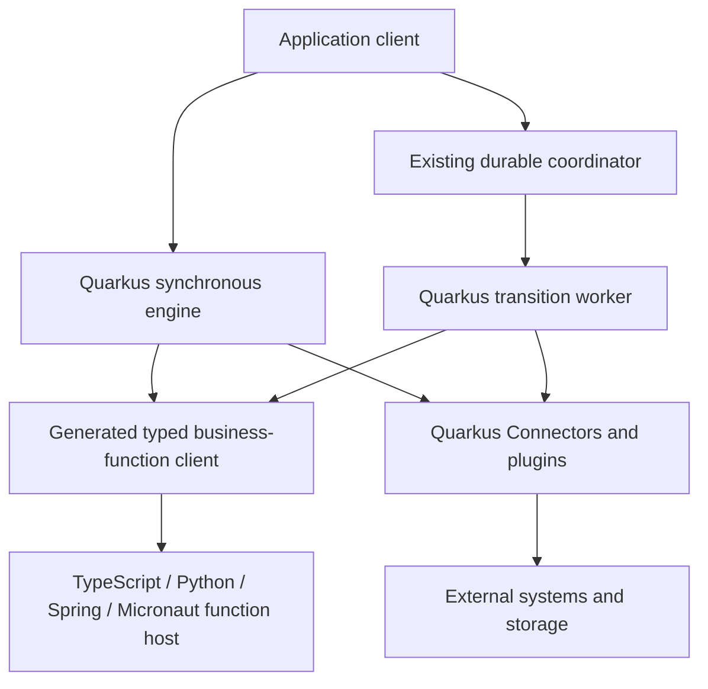

# Polyglot TPF applications: business-function authoring MVP

Evidence assessed 30 October 2026; MVP scope revised 31 October 2026. **Future/backlog exploration, outside Cloud MVP; unscheduled and not an implementation commitment.**

## Executive conclusion and selected MVP

The MVP lets a developer author DSL v3 pipelines, canonical types and unary business functions in TypeScript/Node.js, Python, or Java hosted by Spring/Micronaut. Execution, transition workers, durable coordination, Connectors and plugins remain in the existing Java/Quarkus host. The compiler generates the application-specific Java engine glue internally; non-Java authors do not write application-specific Java.

Application-host interoperability is the baseline. Embedded execution is an optional integration, not a prerequisite. Spring and Micronaut are Java framework hosts, not languages; they can reuse Java models and libraries while using the same external business-function boundary. This proposal neither removes the Spring runner nor expands its parity obligations.

The earlier OpenAPI Query baseline and portable Provider bridge are not the selected MVP. An imported HTTP service demonstrates external-service interoperability, not pure business-function authoring. Connector/plugin authoring in other languages is outside this scope. Existing Quarkus-hosted providers can later compose with foreign-language functions without being ported.

The evidence below supports feasibility, not existing complete support. Compiler discovery remains Java-coupled and language-neutral invocation/generation requires work. Source/tests were inspected rather than rerun during the architecture audit. Preserve the pinned evidence dates; successful unit tests are not deployment qualification.

## Execution and authority boundaries

The coordinator hop is conditional: SYNC executes directly, while QUEUE_ASYNC admits and dispatches durable transitions. A function RPC executes one business function, not a pipeline continuation. The foreign host does not choose the next step, implement execution retries, manage capture/effects, resume Await or access coordinator internals. Functions perform domain transformations; external observations/effects remain explicit Query/Command boundaries, not hidden network I/O inside a nominally pure function.

For gRPC, the function host needs server bindings and the Quarkus worker needs client bindings. An application submitting a pipeline needs separate application-API client bindings. Compiler-produced protobuf contracts are canonical; generated stubs alone do not establish TPF semantics. The invocation contract must define bounded context, callable identity, release compatibility, deadlines/cancellation and typed rejection/failure mapping. Existing REST/protobuf-over-HTTP Operators are reuse evidence, not proof that a general gRPC authoring path already exists.

## MVP deliverables and ownership

| Surface | Scope and gap | Owner |
|---|---|---|
| DSL bindings | Bind canonical unary steps to foreign implementations without authored Java service discovery; reject incompatible declarations | Compiler |
| Canonical models and protobuf | Generate types/stubs from v3 and IDL identity; prove absent/null/value, unions, nominal identity, numeric precision and compatibility with golden vectors | Contracts + compiler |
| Host kits | Generated service bindings and small registration/lifecycle adapters for TS, Python, Spring and Micronaut; one host implementation per application initially | Compiler + host integration |
| Function invocation | Quarkus client adapter retains execution policy, context/lineage and failure classification; authenticate host identity without sending provider credentials | Runtime + contracts |
| Application API | Generate thin typed bindings for the selected synchronous API; durable admission/status bindings follow the existing coordinator contract | Compiler/client tooling |
| Build and packaging | Generate inspectable Java scaffold and package engine + host with existing immutable Release/Compiled Truth; CLI does not duplicate compilation | Compiler + runtime + CLI |
| Connectors/plugins | Keep provider lifecycle, connections/secrets, persistence/cache, Query capture and Command effect authority in Quarkus | Existing semantic owners; no port |
| Other SPIs / embedded executors | Excluded from MVP | Separate future decisions |

The smallest proof uses unary ONE_TO_ONE functions, local COMPUTE and a separate local function process. A local environment does not imply pipeline.transport=LOCAL for a remote gRPC boundary. Exclude streaming, fan-out/reduction, mixed-language steps in one application, FUNCTION hosting, production hosting, polyglot providers/plugins and a universal native engine. Existing Java and Spring capabilities are preserved.

## Delivery gates and acceptance

1. **Boundary probe:** one TS pure function called by the real Quarkus engine. Compare existing typed remote-service/Operator seams with required gRPC generation; do not disguise the function as a Query. Any probe-only handwritten Java is disclosed and removed by the authoring gate.
2. **Canonical contract:** select callable/version identity, presence/numeric representations, deadline/cancellation and rejection/failure rules. Protocol ADR and vectors precede implementation. Do not infer hash equivalence from each language's default JSON.
3. **Generated TS authoring:** a clean checkout containing DSL v3, TS functions and ordinary package/configuration files builds without handwritten application Java. Compiler rejects unsupported cardinality, missing function bindings and type mismatches. Generated Java remains inspectable; Java compilation still occurs internally.
4. **Equivalent host proof:** run the same fixture as separate TS, Python, Spring and Micronaut applications, comparing results, validation and error behaviour. Spring/Micronaut register function beans, not pipeline runners. Shared Java tooling can reduce effort without weakening conformance.
5. **Local acceptance:** a real multi-step pipeline proves engine-owned order and lineage, typed outputs/rejections, cancellation/deadline handling and inaccessible privileged operations. Function invocation may repeat under failure; no exactly-once claim. No Connector or plugin is required in this minimal fixture.
6. **Release/durable follow-up:** verify engine and host digests, callable compatibility, tamper rejection and existing Release identity. Then exercise QUEUE_ASYNC restart/interruption, remote outcome uncertainty and pinned host versions with the existing coordinator. Keep durable/replay claims gated on this evidence rather than inferring them from synchronous success.

An optional later composition fixture may add an existing Quarkus Query/Command or plugin; its provider stays in Quarkus and existing capture/effect conformance applies. It is not a portable Provider SDK gate. FUNCTION/Lambda and production qualification remain separate, unscheduled follow-ups.

## Indicative effort and unresolved decisions

Engineering estimates, not measured delivery data: boundary/contract probe **1–2 person-weeks**; generated TS local authoring slice **3–5 additional person-weeks**; Python **2–4 additional person-weeks**; thin Spring/Micronaut host integrations **1–3 additional person-weeks combined**, contingent on shared Java generation; release/durable qualification **2–4 additional person-weeks**. Re-estimate after the probe. These ranges exclude production hosting and do not schedule work ahead of Cloud priorities.

Open questions are the exact gRPC callable surface and reuse of existing service contracts, bounded context/error representation, generated build-host UX, host authentication and immutable host-version selection. The Quarkus-only execution/provider placement is the selected MVP constraint, not a claim that all future hosts must use Quarkus. Native-image reachability and streaming remain outside initial acceptance.

## Active Spring work remains intact

Issues [#474](https://github.com/The-Pipeline-Framework/pipelineframework/issues/474) and [#475](https://github.com/The-Pipeline-Framework/pipelineframework/issues/475) have independent active stacks: compiler [#43](https://github.com/The-Pipeline-Framework/pipelineframework-compiler/pull/43) → [#44](https://github.com/The-Pipeline-Framework/pipelineframework-compiler/pull/44), runtime [#79](https://github.com/The-Pipeline-Framework/pipelineframework-runtime/pull/79) → [#80](https://github.com/The-Pipeline-Framework/pipelineframework-runtime/pull/80), root [#1053](https://github.com/The-Pipeline-Framework/pipelineframework/pull/1053) → [#1054](https://github.com/The-Pipeline-Framework/pipelineframework/pull/1054).

Their existing acceptance, bases, milestones and coordination remain unchanged. In particular #474 generates a whole-local-unary-pipeline endpoint using the Spring runner; it is not the function-host adapter proposed here. The MVP does not depend on finishing all Spring parity work, and no new MVP decision gates those active stacks.

## Spring roadmap disposition under the MVP

The former Spring workload parity project is now the [Polyglot business-function authoring project](https://github.com/orgs/The-Pipeline-Framework/projects/3), governed by [epic #1055](https://github.com/The-Pipeline-Framework/pipelineframework/issues/1055). No independent Spring epic was found in its 16 issue items; #1055 is the umbrella. Completed #468–473 remain historical evidence, not a promise to extend every capability.

| Issues | Disposition | What to do / what to stop |
|---|---|---|
| #474–475 | Retain active scope | Finish the existing three two-layer gRPC stacks under their existing acceptance; do not pretend their embedded runner is the new external function host |
| #476 | Retire as not planned | No Spring FUNCTION handler parity in this MVP; any future function hosting needs a separately justified proposal |
| #477 | Retire as not planned | No Spring embedded streaming/non-unary engine expansion; future portable streaming must start with a shared boundary contract |
| #478–479 | Retire as not planned | No Spring plugin/cache/persistence ecosystem port; providers and their lifecycle remain Quarkus-hosted |
| #480–481 | Supersede as not planned | No separate Spring Await/checkpoint runtime programme; shared client APIs and Quarkus durable follow-up own applicable interoperability |
| #482 | Repurpose, unscheduled | Spring/Micronaut function-host integration acceptance, subordinate to the shared invocation contract and compiler generation |
| #483 | Repurpose, unscheduled | Host-boundary conformance and observability for the shared proof; no blanket embedded-runtime production parity |

### Retain, eliminate and revisit

Retain the Spring runner, completed integrations and active #474–475 stacks. Do not delete functioning code or change their compatibility promises in this documentation change. Retain the compiler-owned canonical model, shared contracts, Quarkus executor/coordinator and existing Connectors/plugins.

Eliminate the open-ended parity roadmap and its future FUNCTION, streaming, plugin/persistence and Spring-hosted durable-execution obligations. Eliminate portable Provider SDK work from MVP dependencies. Do not introduce a Spring/Micronaut transition worker, coordinator, independent execution engine, or provider ecosystem port merely to support authoring.

A future cleanup may remove demonstrably unused embedded-only scaffolding, but requires owner-specific caller/impact analysis, migration and regression evidence. No source file is identified as safely deletable merely by this architecture decision. No implementation deletion or active-PR cancellation is authorised by the roadmap disposition.

### Spring/Micronaut exit criteria

A generated unary gRPC service registers business-function beans and executes one function. The Quarkus worker owns pipeline order, invocation policy and lineage. Host adapters carry bounded authenticated context, cancellation/deadlines and typed rejection/failure outcomes; they do not own Query capture, Command authority, Await, checkpoints or provider credentials. Prove the same fixture used for TS/Python without a Spring/Micronaut pipeline runner in the new host path.

#482/#483 are coordination/acceptance slices of [equivalent host proof](https://github.com/The-Pipeline-Framework/pipelineframework-examples/issues/28), not additional implementations of it. Compiler owns generated bindings, runtime owns Quarkus invocation, and examples owns host fixtures. These issues do not gate active #474/#475.

Legacy milestone 8 retains only the active gRPC commitment. Milestones 9/10 are retired as parity plans; new host work has no delivery milestone. All new MVP work remains unscheduled and subordinate to current Cloud priorities.

## Reuse, alternatives and ownership

Keep the v3 model, IDL identity, Java executor, coordinator/transition protocols, Quarkus providers and Release authority. Generate language models/adapters instead of another semantic engine. External HTTP/OpenAPI services remain a useful alternative for actual observations/effects, but do not replace pure-function authoring. An embedded Spring executor remains an existing optional path; fully native TS/Python executors and portable Provider SDKs are outside this MVP.

Reuse [build/deploy #966](https://github.com/The-Pipeline-Framework/pipelineframework/issues/966), [descriptor audit #902](https://github.com/The-Pipeline-Framework/pipelineframework/issues/902) and [execution-wide replay #456](https://github.com/The-Pipeline-Framework/pipelineframework/issues/456). Provider ecosystem #581/#578 remains independently governed, not an MVP prerequisite. Compiler owns generation, contracts owns shared semantic/wire contracts, runtime owns Quarkus invocation and execution, examples owns host fixtures, and system-tests owns cross-artifact qualification. No new runtime step kind or accepted semantic protocol is introduced by this assessment; the contract decision must precede implementation.

## MVP backlog

[Epic #1055](https://github.com/The-Pipeline-Framework/pipelineframework/issues/1055). All new work remains unscheduled.

- [ ] [[Polyglot][Proof] Probe unary TypeScript business-function invocation](https://github.com/The-Pipeline-Framework/pipelineframework-examples/issues/27)
- [ ] [[Polyglot][Decision] Pin unary business-function gRPC and canonical conformance](https://github.com/The-Pipeline-Framework/pipelineframework-contracts/issues/52)
- [ ] [[Polyglot] Generate unary TypeScript business-function authoring with a Quarkus engine](https://github.com/The-Pipeline-Framework/pipelineframework-compiler/issues/46)
- [ ] [[Polyglot][Follow-up] Qualify release integrity and durable execution with foreign function hosts](https://github.com/The-Pipeline-Framework/pipelineframework-runtime/issues/82)
- [ ] [[Polyglot] Prove unary authoring across TypeScript, Python, Spring and Micronaut hosts](https://github.com/The-Pipeline-Framework/pipelineframework-examples/issues/28)

Dependency order: boundary probe → contract decision → TS generation → equivalent host proofs. Release/durable qualification follows local acceptance. [Provider bridge #60](https://github.com/The-Pipeline-Framework/pipelineframework-connectors/issues/60) remains deferred outside the MVP and is not a dependency.

## Runtime evidence audit (30 October 2026)

Remote main was checked through GitHub: `68b9a224f55c8fe8ad1934cffcab571d6baae2a9`, 26.11.1-SNAPSHOT; release 26.10.1 freeze PR #77 and snapshot PR #78 are merged. The ordinary local runtime checkout (`8289528`) is diverged and unsuitable as current evidence. Source below was inspected in the GitNexus canonical clone matching remote main. No tests were rerun in this assessment.

### H1: qualified confirmation

TPF owns semantic admission, execution state, lease/retry/commit policy, Await admission, release pins and worker selection. The durable *role* does not run user functions; a single-process deployment can nevertheless host both roles. AWS Durable now owns mechanical checkpointing, waiting and wake-up while TPF retains semantic authority. “The coordinator owns everything” therefore needs this distinction.

[QueueAsyncCoordinator submission and work processing](https://github.com/The-Pipeline-Framework/pipelineframework-runtime/blob/68b9a224f55c8fe8ad1934cffcab571d6baae2a9/runtime/src/main/java/org/pipelineframework/QueueAsyncCoordinator.java#L177-L304) shows submission delegation and segment processing through a supplied PipelineTransitionWorker.

[AwsDurableCoordinatorHandler.handleRequest](https://github.com/The-Pipeline-Framework/pipelineframework-runtime/blob/68b9a224f55c8fe8ad1934cffcab571d6baae2a9/aws-durable-coordination/host/src/main/java/org/pipelineframework/aws/durable/AwsDurableCoordinatorHandler.java#L66-L129) checkpoints bounded action calls, observes WAITING_EXTERNAL and reads terminal results; it does not evaluate business steps. Callback IDs are hosting state, not completion authority.

### H2: deployment independence is bounded, not universal

[PipelineTransitionWorkerSelector.select](https://github.com/The-Pipeline-Framework/pipelineframework-runtime/blob/68b9a224f55c8fe8ad1934cffcab571d6baae2a9/runtime/src/main/java/org/pipelineframework/orchestrator/PipelineTransitionWorkerSelector.java#L39-L75) selects local, registered REST, configured REST, gRPC or SQS. Multiple configured remote targets are rejected; this is not arbitrary transport discovery. [TransitionWorkerExecutionMode](https://github.com/The-Pipeline-Framework/pipelineframework-runtime/blob/68b9a224f55c8fe8ad1934cffcab571d6baae2a9/runtime/src/main/java/org/pipelineframework/orchestrator/TransitionWorkerExecutionMode.java#L6-L11) supports SAME_THREAD and VIRTUAL_THREAD for subscription placement.

[AwsDurableTransitionWorkerHandler](https://github.com/The-Pipeline-Framework/pipelineframework-runtime/blob/68b9a224f55c8fe8ad1934cffcab571d6baae2a9/aws-durable-coordination/host/src/main/java/org/pipelineframework/aws/durable/AwsDurableTransitionWorkerHandler.java#L15-L25) consumes Lambda SQSEvent and delegates SqsTransitionWorkerAction. [SqsTransitionWorkerAction.handle](https://github.com/The-Pipeline-Framework/pipelineframework-runtime/blob/68b9a224f55c8fe8ad1934cffcab571d6baae2a9/runtime/src/main/java/org/pipelineframework/orchestrator/SqsTransitionWorkerAction.java#L59-L96) executes the portable transition through PipelineExecutionService. This is an actual Lambda transition integration, distinct from ordinary HTTP FUNCTION step invocation.

### H3: facade versus executor

[PipelineExecutionService public execution entrypoints](https://github.com/The-Pipeline-Framework/pipelineframework-runtime/blob/68b9a224f55c8fe8ad1934cffcab571d6baae2a9/runtime/src/main/java/org/pipelineframework/PipelineExecutionService.java#L235-L270) exposes streaming/unary synchronous execution separately from executePipelineAsync, which calls the control plane. [Transition entrypoints](https://github.com/The-Pipeline-Framework/pipelineframework-runtime/blob/68b9a224f55c8fe8ad1934cffcab571d6baae2a9/runtime/src/main/java/org/pipelineframework/PipelineExecutionService.java#L422-L433) distinguishes in-process and portable transition policies. [Direct synchronous runner](https://github.com/The-Pipeline-Framework/pipelineframework-runtime/blob/68b9a224f55c8fe8ad1934cffcab571d6baae2a9/runtime/src/main/java/org/pipelineframework/PipelineExecutionService.java#L628-L637) calls PipelineRunner directly; [Continuation execution](https://github.com/The-Pipeline-Framework/pipelineframework-runtime/blob/68b9a224f55c8fe8ad1934cffcab571d6baae2a9/runtime/src/main/java/org/pipelineframework/PipelineExecutionService.java#L883-L895) calls runFromStepUntilWithContext. Thus an application-facing TypeScript/Python client/facade can be thin, but replacing the generated execution service/runner with such a facade would lose important semantics. No mandatory coordinator hop is needed for SYNC.

### H4: application-specific JVM/native engine remains plausible

[PipelineRunner](https://github.com/The-Pipeline-Framework/pipelineframework-runtime/blob/68b9a224f55c8fe8ad1934cffcab571d6baae2a9/runtime/src/main/java/org/pipelineframework/PipelineRunner.java#L58-L97) owns execution with PipelineRunnerCore, step ordering and execution helpers; [runner continuation API](https://github.com/The-Pipeline-Framework/pipelineframework-runtime/blob/68b9a224f55c8fe8ad1934cffcab571d6baae2a9/runtime/src/main/java/org/pipelineframework/PipelineRunner.java#L118-L151) consumes concrete step instances. Keeping those Java components and generating Java boundary stubs is architecturally compatible with non-Java application logic. It does not establish a universal native engine: application-specific steps, types, generated adapters and dependency injection closure still need compiling into the worker. A no-authored-Java experience needs tooling to generate that closure.

### Execution-mode proof matrix

| Mode | Implemented boundary | Evidence level and caveat |
|---|---|---|
| LOCAL/SYNC COMPUTE | PipelineExecutionService → PipelineRunner | Source-verified direct path; no coordinator required. This audit did not rerun tests. |
| Single-process QUEUE_ASYNC | Coordinator → local PipelineTransitionWorker, same/virtual thread | Source-verified selector and execution mode; same process does not collapse semantic roles. |
| Distributed COMPUTE | REST, gRPC, SQS worker clients/services | Source verified; named RestPipelineTransitionWorkerTest, GrpcPipelineTransitionWorkerTest, SqsPipelineTransitionWorkerTest exist. Unit tests are not deployment proof. Self-host references require their own exact stack evidence. |
| FUNCTION/Lambda transition | AWS Durable host + bounded TPF actions + signed SQS worker | Merged production host and deployment package exist; historical real-AWS fault proof exists. Current exact-production-candidate conformance remains a separate open gate. |

Historical [deployed evidence](https://github.com/The-Pipeline-Framework/pipelineframework/blob/5667ffc2702cb358ee842363c8d3c0be86b66ac2/docs/evolve/durable-coordinator/aws-durable-coordination-host.md#L41-L54) reports 22 fault scenarios, ten seeded races, provider-history-loss recovery and terminal-Await passthrough on disposable AWS infrastructure. Treat this as a recorded proof report, not independently rerun evidence. The [production plan](https://github.com/The-Pipeline-Framework/pipelineframework/blob/5667ffc2702cb358ee842363c8d3c0be86b66ac2/docs/evolve/durable-coordinator/aws-durable-production-plan.md#L1145-L1212) explicitly says live production scenarios remain unexecuted and retains exact-artifact publication/conformance gates. Do not promote the historical proof into a production-readiness claim.

Current [deployment contract](https://github.com/The-Pipeline-Framework/pipelineframework/blob/5667ffc2702cb358ee842363c8d3c0be86b66ac2/docs/deploy/orchestrator-runtime/aws-durable.md#L674-L679) uses SQS as the initial supported worker boundary and distinguishes COMPUTE/FUNCTION placement. Earlier topology pages saying AWS Durable is only future work are superseded. Runtime [PR #74](https://github.com/The-Pipeline-Framework/pipelineframework-runtime/pull/74) fixes native SQS queue-only execution; [host README](https://github.com/The-Pipeline-Framework/pipelineframework-runtime/blob/68b9a224f55c8fe8ad1934cffcab571d6baae2a9/aws-durable-coordination/host/README.md#L29-L40) explains why local CDI loopback must be disabled in Lambda.

## Compiler, contracts and CLI evidence

Verified GitHub main on 2026-10-30: compiler `57be39692e7410384a70fd29b668a617a55332f6`; contracts `66f10452aec78ac79645292fa4df6cf8479a204c`; CLI `aaa1be8010e43cd77727a70623c625d3a796742b`. Fetched refs only; no repository edits. GitNexus compiler query preceded source inspection; stale index results were checked against `git show origin/main`.

## Host independence

Partially extracted, not established end to end. [PipelineCompiler.compile, lines 6–34](https://github.com/The-Pipeline-Framework/pipelineframework-compiler/blob/57be39692e7410384a70fd29b668a617a55332f6/src/main/java/org/pipelineframework/processor/PipelineCompiler.java#L6-L34) executes an immutable list of phases. Production [PipelineStepProcessor, lines 75–138](https://github.com/The-Pipeline-Framework/pipelineframework-compiler/blob/57be39692e7410384a70fd29b668a617a55332f6/src/main/java/org/pipelineframework/processor/PipelineStepProcessor.java#L75-L138) still constructs the phases, discovers Java annotations and supplies ProcessingEnvironment and Jsr269SourceInventory. [ModelExtractionPhase.createInternalStepModel, lines 528–558](https://github.com/The-Pipeline-Framework/pipelineframework-compiler/blob/57be39692e7410384a70fd29b668a617a55332f6/src/main/java/org/pipelineframework/processor/phase/ModelExtractionPhase.java#L528-L558) resolves execution classes with Elements.getTypeElement and checks Java service signatures with Types. Missing classes fail unless a cross-module synthetic model is possible. A generic phase engine does not prove complete Java-free compilation.

## Application facade

[OrchestratorRestResourceRenderer, lines 125–218](https://github.com/The-Pipeline-Framework/pipelineframework-compiler/blob/57be39692e7410384a70fd29b668a617a55332f6/src/main/java/org/pipelineframework/processor/renderer/OrchestratorRestResourceRenderer.java#L125-L218) generates direct calls to PipelineExecutionService.executePipeline/executePipelineStreaming and asynchronous admission calls to executePipelineAsync, including tenant/idempotency/context. A generated TS/Python client can use these APIs without owning pipeline execution. Trusted tenant admission must stay server-side; forwarding headers is not authorisation.

## Types, identity and serialization

[V3 protobuf renderer, lines 47–84](https://github.com/The-Pipeline-Framework/pipelineframework-compiler/blob/57be39692e7410384a70fd29b668a617a55332f6/src/main/java/org/pipelineframework/proto/PipelineTypesProtoRenderer.java#L47-L84) consumes PipelineGenerationPlan, canonical type model and compiler-owned IDL identity, sorts type names, emits records/wrappers/unions and rejects absent IDL state. Standard protobuf language tools can reuse schemas; this does not prove equivalent canonical TS/Python model validation.

[CanonicalFieldValue, lines 11–50](https://github.com/The-Pipeline-Framework/pipelineframework-contracts/blob/66f10452aec78ac79645292fa4df6cf8479a204c/runtime-core/src/main/java/org/pipelineframework/type/CanonicalFieldValue.java#L11-L50) distinguishes absent, present-null and present-value. JS null or Python None alone loses information. [PipelineJson, lines 38–76](https://github.com/The-Pipeline-Framework/pipelineframework-contracts/blob/66f10452aec78ac79645292fa4df6cf8479a204c/runtime-serialization/src/main/java/org/pipelineframework/config/pipeline/PipelineJson.java#L38-L76) centralises Jackson modules, protobuf JsonFormat, Path encoding and CanonicalFieldJsonModule. This is a Java reference implementation, not evidence of cross-language byte/hash identity. Golden vectors must cover presence/nullability, union tags, IDL reservations, decimal/int64 precision, bytes, collection ordering, Unicode and digest input. Do not infer deterministic hashing from deterministic type-name ordering.

Existing coverage files (inspected as coverage inventory, not executed): compiler `src/test/java/org/pipelineframework/processor/renderer/CanonicalRestPresenceMatrixTest.java`, `CanonicalUnionRestIntegrationTest.java`, `CanonicalOptionalPayloadReferenceTransportTest.java`; contracts `runtime-serialization/src/test/java/org/pipelineframework/config/pipeline/CanonicalFieldJsonTest.java`.

## Operators

[RemoteOperatorAdapterRenderer, lines 40–93](https://github.com/The-Pipeline-Framework/pipelineframework-compiler/blob/57be39692e7410384a70fd29b668a617a55332f6/src/main/java/org/pipelineframework/processor/renderer/RemoteOperatorAdapterRenderer.java#L40-L93) generates Java service adapters backed by ProtobufHttpRemoteOperatorClient or EnvelopeHttpRemoteOperatorClient, requiring domain types and remote target. This is an existing seam to test for a TS pure transform before inventing a protocol. It is not Query capture or Command authority; these remain Connector/runtime responsibilities.

## CLI and packaging

[ReleaseCommand, lines 5–8](https://github.com/The-Pipeline-Framework/pipelineframework-cli/blob/aaa1be8010e43cd77727a70623c625d3a796742b/tpf-cli/src/main/java/org/pipelineframework/cli/ReleaseCommand.java#L5-L8) exposes release inspection/verification. CLI AGENTS assigns build-tool-neutral release resolution/deployment adapters; runtime owns release production and compiler owns compilation. A build front door must not duplicate semantic compilation.

## Connector evidence

Read-only audit 2026-10-30. GitNexus query used first; source then verified. Connectors local da2cadb is behind remote main `cd555b5e52e067ae86f64fbaca2c69e5a2aaf040`. GitHub compare confirmed the HTTP/OpenAPI files cited below unchanged. Contracts local db96460 is behind remote main `66f10452aec78ac79645292fa4df6cf8479a204c`; current CommandOperation, CommandCapabilities and QueryOperation were read directly from GitHub. No tests executed by this assessment.

## Supported today

- `HttpConnector` implements release-pinned HTTP Query/Command operations and invokes ordinary HTTP endpoints. Nothing in that endpoint boundary requires Java; TypeScript/Python HTTP services are credible integrations through the existing adapter, not evidence that non-Java code implements the ConnectorProvider SPI. [HttpConnector declaration, discovery and lifecycle](https://github.com/The-Pipeline-Framework/pipelineframework-connectors/blob/cd555b5e52e067ae86f64fbaca2c69e5a2aaf040/framework/connectors/http/src/main/java/org/pipelineframework/connector/http/HttpConnector.java#L47-L115).
- Host owns connection resolution, selected security constraints and authorization. The connector borrows an `HttpClientConnection`, asks the host resolver with execution context, checks security capabilities, requests authorization material, and validates it against the pinned security selection. [connection/authorization](https://github.com/The-Pipeline-Framework/pipelineframework-connectors/blob/cd555b5e52e067ae86f64fbaca2c69e5a2aaf040/framework/connectors/http/src/main/java/org/pipelineframework/connector/http/HttpConnector.java#L117-L159).
- Unary Query maps canonical input to wire JSON and response back to invocation output class; connection and transport errors receive typed Query outcomes. [PinnedQueryOperation.query](https://github.com/The-Pipeline-Framework/pipelineframework-connectors/blob/cd555b5e52e067ae86f64fbaca2c69e5a2aaf040/framework/connectors/http/src/main/java/org/pipelineframework/connector/http/HttpConnector.java#L179-L233).
- Command dispatch uses supplied dispatch identity/callback context. Failures before dispatch can be retryable; post-dispatch failure and invalid response are ambiguous. It does not turn unknown effect status into permission to retry. HTTP connector advertises provider idempotency only when explicitly pinned, and reconciliation is false. [dispatch and commandCapabilities](https://github.com/The-Pipeline-Framework/pipelineframework-connectors/blob/cd555b5e52e067ae86f64fbaca2c69e5a2aaf040/framework/connectors/http/src/main/java/org/pipelineframework/connector/http/HttpConnector.java#L255-L348).
- Concrete socket-level unit tests cover host authorization, explicit provider idempotency and acknowledged confirmation, post-dispatch disconnect ambiguity, response-size limits, redirect-free borrowed clients and lifecycle. They are not distributed pipeline/recovery or production deployment proof. [HttpConnectorTest](https://github.com/The-Pipeline-Framework/pipelineframework-connectors/blob/cd555b5e52e067ae86f64fbaca2c69e5a2aaf040/framework/connectors/http/src/test/java/org/pipelineframework/connector/http/HttpConnectorTest.java#L147-L324).
- OpenAPI import creates ordinary Query/Command pins, requires explicit semantic kind instead of guessing from HTTP method, pins source closure digest, and rejects unresolved remote reference closure. [OpenApiImportEngineTest](https://github.com/The-Pipeline-Framework/pipelineframework-connectors/blob/cd555b5e52e067ae86f64fbaca2c69e5a2aaf040/framework/connector-openapi-maven-plugin/src/test/java/org/pipelineframework/connector/openapi/maven/OpenApiImportEngineTest.java#L35-L136). This is build-time importer coverage, not a TS end-to-end application.

## Hidden Java dependencies / current recovery contract

- Provider identity/version/operations/configuration/start/stop are semantic concepts wrapped in Java generic interfaces and CompletionStage. [ConnectorProvider](https://github.com/The-Pipeline-Framework/pipelineframework-contracts/blob/66f10452aec78ac79645292fa4df6cf8479a204c/runtime-core/src/main/java/org/pipelineframework/connector/ConnectorProvider.java#L10-L32).
- Runtime provider discovery uses Java ClassLoader + ServiceLoader, not npm/PyPI or process discovery. [ConnectorProviderDiscovery](https://github.com/The-Pipeline-Framework/pipelineframework-contracts/blob/66f10452aec78ac79645292fa4df6cf8479a204c/runtime-core/src/main/java/org/pipelineframework/connector/ConnectorProviderDiscovery.java#L13-L24).
- Current unary Query operation exposes `Class<O>` and CompletionStage; this is framework-neutral Java, not language-neutral ABI. [QueryOperation](https://github.com/The-Pipeline-Framework/pipelineframework-contracts/blob/66f10452aec78ac79645292fa4df6cf8479a204c/runtime-core/src/main/java/org/pipelineframework/connector/QueryOperation.java#L12-L36).
- Command recovery has now gained explicit hooks: `recoveryTarget` must derive authoritative non-secret destination/configuration identity; `reconcile` is read-only authoritative inquiry, never dispatch/retry, and defaults to unresolved. A portable adapter must preserve these distinctions. [CommandOperation](https://github.com/The-Pipeline-Framework/pipelineframework-contracts/blob/66f10452aec78ac79645292fa4df6cf8479a204c/runtime-core/src/main/java/org/pipelineframework/connector/CommandOperation.java#L22-L41). Capability declaration alone is explicitly insufficient without inquiry/target hooks and recovery-capable effect store. [CommandCapabilities](https://github.com/The-Pipeline-Framework/pipelineframework-contracts/blob/66f10452aec78ac79645292fa4df6cf8479a204c/runtime-core/src/main/java/org/pipelineframework/connector/CommandCapabilities.java#L7-L20).
- Invocation metadata includes tenant, execution/pipeline/contract/release/step identities, target, correlation, trace and deadline; do not serialize host runtime services or credentials into it. [ConnectorExecutionContext](https://github.com/The-Pipeline-Framework/pipelineframework-contracts/blob/66f10452aec78ac79645292fa4df6cf8479a204c/runtime-core/src/main/java/org/pipelineframework/connector/ConnectorExecutionContext.java#L7-L31). Host connection API requires a Java typed resolved connection. [ConnectionResolver](https://github.com/The-Pipeline-Framework/pipelineframework-contracts/blob/66f10452aec78ac79645292fa4df6cf8479a204c/runtime-core/src/main/java/org/pipelineframework/connector/ConnectionResolver.java#L5-L9).

## Connector evidence implication for this MVP

These contracts remain in the Quarkus host. Provider process discovery, foreign Query/Command authoring and provider reconciliation protocols are excluded; the existing HTTP adapter is not the pure-function MVP.

## Cloud evidence limits

Accessible private Cloud material was inspected but is not reproduced here. It does not establish a public, reproducible polyglot hosting qualification. No Cloud deployment was run. Public Release contracts remain the evidence authority for this proposal.

## Reference application evidence

Remote main `5787c765dd22348893ee47be711904d53a669f23` was inspected. [Checkout's handwritten JavaScript facade](https://github.com/The-Pipeline-Framework/pipelineframework-reference-implementations/blob/5787c765dd22348893ee47be711904d53a669f23/checkout/nextjs-ui/lib/tpf-client.js#L328-L347) already calls RunAsync with typed input, tenant and idempotency key. This proves a non-Java application client, not generated TypeScript or non-Java business execution.

[Search Lambda mock smoke](https://github.com/The-Pipeline-Framework/pipelineframework-reference-implementations/blob/5787c765dd22348893ee47be711904d53a669f23/search/orchestrator-svc/src/test/java/org/pipelineframework/search/orchestrator/service/LambdaMockEventServerSmokeTest.java#L26-L34) starts a mock event server. [Deployed Lambda integration coverage](https://github.com/The-Pipeline-Framework/pipelineframework-reference-implementations/blob/5787c765dd22348893ee47be711904d53a669f23/search/orchestrator-svc/src/it/java/org/pipelineframework/search/orchestrator/service/AwsLambdaModularEndToEndIT.java#L37-L109) checks HTTP execution/cardinality but skips without a deployment URL. [Topology documentation](https://github.com/The-Pipeline-Framework/pipelineframework-reference-implementations/blob/5787c765dd22348893ee47be711904d53a669f23/search/README.md#L221-L250) describes six-Lambda modular hosting; the test's five-Lambda comment is stale. Neither mock smoke nor conditional test presence establishes a current live deployment run.

## Existing decisions retained

This assessment proposes no accepted semantic change. It retains [ADR-0042 canonical serialization](https://github.com/The-Pipeline-Framework/pipelineframework/blob/5667ffc2702cb358ee842363c8d3c0be86b66ac2/docs/decisions/0042-shared-canonical-pipeline-serialization.md), [ADR-0049 wire results versus runtime outcomes](https://github.com/The-Pipeline-Framework/pipelineframework/blob/5667ffc2702cb358ee842363c8d3c0be86b66ac2/docs/decisions/0049-transition-results-separate-wire-data-from-runtime-outcomes.md), [ADR-0050 remote protocol ownership](https://github.com/The-Pipeline-Framework/pipelineframework/blob/5667ffc2702cb358ee842363c8d3c0be86b66ac2/docs/decisions/0050-remote-worker-protocols-are-shared-runtime-contracts.md), and [ADR-0051 release identity](https://github.com/The-Pipeline-Framework/pipelineframework/blob/5667ffc2702cb358ee842363c8d3c0be86b66ac2/docs/decisions/0051-release-identity-is-shared-runtime-model.md). Decision spikes must add ADRs before freezing new language/provider contracts.
